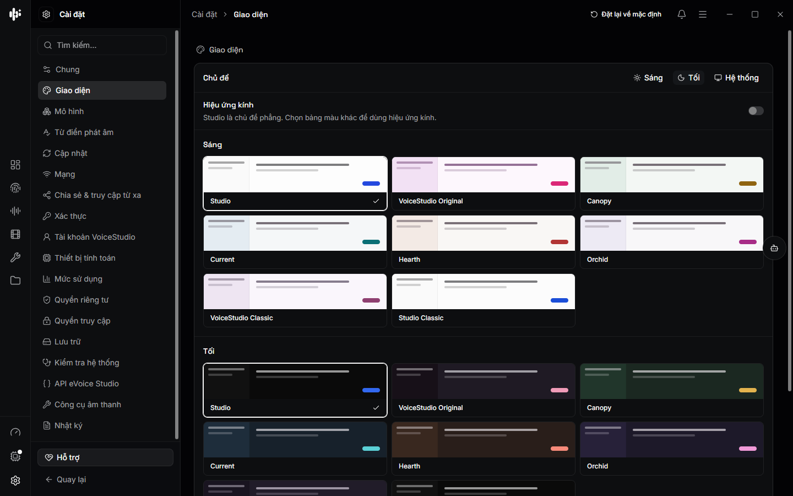

## Tính năng này làm gì

eVoice Studio là ứng dụng máy tính để lồng tiếng, nhân bản giọng nói và tạo âm thanh ngay trên máy của bạn. Mọi tác vụ xử lý giọng nói, chép lời và dựng nội dung đều chạy cục bộ mà không cần gửi dữ liệu âm thanh lên đám mây. Bài hướng dẫn này giúp bạn cài đặt ứng dụng trên Windows, thiết lập lần đầu, tải model và làm quen giao diện chính.

## Cần chuẩn bị

- Máy tính chạy Windows 10 hoặc Windows 11 bản 64-bit (x64). Bản beta hiện tại của eVoice Studio chỉ có bộ cài cho Windows 10/11 x64, chưa có bản cho macOS và Linux.
- Tối thiểu khoảng 10 GB dung lượng ổ đĩa trống cho ứng dụng, môi trường Python đi kèm và các model tải về (khoảng 5 GB nếu chỉ chạy bằng CPU).
- Tùy chọn: GPU NVIDIA đã cài driver để tăng tốc bằng CUDA. Nếu máy không có GPU rời NVIDIA, ứng dụng vẫn chạy đầy đủ trên CPU.
- Kết nối mạng trong lần mở đầu tiên hoặc khi bạn chủ động tải công cụ âm thanh và model từ Hugging Face.

## Các bước

### 1. Tải và cài đặt eVoice Studio trên Windows

1. Tải file bộ cài `eVoice-Studio-Electron-<phiên bản>-win-x64.exe` từ trang Releases tại `https://github.com/elevatevietnamai-lang/eVoice-Studio` hoặc bấm nút tải trên trang `https://evoice.elevatemarketing.vn`.
2. Mở file `.exe` vừa tải về để chạy trình cài đặt. Vì bộ cài bản beta chưa ký số, Windows SmartScreen có thể hiện hộp thoại cảnh báo: hãy bấm `Thông tin thêm` rồi chọn `Vẫn chạy`.
3. Chọn thư mục cài đặt theo hướng dẫn trên màn hình. Trình cài đặt chạy dưới quyền người dùng hiện tại, không yêu cầu quyền quản trị viên (Administrator), và tự thiết lập Python cùng công cụ âm thanh trong lần khởi động đầu tiên.

### 2. Hoàn tất thiết lập trong lần mở đầu tiên

1. Chờ bước **Kiểm tra hệ thống** tự động dò phần cứng (GPU NVIDIA hoặc CPU), dung lượng ổ đĩa và kết nối tới máy chủ tải model. Nếu cần kiểm tra lại sau khi giải phóng ổ đĩa hoặc đổi mạng, bấm **Kiểm tra lại**, sau đó bấm **Mọi thứ đã ổn — tiếp tục**.
2. Chọn gói model phù hợp với cấu hình máy ở bước **Cài đặt mô hình** (ứng dụng tự gợi ý gói nhẹ nếu máy chỉ dùng CPU).
3. Xem mục **Quyền riêng tư** khi ứng dụng hỏi về việc chia sẻ dữ liệu thống kê sử dụng (analytics). Tùy chọn này mặc định tắt; bạn có thể giữ nguyên trạng thái tắt để không gửi dữ liệu nào ra ngoài.
4. Bấm **Vào studio** để hoàn tất thiết lập và mở màn hình chính.

### 3. Tham quan thanh điều hướng và Trang chủ

1. Quan sát thanh điều hướng bên trái để chuyển nhanh giữa các nhóm công cụ: **Giọng nói**, **Truyện**, **Lồng tiếng** và **Thêm**, hoặc kiểm tra trạng thái phần cứng ở các nút **Tốc độ / chất lượng** và **Thiết bị cục bộ: Engine sẵn sàng** ở góc dưới bên trái.
2. Bấm vào các thẻ tính năng chính trên **Trang chủ** gồm **Nhân bản giọng**, **Thiết kế**, **Lồng tiếng**, hoặc các không gian làm việc khác như **Thư viện**, **Truyện**, **Sách nói**, **Studio âm nhạc**, **Dựng video**, **Video quảng cáo**, **Chép lời**, **Quy trình** và **Công cụ**.
3. Chọn nhanh một hồ sơ trong cột **Giọng đã lưu** hoặc **Bản thu gần đây** ở bên trái, hoặc bấm **Dùng giọng này** ngay tại mục **Giọng đã lưu** bên dưới **Trang chủ** để mở thẳng không gian nhân bản giọng với giọng đó.
4. Nhập từ khóa vào ô **Tìm kiếm…** (hoặc nhấn `Ctrl+K`) trên thanh tiêu đề để tìm nhanh tính năng, hoặc bấm **Hỏi eVoice Studio Agent** ở cạnh phải khi cần trợ giúp.

### 4. Tải model đầu tiên và cấu hình máy chủ tải

1. Bấm biểu tượng bánh răng ở góc dưới bên trái để mở **Cài đặt**, sau đó chọn **Mô hình** ở trình đơn bên trái.
2. Chọn nhóm model bạn cần dùng trong phần **Mô hình** (chẳng hạn TTS để tạo giọng nói, ASR để chép lời, đọc chính tả, phân tách người nói, dịch thuật hoặc LLM) rồi bấm tải model đầu tiên về máy.
3. Bật tùy chọn trong mục **Xem trước giọng nói** nếu bạn muốn tải sẵn các đoạn âm thanh mẫu để nghe thử giọng ngay cả khi model chưa tải xong (mặc định tắt để không tự tạo kết nối mạng).
4. Kiểm tra mục **Máy chủ gương Hugging Face** nếu mạng tải chậm: ứng dụng mặc định để tự động chọn máy chủ nhanh nhất, hoặc bạn có thể chọn **Official huggingface.co**, nhập địa chỉ vào ô **URL mirror tùy chỉnh** rồi bấm **Lưu**, và bấm **Kiểm tra máy chủ** để đo tốc độ kết nối.

### 5. Đổi ngôn ngữ và chủ đề giao diện

1. Chọn mục **Giao diện** trong thanh bên của **Cài đặt** để mở các tùy chỉnh hiển thị, hoặc qua mục **Ngôn ngữ** và dùng ô **Chọn ngôn ngữ giao diện** khi muốn đổi ngôn ngữ hiển thị của ứng dụng.
2. Chọn chế độ màu tại mục **Chủ đề** bằng cách bấm **Sáng**, **Tối** hoặc **Hệ thống** để tự động đổi theo giao diện Windows.
3. Bấm chọn bảng màu bạn thích trong danh sách **Sáng** hoặc **Tối** như **Studio**, **VoiceStudio Original**, **Canopy**, **Current**, **Hearth**, **Orchid**, **VoiceStudio Classic** hoặc **Studio Classic**.
4. Bật công tắc **Hiệu ứng kính** nếu bạn đang dùng bảng màu hỗ trợ hiệu ứng trong mờ (chủ đề **Studio** là giao diện phẳng nên không dùng hiệu ứng kính), hoặc bấm **Đặt lại về mặc định** ở góc trên bên phải để khôi phục giao diện ban đầu.

## Mẹo

- Nếu ổ `C:` còn ít dung lượng, bạn có thể chuyển dữ liệu giọng nói, dự án và bộ nhớ đệm sang ổ đĩa khác trong **Cài đặt** → **Lưu trữ**, hoặc đặt biến môi trường `OMNIVOICE_ENGINES_DIR` trước khi mở ứng dụng để lưu các môi trường engine sang ổ đĩa khác.
- Khi tải các model lớn hoặc model yêu cầu cấp quyền trên Hugging Face, hãy vào **Cài đặt** → **Xác thực** và nhập **Token HuggingFace** để tăng giới hạn tốc độ tải và giảm tình trạng ngắt quãng.
- Trình tải của eVoice Studio tự chia nhỏ file để tải đa luồng và lưu tiến trình liên tục; nếu mạng bị ngắt giữa chừng, lần tải tiếp theo sẽ nối tiếp phần đang dở thay vì tải lại từ đầu.

## Lỗi thường gặp

- Windows SmartScreen chặn không cho mở bộ cài: do bản beta chưa ký số, bạn bấm vào `Thông tin thêm` trên cửa sổ cảnh báo của Windows rồi bấm `Vẫn chạy` để tiếp tục cài đặt.
- Tải model bị đứng ở bước chuẩn bị hoặc tốc độ rất chậm: vào **Cài đặt** → **Mô hình**, tìm mục **Máy chủ gương Hugging Face**, bấm **Kiểm tra máy chủ** hoặc nhập mirror vào **URL mirror tùy chỉnh** rồi bấm **Lưu**; bạn cũng nên thêm **Token HuggingFace** trong **Cài đặt** → **Xác thực** để tránh bị giới hạn lượt tải.
- Không dùng được GPU trên máy dùng card AMD Radeon hoặc đồ họa tích hợp: trên Windows, tăng tốc GPU cho các engine PyTorch chỉ hỗ trợ GPU NVIDIA (CUDA), nên máy dùng card AMD hoặc Intel sẽ tự chạy trên CPU. Bạn có thể kiểm tra chi tiết từng engine tại mục **Tăng tốc GPU** hoặc chọn các model nhẹ dành cho CPU.
- Báo lỗi thiếu bộ nhớ VRAM (`CUDA out of memory` hoặc lỗi biên dịch Triton) trong lần tạo âm thanh đầu tiên trên Windows: mở **Cài đặt**, tìm tùy chọn **Tắt torch.compile** và bật lên để các engine chạy trực tiếp mà không tốn thêm VRAM cho bước biên dịch.
- Báo thiếu dung lượng ổ đĩa khi tải model: ngoài dung lượng của chính model đó, ứng dụng luôn giữ lại tối thiểu 2 GB trống trên ổ đĩa chứa bộ nhớ đệm. Hãy dọn bớt file tạm hoặc đổi thư mục lưu trong **Cài đặt** → **Lưu trữ**.

## Bài liên quan

- [Nhân bản giọng](../nhan-ban-giong/)
- [Thư viện giọng](../thu-vien-giong/)
- [Lồng tiếng video](../long-tieng-video/)
- [Cài đặt](../cai-dat/)
- [Khắc phục sự cố](../khac-phuc-su-co/)
