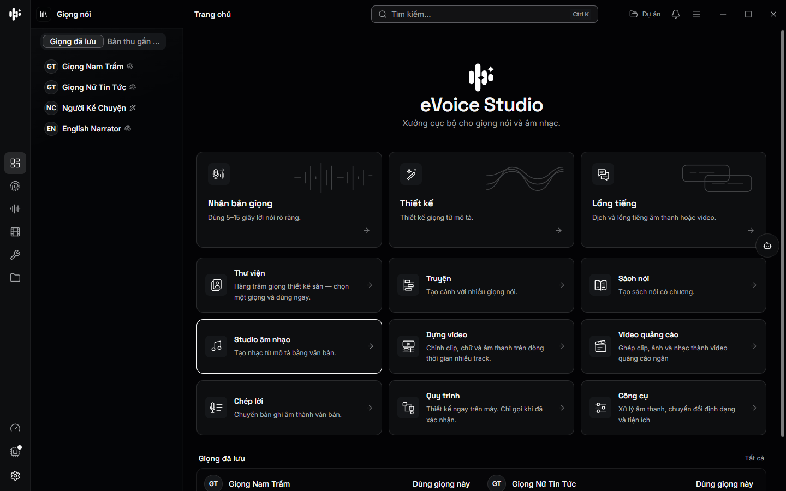
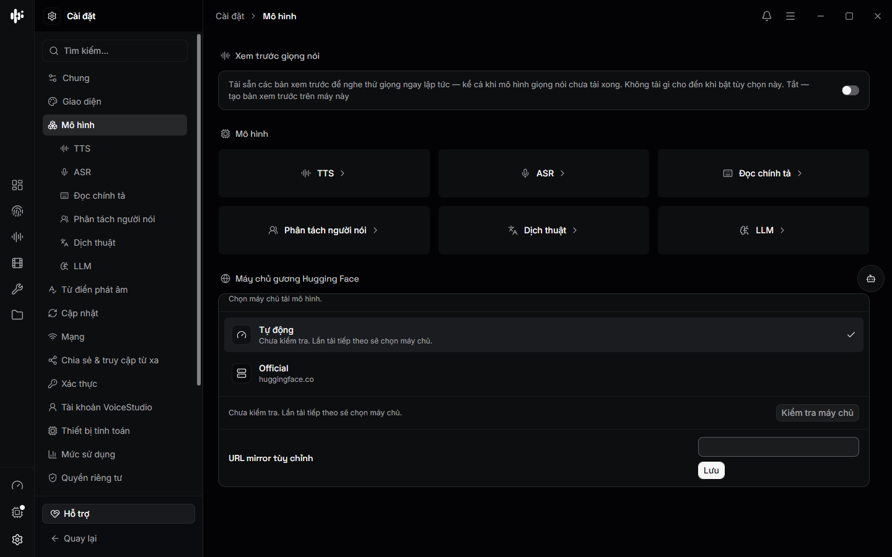

## Tính năng này làm gì

Bài viết này hướng dẫn bạn cài đặt eVoice Studio trên máy tính, chạy kiểm tra hệ thống trong lần mở đầu tiên và tải model về máy. Sau vài phút thiết lập, bạn có thể nhân bản giọng, lồng tiếng video, tạo truyện nhiều giọng và dựng âm thanh trực tiếp trên thiết bị của mình mà không cần gửi dữ liệu ra ngoài.

## Cần chuẩn bị

- Máy tính chạy một trong các hệ điều hành sau:
  - Windows 10 hoặc 11 bản 64-bit (x64), hoặc **Windows trên ARM** (thử nghiệm, chạy qua giả lập CPU).
  - macOS 13.3 (Ventura) trở lên trên máy dùng chip Apple Silicon (M1/M2/M3/M4…). Máy Mac dùng chip Intel chỉ mở được giao diện khi nối với **Backend từ xa**.
  - Linux x86_64 có môi trường đồ họa (X11 hoặc Wayland).
- Khoảng 10 GB dung lượng ổ đĩa trống cho ứng dụng, môi trường Python đi kèm và trọng số model (khoảng 5 GB nếu máy chạy hoàn toàn trên CPU).
- Kết nối mạng trong lần chạy đầu tiên để tải môi trường Python, công cụ âm thanh và model từ Hugging Face. Sau khi tải xong, ứng dụng hoạt động hoàn toàn cục bộ trên máy.
- Tùy chọn: GPU NVIDIA có cài driver trên Windows/Linux để tăng tốc CUDA, hoặc GPU AMD trên Linux với ROCm. Trên máy Mac Apple Silicon, ứng dụng tự động tăng tốc bằng phần cứng của máy.

## Các bước

### 1. Cài đặt ứng dụng trên Windows, macOS hoặc Linux

Chọn cách cài đặt phù hợp với hệ điều hành của bạn:

- Trên Windows: Tải bộ cài đặt `.exe` (`win-x64` hoặc `win-arm64`) từ trang phát hành chính thức và mở tệp để cài đặt cho tài khoản hiện tại mà không cần quyền quản trị. Bạn cũng có thể mở PowerShell thông thường và chạy lệnh `irm https://voicestudio.sh/install | iex`.
- Trên macOS: Tải tệp DMG bản `mac-arm64` cho máy Apple Silicon, mở tệp và kéo ứng dụng vào thư mục `/Applications`. Bạn cũng có thể mở Terminal và chạy lệnh `curl -fsSL https://voicestudio.sh/install | sh`.
- Trên Linux: Tải gói `.AppImage` (chạy lệnh `chmod +x` rồi mở trực tiếp, không cần cài thêm `libfuse2`) hoặc gói `.deb` cho Debian/Ubuntu (cài bằng lệnh `sudo apt install ./VoiceStudio-Electron-<version>-linux-x64.deb`). Bạn cũng có thể chạy lệnh `curl -fsSL https://voicestudio.sh/install | sh` để cài đặt tự động vào `~/.local/bin/VoiceStudio`.

### 2. Hoàn tất kiểm tra hệ thống và thiết lập lần mở đầu

Mở eVoice Studio lần đầu tiên và làm theo trình thiết lập khởi đầu:

1. Xem kết quả tại bước **Kiểm tra hệ thống**. Ứng dụng tự động kiểm tra phần cứng, dung lượng trống và cài đặt môi trường Python cùng công cụ âm thanh đi kèm. Nếu máy không có GPU rời, trình cài đặt sẽ chọn gói chạy trên CPU gọn nhẹ hơn. Bấm **Kiểm tra lại** nếu bạn vừa thay đổi thiết bị hoặc dung lượng ổ đĩa.
2. Bấm **Mọi thứ đã ổn — tiếp tục** để chuyển sang bước chọn gói model khởi đầu tại mục **Cài đặt mô hình**.
3. Xem lại tùy chọn ở mục **Quyền riêng tư** khi được hỏi về việc gửi dữ liệu thống kê sử dụng (analytics). Tùy chọn này mặc định tắt để mọi hoạt động của bạn ở lại trên máy; bạn có thể giữ nguyên trạng thái tắt hoặc bật lên tùy ý.
4. Bấm **Vào studio** để mở màn hình chính của ứng dụng.

### 3. Tham quan thanh điều hướng và Trang chủ

Làm quen với các khu vực chính trên màn hình **Trang chủ**:

1. Nhìn sang cột biểu tượng bên trái cùng để chuyển nhanh giữa các nhóm công cụ: **Trang chủ**, **Giọng nói**, **Truyện**, **Lồng tiếng**, **Thêm**, **Dự án** và các nút trạng thái ở góc dưới gồm **Tốc độ / chất lượng**, **Thiết bị cục bộ: Engine sẵn sàng**, **Cài đặt**.
2. Xem danh sách bên cạnh thanh điều hướng khi đang ở mục **Giọng nói**: bạn có thể chuyển giữa hai thẻ **Giọng đã lưu** và **Bản thu gần đây** để nghe thử hoặc mở lại các giọng sẵn có như **Giọng Nam Trầm**, **Giọng Nữ Tin Tức**, **Người Kể Chuyện** hay **English Narrator**.
3. Bấm vào một thẻ tính năng ở giữa màn hình để bắt đầu công việc tương ứng:
   - Hàng đầu gồm ba công cụ chính: **Nhân bản giọng**, **Thiết kế** và **Lồng tiếng**.
   - Các hàng tiếp theo mở **Thư viện**, **Truyện**, **Sách nói**, **Studio âm nhạc**, **Dựng video**, **Video quảng cáo**, **Chép lời**, **Quy trình** và **Công cụ**.
4. Bấm vào ô **Tìm kiếm…** ở thanh trên cùng (hoặc nhấn phím tắt `Ctrl K`) khi cần tìm nhanh một tính năng, hoặc bấm nút **Dùng giọng này** ở khu vực **Giọng đã lưu** phía dưới để nạp ngay giọng đó vào không gian làm việc.

### 4. Tải model đầu tiên trong Cài đặt

Tải trước các model cần dùng để quá trình tạo giọng và lồng tiếng diễn ra liền mạch:

1. Bấm biểu tượng bánh răng **Cài đặt** ở góc dưới bên trái, sau đó chọn mục **Mô hình** ở trình đơn bên trái.
2. Chọn nhóm model bạn muốn cài đặt trong phần **Mô hình**, bao gồm **TTS** (tổng hợp tiếng nói), **ASR** (nhận diện giọng nói), **Đọc chính tả**, **Phân tách người nói**, **Dịch thuật** hoặc **LLM**, rồi chọn tải gói trọng số phù hợp với cấu hình máy.
3. Bật công tắc tại mục **Xem trước giọng nói** nếu bạn muốn ứng dụng tải sẵn các đoạn âm thanh mẫu để nghe thử giọng ngay cả khi model giọng nói chưa tải xong.
4. Giữ nguyên tùy chọn **Tự động** ở phần **Máy chủ gương Hugging Face** để ứng dụng tự chọn máy chủ nhanh nhất khi tải, hoặc chọn **Official huggingface.co**, hoặc nhập địa chỉ `https://` vào ô **URL mirror tùy chỉnh** rồi bấm **Lưu**. Bạn có thể bấm **Kiểm tra máy chủ** để đo lại tốc độ kết nối bất cứ lúc nào.

### 5. Đổi ngôn ngữ và chủ đề giao diện

Tùy chỉnh ngôn ngữ hiển thị và màu sắc ứng dụng theo sở thích của bạn:

1. Trong **Cài đặt**, bấm vào mục **Chung** ở thanh bên trái, tìm đến phần **Ngôn ngữ** (**Chọn ngôn ngữ giao diện**) và chọn ngôn ngữ bạn muốn sử dụng.
2. Chuyển sang mục **Giao diện** ở thanh bên trái để đổi màu sắc hiển thị.
3. Tại dòng **Chủ đề**, bấm chọn **Sáng**, **Tối** hoặc **Hệ thống** để giao diện tự động đổi theo giờ của hệ điều hành.
4. Chọn một bảng màu cụ thể trong danh sách **Sáng** hoặc **Tối** như **Studio**, **VoiceStudio Original**, **Canopy**, **Current**, **Hearth**, **Orchid**, **VoiceStudio Classic** hoặc **Studio Classic**. Nếu chọn bảng màu khác **Studio**, bạn có thể bật thêm công tắc **Hiệu ứng kính**.
5. Bấm nút **Đặt lại về mặc định** ở góc trên bên phải nếu bạn muốn khôi phục toàn bộ thiết lập giao diện về như lúc mới cài.

## Mẹo

- Nếu máy tính không có GPU rời NVIDIA, bạn vẫn dùng được đầy đủ tính năng trên CPU bằng cách chọn các engine nhẹ (như KittenTTS, Supertonic-3, PocketTTS) và model Whisper nhỏ trong mục **Mô hình**.
- Khi cần cài toàn bộ môi trường Python, dữ liệu và bộ nhớ đệm model sang ổ đĩa ngoài trên Windows, bạn có thể chọn thư mục trên ổ đĩa đó ngay từ màn hình thiết lập đầu tiên hoặc di chuyển dữ liệu sau trong **Cài đặt** → **Lưu trữ**.
- Bấm vào biểu tượng logo eVoice Studio ở góc trên cùng bên trái bất cứ lúc nào để quay về **Trang chủ** mà không làm mất tiến độ ở không gian làm việc đang mở.
- Thêm token Hugging Face miễn phí trong mục **Cài đặt** → **Xác thực** giúp tăng giới hạn băng thông khi tải các model dung lượng lớn và mở khóa model **Phân tách người nói**.

## Lỗi thường gặp

- macOS báo không thể mở ứng dụng vì chưa xác minh được nhà phát triển hoặc báo tệp bị hỏng: trong Finder, bấm chuột phải (hoặc giữ phím Control rồi bấm) vào biểu tượng ứng dụng, chọn **Mở** rồi xác nhận mở trong hộp thoại hiện ra. Trên macOS 15 Sequoia trở lên, mở phần cài đặt quyền riêng tư và bảo mật của hệ thống để cho phép mở ứng dụng, hoặc chạy lệnh `xattr -dr com.apple.quarantine "/Applications/VoiceStudio.app"` trong Terminal.
- cài đặt trên máy Mac báo lỗi không tìm thấy bản dựng PyTorch cho nền tảng `x86_64`: máy Mac chip Intel không hỗ trợ chạy backend cục bộ (hãy nối sang **Backend từ xa** trên một máy khác), còn nếu bạn đang dùng máy Mac Apple Silicon thì hãy tải và cài lại đúng gói cài đặt đuôi `mac-arm64.dmg`.
- cửa sổ ứng dụng trên Linux bị trắng xóa hoặc báo lỗi tiến trình GPU khi khởi động: mở ứng dụng từ dòng lệnh kèm cờ tắt tăng tốc phần cứng cho giao diện `./VoiceStudio-Electron-*-linux-x64.AppImage --disable-gpu`, hoặc thêm `--ozone-platform=x11` nếu đang dùng phiên Wayland.
- quá trình tải model dừng ở bước kiểm tra thông tin hoặc tải rất chậm: vào **Cài đặt** → **Mô hình**, bấm **Kiểm tra máy chủ** ở mục **Máy chủ gương Hugging Face** để ứng dụng chọn lại máy chủ nhanh hơn, hoặc thêm token trong mục **Xác thực** để tránh bị giới hạn lượt tải.
- báo lỗi tràn bộ nhớ (`CUDA out of memory` hoặc lỗi biên dịch Triton) trên Windows khi tạo giọng lần đầu ở máy có ít hơn 16 GB VRAM: vào **Cài đặt** → **Thiết bị tính toán** và bật tùy chọn **Tắt torch.compile** để chạy trực tiếp không qua bước biên dịch nhân.

## Bài liên quan

- [Nhân bản giọng](../nhan-ban-giong/)
- [Thiết kế giọng bằng mô tả](../thiet-ke-giong/)
- [Lồng tiếng video](../long-tieng-video/)
- [Cài đặt](../cai-dat/)
- [Khắc phục sự cố](../khac-phuc-su-co/)
