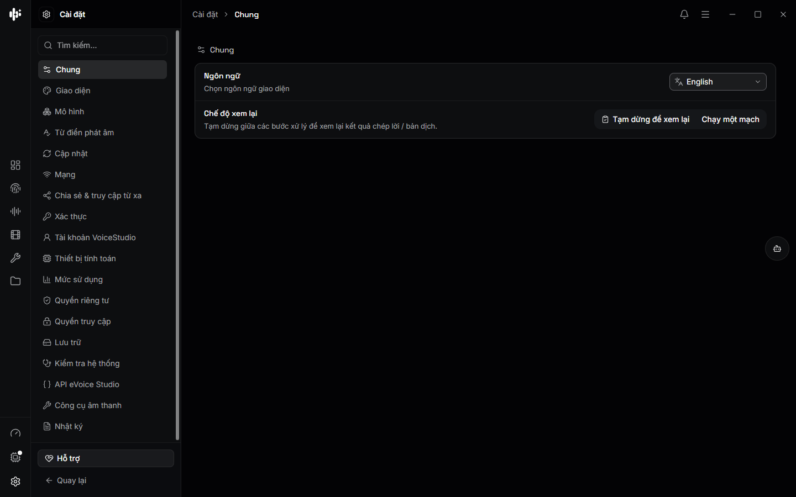
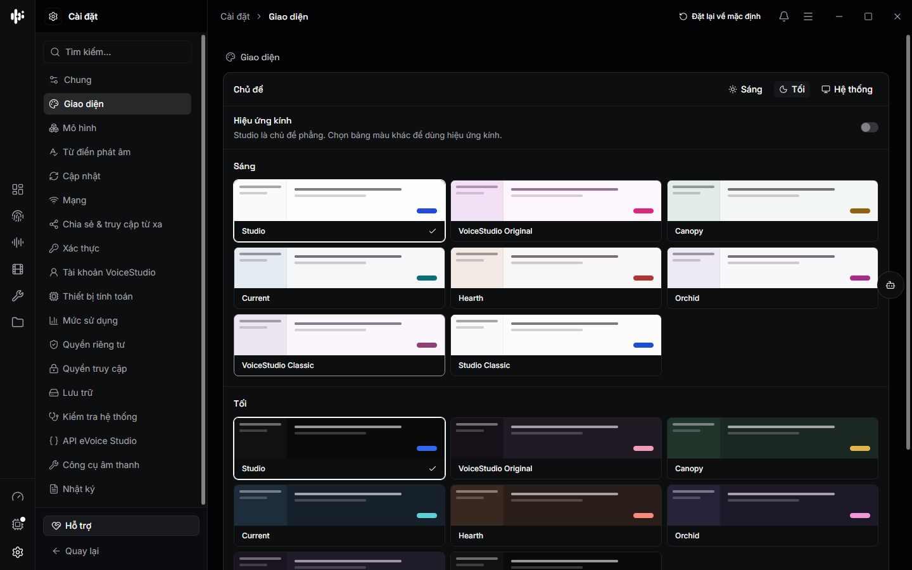
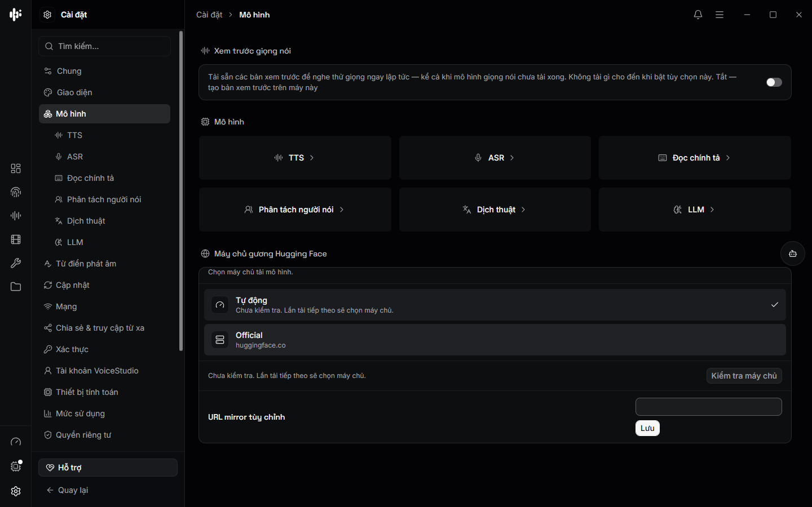
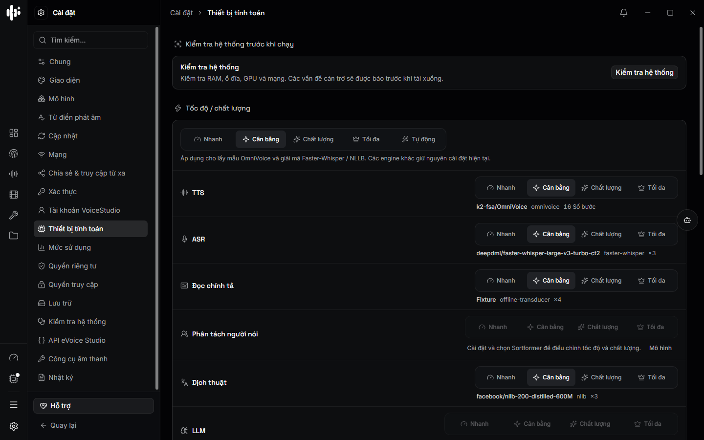
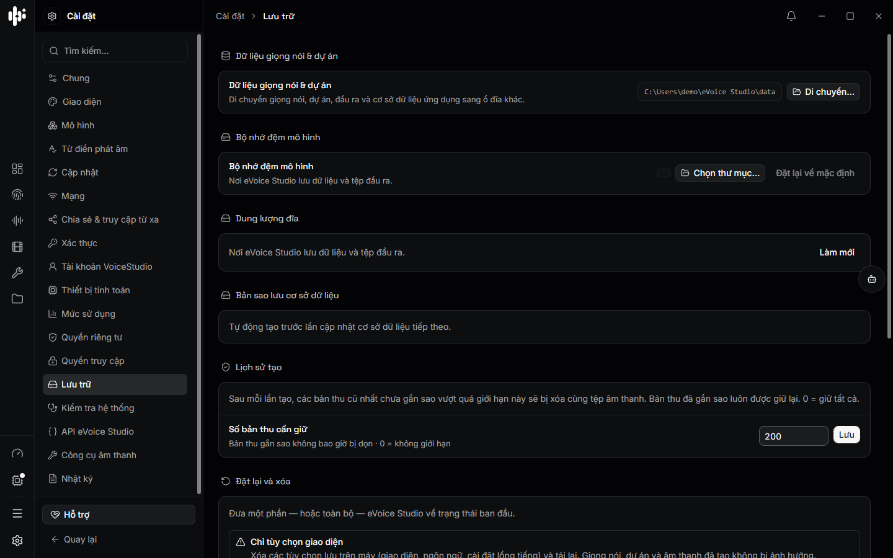

## Tính năng này làm gì

Trang **Cài đặt** tập trung các tùy chọn cấu hình của eVoice Studio trên máy của bạn, từ ngôn ngữ hiển thị, giao diện sáng tối cho tới quản lý model, thiết bị tính toán và dung lượng ổ đĩa. Mọi xử lý âm thanh và cấu hình đều chạy cục bộ trên máy; ứng dụng chỉ dùng kết nối mạng khi bạn chủ động tải model, dùng dịch vụ từ xa hoặc kiểm tra bản phát hành mới.

## Cần chuẩn bị

- Mở sẵn eVoice Studio và bấm vào biểu tượng **Cài đặt** ở góc dưới bên trái thanh điều hướng chính.
- Đảm bảo trạng thái ở thanh bên báo **Thiết bị cục bộ: Engine sẵn sàng** trước khi thay đổi các mục liên quan tới lưu trữ, dữ liệu hoặc phần cứng.
- Chuẩn bị ổ đĩa còn đủ dung lượng trống nếu bạn định di chuyển thư mục **Dữ liệu giọng nói & dự án** hoặc đổi thư mục **Bộ nhớ đệm mô hình**.

## Các bước

### 1. Chung

1. Bấm **Chung** ở danh sách bên trái (hoặc gõ từ khóa vào ô **Tìm kiếm…** để lọc nhanh mục cần chỉnh).
2. Chọn ngôn ngữ hiển thị tại mục **Ngôn ngữ** (ví dụ đang chọn **English**) để đổi ngôn ngữ toàn bộ giao diện ngay lập tức.
3. Chọn cách xử lý tại mục **Chế độ xem lại**: bấm **Tạm dừng để xem lại** nếu bạn muốn kiểm tra kết quả chép lời và bản dịch giữa các bước, hoặc bấm **Chạy một mạch** để quy trình tự chạy từ đầu đến cuối.

### 2. Giao diện

1. Bấm **Giao diện** ở thanh điều hướng bên trái.
2. Chọn chế độ hiển thị tại mục **Chủ đề**: bấm **Sáng**, **Tối** hoặc **Hệ thống**.
3. Chọn bảng màu riêng cho nền **Sáng** và nền **Tối** gồm **Studio**, **VoiceStudio Original**, **Canopy**, **Current**, **Hearth**, **Orchid**, **VoiceStudio Classic** hoặc **Studio Classic**.
4. Bật công tắc **Hiệu ứng kính** nếu bạn dùng các bảng màu có hỗ trợ hiệu ứng trong mờ (bảng màu **Studio** mặc định là giao diện phẳng nên công tắc này sẽ khóa).
5. Bấm **Đặt lại về mặc định** ở góc trên bên phải nếu bạn muốn khôi phục toàn bộ bố cục màu sắc và phông chữ ban đầu.

### 3. Model

1. Bấm **Mô hình** ở cột bên trái để mở trang quản lý các nhóm model cục bộ.
2. Bật công tắc tại mục **Xem trước giọng nói** nếu bạn muốn tải sẵn các đoạn âm thanh mẫu để nghe thử giọng ngay cả khi model tạo giọng chưa tải về máy; khi tắt, bản xem trước sẽ được tạo trực tiếp trên máy của bạn.
3. Chọn từng nhóm trong mục **Mô hình** (hoặc chọn trực tiếp ở menu con bên trái) gồm **TTS**, **ASR**, **Đọc chính tả**, **Phân tách người nói**, **Dịch thuật** và **LLM** để xem dung lượng, tải về hoặc chọn engine mặc định cho từng tác vụ.
4. Kiểm tra mục **Máy chủ gương Hugging Face** ở cuối trang để chọn máy chủ tải model phù hợp khi kết nối mạng tới máy chủ gốc bị chậm.

### 4. Mạng và mirror Hugging Face

1. Bấm **Mạng** ở cột bên trái khi bạn cần cấu hình kết nối cho việc tải model từ Hugging Face hoặc tải video.
2. Nhập địa chỉ máy chủ trung gian (hỗ trợ `http://`, `https://`, `socks5://`) vào ô **Proxy** rồi bấm **Lưu** để áp dụng ngay cho các lượt tải mới, hoặc bấm **Xóa** để bỏ proxy.
3. Bấm **Công cụ âm thanh** tại dòng **FFmpeg** để chuyển sang trang kiểm tra, cập nhật hoặc chọn đường dẫn cho `ffmpeg`, `ffprobe` và trình tải video.

### 5. Hiệu năng

1. Bấm **Thiết bị tính toán** ở thanh bên trái để mở các thiết lập phần cứng và tốc độ xử lý.
2. Bấm nút **Kiểm tra hệ thống** trong mục **Kiểm tra hệ thống trước khi chạy** để rà soát RAM, ổ đĩa, GPU và mạng trước khi tải model nặng.
3. Chọn mức tổng thể tại mục **Tốc độ / chất lượng** gồm **Nhanh**, **Cân bằng**, **Chất lượng**, **Tối đa** hoặc bấm **Tự động** để ứng dụng tự chọn theo cấu hình CPU, RAM và GPU của máy.
4. Chọn mức riêng (**Nhanh**, **Cân bằng**, **Chất lượng**, **Tối đa**) cho từng nhóm **TTS**, **ASR**, **Đọc chính tả**, **Phân tách người nói**, **Dịch thuật** và **LLM** nếu bạn muốn ưu tiên chất lượng cho một tác vụ cụ thể mà không đổi toàn bộ hệ thống.

### 6. Lưu trữ

1. Bấm **Lưu trữ** ở cột bên trái để xem nơi eVoice Studio lưu dữ liệu và tệp đầu ra.
2. Bấm **Di chuyển…** tại mục **Dữ liệu giọng nói & dự án** để chuyển giọng nói, dự án, đầu ra và cơ sở dữ liệu sang một thư mục trống trên ổ đĩa khác.
3. Bấm **Chọn thư mục…** tại mục **Bộ nhớ đệm mô hình** để đổi nơi lưu các model tải về, hoặc bấm **Đặt lại về mặc định** để quay về thư mục chuẩn (thay đổi có hiệu lực sau khi khởi động lại ứng dụng).
4. Bấm **Làm mới** tại mục **Dung lượng đĩa** để quét lại mức chiếm dụng ổ cứng và kiểm tra trạng thái tại mục **Bản sao lưu cơ sở dữ liệu**.
5. Nhập giới hạn vào ô **Số bản thu cần giữ** trong mục **Lịch sử tạo** (nhập `0` nếu muốn giữ không giới hạn; các bản thu đã gắn sao luôn được giữ lại) rồi bấm **Lưu**.
6. Chọn mức khôi phục trong mục **Đặt lại và xóa** (chẳng hạn **Chỉ tùy chọn giao diện** hoặc xóa dữ liệu theo từng phần) khi bạn muốn đưa ứng dụng về trạng thái ban đầu.

### 7. Quyền riêng tư

1. Bấm **Quyền riêng tư** ở thanh bên trái.
2. Bấm **Dịch thuật** tại dòng **Trình dịch** nếu bạn muốn kiểm tra hoặc đổi nhà cung cấp dịch thuật đang dùng.
3. Bật hoặc tắt công tắc **Dấu thủy vân ẩn** để quyết định việc nhúng dấu nhận biết âm thanh do AI tạo vào các tệp âm thanh xuất ra từ thời điểm đó trở đi.
4. Nhập số lượng vào ô **Số bản thu cần giữ** tại mục **Lịch sử tạo** rồi bấm **Lưu** để tự động dọn các bản thu cũ chưa gắn sao sau mỗi lần tạo mới.

### 8. Cập nhật

1. Bấm **Cập nhật** ở cột bên trái để xem phiên bản hiện tại và trạng thái trình cập nhật của bản cài đặt.
2. Xem mục **Bản sao lưu cơ sở dữ liệu** để biết thông tin bản sao lưu tự động trước mỗi lần nâng cấp cơ sở dữ liệu.
3. Kiểm tra danh sách trong mục **Bản phát hành** để xem thông tin các bản phát hành hiện có.

Bản eVoice Studio hiện tại không tự tải bản mới. Khi có phiên bản mới, tải bộ cài từ trang tải về rồi cài đè lên bản cũ; giọng, dự án và cài đặt được giữ nguyên.

## Mẹo

- Dùng ô **Tìm kiếm…** ở đầu cột **Cài đặt** để nhảy thẳng tới từng mục con như **Ngôn ngữ**, **Chế độ xem lại** hay **Hiệu ứng kính** mà không cần mở từng trang.
- Đặt mức **Tự động** trong mục **Tốc độ / chất lượng** nếu bạn mới cài đặt: eVoice Studio sẽ tự cân đối theo dung lượng RAM và VRAM thực tế mà không tự ý tải thêm model về máy.
- Đánh dấu sao cho các bản thu quan trọng trước khi giảm **Số bản thu cần giữ**, vì các bản thu gắn sao không bao giờ bị xóa khi dọn lịch sử tự động.
- Bấm **Quay lại** ở góc dưới cùng bên trái cột **Cài đặt** để trở về không gian làm việc ngay lập tức.

## Lỗi thường gặp

- không bật được công tắc **Hiệu ứng kính**: bạn đang chọn bảng màu **Studio** (chủ đề phẳng). Hãy chọn một bảng màu khác như **VoiceStudio Original**, **Canopy** hoặc **Orchid** trong mục **Giao diện** để mở khóa tùy chọn này.
- nút chọn mức **Nhanh**, **Cân bằng**, **Chất lượng**, **Tối đa** ở mục **Phân tách người nói** bị mờ: máy chưa cài đặt và chọn engine tương thích. Hãy bấm liên kết **Mô hình** ngay bên dưới dòng đó để cài đặt model trước.
- không di chuyển được **Dữ liệu giọng nói & dự án** sang ổ đĩa mới: thư mục đích không trống, nằm bên trong thư mục dữ liệu hiện tại, ổ đĩa không đủ dung lượng trống hoặc bạn đang kết nối tới backend từ xa. Hãy đảm bảo đang dùng engine cục bộ và chọn một thư mục mới hoàn toàn trống.
- danh sách **Bản phát hành** báo **Không tìm thấy bản phát hành nào** hoặc bản cài đặt báo đã tắt kiểm tra cập nhật: máy đang ngoại tuyến hoặc bạn đang dùng bản dựng tắt trình cập nhật tự động. Hãy tải bản mới trực tiếp từ trang bạn đã tải ứng dụng.

## Bài liên quan

- [Bắt đầu với eVoice Studio](../bat-dau/)
- [Nhân bản giọng](../nhan-ban-giong/)
- [Lồng tiếng video](../long-tieng-video/)
- [Tích hợp](../tich-hop/)
- [Khắc phục sự cố](../khac-phuc-su-co/)
