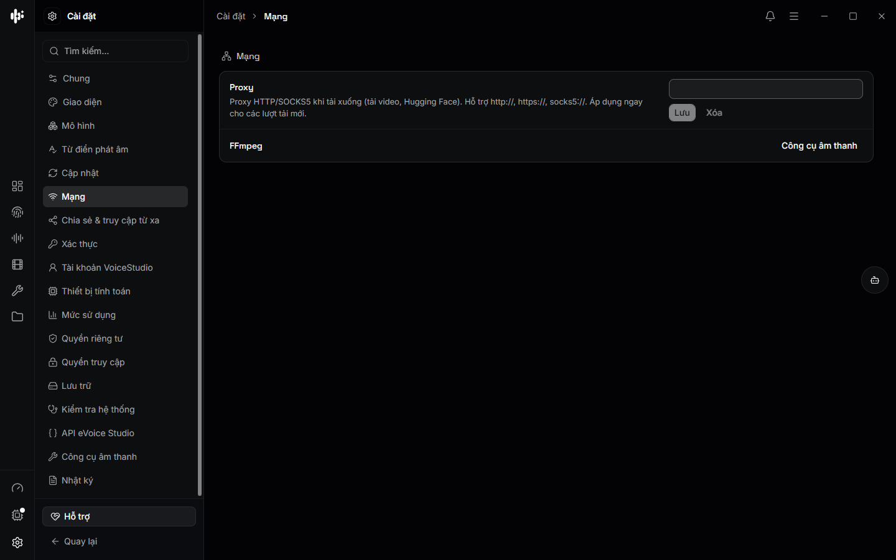
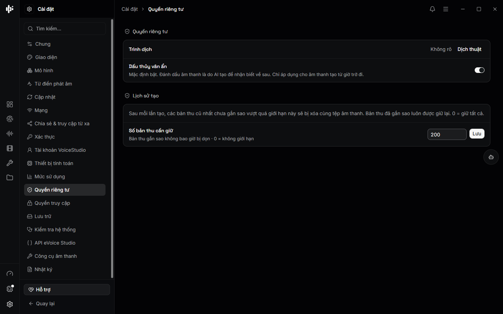
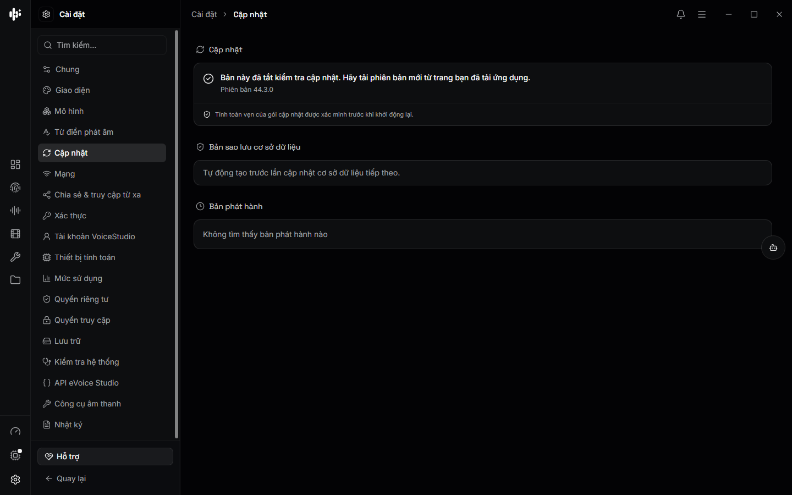

## Tính năng này làm gì

Trang **Cài đặt** tập trung mọi tùy chọn hệ thống của eVoice Studio: từ ngôn ngữ giao diện, bảng màu, quản lý model cho tới cấu hình thiết bị tính toán và dung lượng ổ đĩa. Toàn bộ quá trình tạo giọng, chép lời và lồng tiếng đều chạy cục bộ trên máy của bạn; ứng dụng chỉ kết nối mạng khi bạn chủ động tải model, dùng proxy hoặc kiểm tra bản phát hành.

## Cần chuẩn bị

- Máy tính đã mở sẵn eVoice Studio và hiển thị trạng thái **Thiết bị cục bộ: Engine sẵn sàng** ở góc dưới bên trái.
- Thư mục trống trên ổ đĩa khác nếu bạn định di chuyển dữ liệu giọng nói, dự án hoặc đổi nơi lưu bộ nhớ đệm model.
- Kết nối mạng nếu bạn cần tải model từ Hugging Face, cấu hình proxy hoặc xem danh sách bản phát hành mới.

## Các bước

### 1. Cài đặt chung

1. Bấm biểu tượng bánh răng **Cài đặt** ở góc dưới bên trái thanh điều hướng, hoặc nhập từ khóa vào ô **Tìm kiếm…** để lọc nhanh mục cần tìm.
2. Chọn mục **Chung** ở danh sách bên trái.
3. Chọn ngôn ngữ hiển thị tại mục **Ngôn ngữ** (ví dụ đang chọn **English**).
4. Chọn cách xử lý quy trình tại mục **Chế độ xem lại**: bấm **Tạm dừng để xem lại** để kiểm tra kết quả chép lời và bản dịch giữa các bước, hoặc bấm **Chạy một mạch** để chạy liên tục từ đầu đến cuối.

### 2. Giao diện

1. Chọn mục **Giao diện** ở thanh bên trái.
2. Chọn chế độ hiển thị tại mục **Chủ đề**: bấm **Sáng**, **Tối** hoặc **Hệ thống**.
3. Chọn một bảng màu trong danh sách **Sáng** hoặc **Tối** như **Studio**, **VoiceStudio Original**, **Canopy**, **Current**, **Hearth**, **Orchid**, **VoiceStudio Classic** hoặc **Studio Classic**.
4. Bật công tắc **Hiệu ứng kính** nếu bạn đang dùng bảng màu có hỗ trợ (lưu ý **Studio** là chủ đề phẳng nên cần chọn bảng màu khác để bật **Hiệu ứng kính**).
5. Bấm **Đặt lại về mặc định** ở góc trên bên phải nếu bạn muốn đưa giao diện về thiết lập ban đầu.

### 3. Model

1. Chọn mục **Mô hình** ở thanh bên trái.
2. Bật công tắc tại mục **Xem trước giọng nói** nếu bạn muốn tải sẵn các bản nghe thử để nghe ngay cả khi model giọng nói chưa tải xong (khi tắt, ứng dụng không tải gì mà tự tạo bản xem trước trên máy).
3. Bấm vào từng nhóm trong khu vực **Mô hình** gồm **TTS**, **ASR**, **Đọc chính tả**, **Phân tách người nói**, **Dịch thuật** hoặc **LLM** để xem và quản lý model của từng tác vụ.
4. Chọn nguồn tải tại mục **Máy chủ gương Hugging Face**: chọn **Tự động** hoặc **Official huggingface.co**, rồi bấm **Kiểm tra máy chủ** để thử kết nối mà không gửi dữ liệu âm thanh.
5. Nhập địa chỉ vào ô **URL mirror tùy chỉnh** và bấm **Lưu** nếu bạn muốn dùng một máy chủ gương Hugging Face riêng.

### 4. Mạng và mirror Hugging Face

1. Chọn mục **Mạng** ở thanh bên trái.
2. Nhập địa chỉ proxy (hỗ trợ `http://`, `https://`, `socks5://`) vào ô **Proxy** để áp dụng cho các lượt tải video và tải model từ Hugging Face.
3. Bấm **Lưu** để áp dụng ngay cho các lượt tải mới, hoặc bấm **Xóa** khi không dùng proxy nữa.
4. Bấm **Công cụ âm thanh** tại dòng **FFmpeg** để mở trang quản lý các công cụ xử lý đa phương tiện đi kèm.

### 5. Hiệu năng

1. Chọn mục **Thiết bị tính toán** ở thanh bên trái.
2. Bấm **Kiểm tra hệ thống** trong mục **Kiểm tra hệ thống trước khi chạy** để rà soát RAM, ổ đĩa, GPU và mạng trước khi tải xuống.
3. Chọn mức ưu tiên chung tại mục **Tốc độ / chất lượng**: bấm **Nhanh**, **Cân bằng**, **Chất lượng**, **Tối đa** hoặc **Tự động**.
4. Chọn mức riêng (**Nhanh**, **Cân bằng**, **Chất lượng**, **Tối đa**) tại từng dòng **TTS**, **ASR**, **Đọc chính tả**, **Phân tách người nói**, **Dịch thuật** và **LLM** nếu bạn muốn tùy chỉnh riêng cho từng tác vụ.

### 6. Lưu trữ

1. Chọn mục **Lưu trữ** ở thanh bên trái.
2. Bấm **Di chuyển…** tại mục **Dữ liệu giọng nói & dự án** và chọn một thư mục trống trên ổ đĩa khác để chuyển toàn bộ giọng nói, dự án, đầu ra và cơ sở dữ liệu sang vị trí mới.
3. Bấm **Chọn thư mục…** tại mục **Bộ nhớ đệm mô hình** để đổi nơi lưu model tải về, hoặc bấm **Đặt lại về mặc định** (thay đổi có hiệu lực sau khi khởi động lại ứng dụng).
4. Bấm **Làm mới** tại mục **Dung lượng đĩa** để cập nhật thống kê dung lượng đang dùng, và xem trạng thái bản chụp tự động tại mục **Bản sao lưu cơ sở dữ liệu**.
5. Nhập số lượng vào ô **Số bản thu cần giữ** trong mục **Lịch sử tạo** (nhập `0` nếu muốn giữ tất cả) rồi bấm **Lưu**.
6. Cuộn xuống mục **Đặt lại và xóa** và chọn phạm vi như **Chỉ tùy chọn giao diện** khi bạn cần đưa một phần hoặc toàn bộ ứng dụng về trạng thái ban đầu.

### 7. Quyền riêng tư

1. Chọn mục **Quyền riêng tư** ở thanh bên trái.
2. Bấm **Dịch thuật** tại dòng **Trình dịch** để kiểm tra và chuyển đổi nhà cung cấp dịch thuật.
3. Bật hoặc tắt công tắc **Dấu thủy vân ẩn** để đánh dấu âm thanh do AI tạo cho các lượt tạo từ thời điểm đó trở đi.
4. Nhập giới hạn vào ô **Số bản thu cần giữ** tại mục **Lịch sử tạo** rồi bấm **Lưu** để ứng dụng tự dọn các bản thu cũ chưa gắn sao sau mỗi lần tạo.

### 8. Cập nhật (Ổn định/Beta)

1. Chọn mục **Cập nhật** ở thanh bên trái.
2. Xem phiên bản hiện tại và trạng thái xác minh gói cập nhật trong khung **Cập nhật**.
3. Xem thông tin bản sao lưu tự động trước khi nâng cấp tại mục **Bản sao lưu cơ sở dữ liệu** và theo dõi các phiên bản tại mục **Bản phát hành**.

<!-- TODO: kiểm tra tùy chọn chuyển kênh Ổn định/Beta trên giao diện Cập nhật -->

## Mẹo

- Dùng ô **Tìm kiếm…** ở đầu thanh bên trái của **Cài đặt** để nhảy thẳng tới trường cần chỉnh (như **Ngôn ngữ**, **Chế độ xem lại** hay **Hiệu ứng kính**) mà không cần mở từng mục.
- Đánh dấu sao cho các bản thu quan trọng: các bản thu đã gắn sao luôn được giữ lại và không bị xóa khi vượt giới hạn **Số bản thu cần giữ**.
- Chọn **Tự động** trong mục **Tốc độ / chất lượng** để ứng dụng tự cân đối theo CPU, RAM và VRAM hiện có trên máy mà không tự ý tải thêm model mới.

## Lỗi thường gặp

- công tắc **Hiệu ứng kính** bị mờ và không bật được: bạn đang chọn bảng màu **Studio** (chủ đề phẳng). Hãy chọn một bảng màu khác như **VoiceStudio Original**, **Canopy** hoặc **Current** rồi bật lại **Hiệu ứng kính**.
- không chọn được mức **Nhanh**, **Cân bằng**, **Chất lượng** hoặc **Tối đa** ở mục **Phân tách người nói**: máy chưa cài đặt và chọn engine tương thích. Hãy bấm liên kết **Mô hình** ngay bên dưới dòng đó để cài đặt và chọn Sortformer.
- không di chuyển được dữ liệu sang thư mục mới trong mục **Dữ liệu giọng nói & dự án**: thư mục đích đã có sẵn tệp, nằm bên trong thư mục dữ liệu hiện tại hoặc ổ đĩa không đủ dung lượng trống. Hãy tạo một thư mục mới hoàn toàn trống trên ổ đĩa còn đủ chỗ rồi bấm **Di chuyển…** lại.
- mục **Bản phát hành** hiển thị thông báo không tìm thấy bản phát hành nào: máy đang ngoại tuyến hoặc bản cài đặt hiện tại đã tắt kiểm tra cập nhật tự động. Hãy kiểm tra lại kết nối mạng hoặc tải phiên bản mới từ trang bạn đã tải ứng dụng.

## Bài liên quan

- [Bắt đầu với eVoice Studio](../bat-dau/)
- [Nhân bản giọng](../nhan-ban-giong/)
- [Lồng tiếng video](../long-tieng-video/)
- [Dự án](../du-an/)
- [Khắc phục sự cố](../khac-phuc-su-co/)
