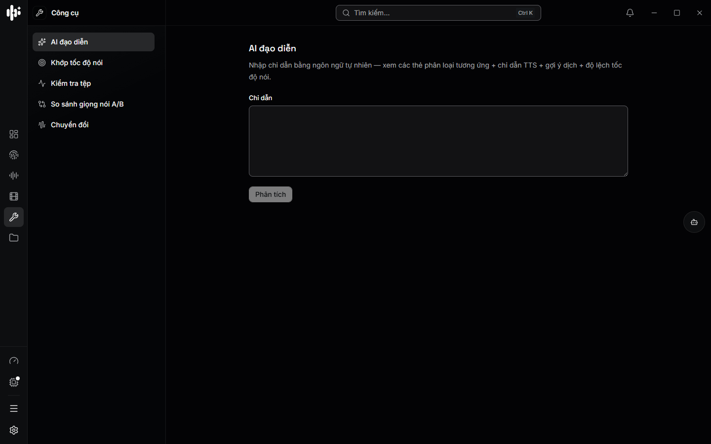

## Tính năng này làm gì

Trang **Công cụ** tập hợp các tiện ích xử lý âm thanh và giọng nói chạy trực tiếp trên máy của bạn. Tại đây, bạn có thể nghe thử và đối chiếu hai giọng nói cạnh nhau, chuyển đổi một đoạn thu âm có sẵn sang giọng đã lưu, hoặc kiểm tra nhanh chỉ dẫn diễn xuất, tốc độ câu dịch và thông số kỹ thuật của tệp.

## Cần chuẩn bị

- Ít nhất một model đọc văn bản (TTS) có hỗ trợ nhân bản giọng ở trạng thái sẵn sàng nếu bạn muốn dùng **So sánh giọng nói A/B** hoặc **Chuyển đổi**.
- Một hoặc nhiều hồ sơ giọng đã tạo sẵn (giọng nhân bản hoặc giọng thiết kế) để chọn làm giọng đối chiếu hoặc giọng đích.
- Một tệp âm thanh nguồn (định dạng WAV, MP3, M4A…) nếu cần chuyển đổi giọng, hoặc đường dẫn tệp trên máy nếu cần kiểm tra bằng ffprobe.

## Các bước

### 1. Mở trang Công cụ

1. Bấm biểu tượng **Công cụ** (hình cờ lê) trên thanh điều hướng bên trái, hoặc bấm thanh **Tìm kiếm…** ở phía trên để tìm và mở nhanh trang `/tools`.
2. Chọn tiện ích bạn muốn dùng ở cột danh mục bên trái: **AI đạo diễn**, **Khớp tốc độ nói**, **Kiểm tra tệp**, **So sánh giọng nói A/B** hoặc **Chuyển đổi**.

### 2. So sánh hai giọng

1. Bấm **So sánh giọng nói A/B** ở cột bên trái.
2. Nhập đoạn văn bản bạn muốn dùng để nghe thử vào ô **Câu thử**.
3. Chọn giọng thứ nhất tại mục **Giọng nói A** và giọng thứ hai tại mục **Giọng nói B** (có thể chọn giọng đã lưu hoặc **(Mẫu sẵn)**).
4. Bấm **So sánh** và đợi ứng dụng lần lượt báo **Đang tạo Giọng nói A...**, **Đang tạo Giọng nói B...** cho tới khi hiện **So sánh hoàn tất!**.
5. Bấm **Phát** ở từng giọng để nghe và đối chiếu chất giọng trên cùng một câu thoại.

### 3. Chuyển giọng một file audio sang giọng đã lưu

1. Bấm **Chuyển đổi** ở cột bên trái.
2. Kéo tệp âm thanh vào khung **Clip nguồn** (có dòng **Thả clip cần chuyển đổi vào đây — hoặc nhấp. WAV, MP3, M4A…**) hoặc bấm vào khung để chọn tệp từ máy.
3. Chọn giọng bạn muốn áp dụng tại mục **Giọng đích** (ô **Chọn hồ sơ giọng nói…** hỗ trợ cả giọng nhân bản lẫn giọng thiết kế đã lưu).
4. Bật tùy chọn **Khớp thời lượng nguồn** nếu bạn muốn độ dài của bản thu mới được căn chỉnh theo tổng thời lượng của clip gốc.
5. Bấm **Chuyển đổi**. Ứng dụng sẽ chép lời đoạn âm thanh gốc tại mục **Nội dung nghe được** rồi tổng hợp lại bằng giọng đích tại mục **Bản thu đã chuyển đổi**.
6. Bấm **Phát** để nghe lại kết quả sau khi hoàn tất.

### 4. Các tiện ích audio khác

Ngoài so sánh và chuyển giọng, cột bên trái còn có ba tiện ích kiểm tra nhanh:

- **AI đạo diễn**:
  1. Chọn **AI đạo diễn** ở cột bên trái.
  2. Nhập mô tả cách thể hiện giọng bằng ngôn ngữ tự nhiên vào ô **Chỉ dẫn**.
  3. Bấm **Phân tích** để xem kết quả gồm **phương pháp:**, **chỉ dẫn TTS:**, **gợi ý dịch:**, **độ lệch tốc độ:** cùng hai mục mở rộng **thẻ** và **phân loại**.
- **Khớp tốc độ nói**:
  1. Chọn **Khớp tốc độ nói** để kiểm tra câu dịch có vừa với khung thời gian lồng tiếng hay không.
  2. Nhập lời thoại vào ô **Câu đã dịch**, điền số giây dương vào ô **Thời lượng (giây)** và chọn **Ngôn ngữ đích**.
  3. Bấm **Kiểm tra độ khớp** để xem **phương pháp:**, **tỷ lệ:**, **số lần thử:** và **kết quả:**.
- **Kiểm tra tệp**:
  1. Chọn **Kiểm tra tệp** ở cột bên trái.
  2. Dán đường dẫn đầy đủ của tệp âm thanh hoặc video trên máy vào ô **Đường dẫn tuyệt đối**.
  3. Bấm **Kiểm tra** để đọc thông tin codec, luồng, độ sâu bit và thời lượng thông qua trình bọc ffprobe.

## Mẹo

- Trong mục **Chuyển đổi**, tùy chọn **Khớp thời lượng nguồn** chỉ co giãn tổng độ dài đoạn thu mới cho khớp thời gian gốc chứ không giữ nguyên cao độ, nhịp nghỉ hay biểu cảm của người nói ban đầu.
- Khi chuyển sang một công cụ khác ở cột bên trái, yêu cầu đang chạy của công cụ trước đó sẽ tự động dừng để không ghi đè kết quả.
- Dùng cùng một **Câu thử** ngắn, có dấu câu rõ ràng trong **So sánh giọng nói A/B** giúp bạn nhận ra sự khác biệt về nhịp ngắt và âm sắc giữa hai hồ sơ giọng nhanh hơn.

## Lỗi thường gặp

- hiện thông báo **Chọn một mô hình đọc văn bản đã sẵn sàng và hỗ trợ nhân bản giọng.** khi so sánh hoặc chuyển giọng: kiểm tra mục **Thiết bị cục bộ: Engine sẵn sàng** ở góc dưới bên trái hoặc vào **Cài đặt** để tải và kích hoạt một engine TTS có hỗ trợ nhân bản giọng trước khi thực hiện.
- hiện thông báo **Thêm clip nguồn và chọn giọng đích trước.** ở mục **Chuyển đổi**: bạn cần tải lên tệp tại **Clip nguồn** và chọn một hồ sơ trong **Giọng đích** rồi mới bấm **Chuyển đổi**.
- nút **Kiểm tra độ khớp** không bấm được trong mục **Khớp tốc độ nói**: kiểm tra lại ô **Câu đã dịch** đã có nội dung chưa và giá trị trong **Thời lượng (giây)** phải là một số lớn hơn `0`.
- kiểm tra tệp bằng **Kiểm tra tệp** báo lỗi thiếu công cụ media hoặc không đọc được đường dẫn: hãy nhập đúng **Đường dẫn tuyệt đối** tới tệp trên máy và bấm liên kết tới trang công cụ âm thanh trong **Cài đặt** để cài đặt hoặc khôi phục bộ công cụ ffprobe do ứng dụng quản lý.

## Bài liên quan

- [Nhân bản giọng](../nhan-ban-giong/)
- [Quản lý giọng đã lưu](../giong-da-luu/)
- [Thiết kế giọng bằng mô tả](../thiet-ke-giong/)
- [Lồng tiếng video](../long-tieng-video/)
- [Cài đặt](../cai-dat/)
- [Khắc phục sự cố](../khac-phuc-su-co/)
