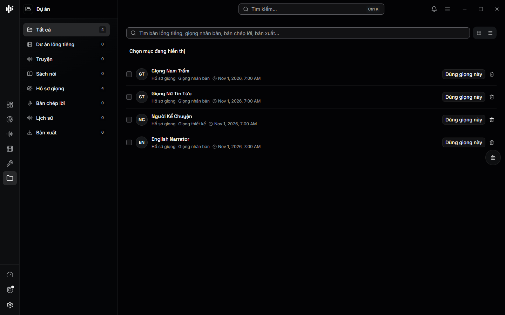

## Tính năng này làm gì

Trang **Dự án** tập hợp toàn bộ dữ liệu làm việc trên máy của bạn ở một nơi, gồm **Dự án lồng tiếng**, **Truyện**, **Sách nói**, **Hồ sơ giọng**, **Bản chép lời**, **Lịch sử** và **Bản xuất**. Bạn có thể tìm kiếm, lọc theo từng nhóm, mở lại bản nháp đã lưu, đổi tên hoặc dọn dẹp các mục không còn dùng mà không cần kết nối mạng.

## Cần chuẩn bị

- Ít nhất một dự án đã lưu hoặc một mục trong thư viện như **Hồ sơ giọng**, **Bản chép lời**, **Lịch sử** hay **Bản xuất**.
- Đảm bảo không có tác vụ lồng tiếng hoặc tạo âm thanh dài đang chạy nền nếu bạn muốn mở, đổi tên hoặc xóa dự án.

## Các bước

### 1. Mở danh sách dự án

1. Bấm biểu tượng thư mục trên thanh điều hướng bên trái hoặc dùng ô **Tìm kiếm…** ở thanh trên cùng để mở trang **Dự án**.
2. Chọn một danh mục ở cột bên trái gồm **Tất cả**, **Dự án lồng tiếng**, **Truyện**, **Sách nói**, **Hồ sơ giọng**, **Bản chép lời**, **Lịch sử** hoặc **Bản xuất** để lọc theo loại mục và xem số lượng tương ứng.
3. Nhập từ khóa vào ô **Tìm bản lồng tiếng, giọng nhân bản, bản chép lời, bản xuất…** để lọc nhanh theo tên hoặc thông tin phụ.
4. Bấm nút **Lưới thẻ** hoặc **Danh sách** ở góc phải thanh tìm kiếm để đổi kiểu hiển thị.

### 2. Mở, đổi tên, nhân bản và xóa dự án

1. Bấm vào tên một mục thuộc **Dự án lồng tiếng**, **Truyện** hoặc **Sách nói**, sau đó bấm **Xác nhận** để mở lại bản nháp trong không gian làm việc tương ứng (hoặc bấm **Hủy** nếu muốn giữ nguyên bản nháp hiện tại). Với mục trong **Hồ sơ giọng**, bấm **Dùng giọng này** để chuyển sang trang nhân bản giọng với giọng đã chọn.
2. Bấm biểu tượng cây bút ở dòng dự án để sửa tên, nhập tên mới rồi nhấn phím Enter để lưu hoặc nhấn phím Escape (hoặc bấm **Hủy**) để đóng.
3. Nhập tên mới tại khung lưu ở đầu trang **Dự án** khi đang có phiên **Lồng tiếng** mở sẵn, sau đó bấm **Lưu** để cập nhật dự án hiện tại hoặc chọn nút lưu bản sao bên cạnh để nhân bản thành dự án mới.

<!-- TODO: kiểm tra -->

4. Bấm biểu tượng thùng rác ở từng dòng, hoặc bấm **Chọn mục đang hiển thị** (hay tích chọn từng ô vuông) rồi mở hộp thoại xóa hàng loạt, kiểm tra danh sách tên mục và bấm **Xóa** để xác nhận. Với **Dự án lồng tiếng**, **Truyện**, **Sách nói** và **Bản xuất**, thao tác xóa chỉ gỡ bản ghi trong thư viện và giữ nguyên file gốc cũng như âm thanh đã xuất trên ổ đĩa; với **Hồ sơ giọng** và **Lịch sử**, file âm thanh lưu kèm trong thư viện sẽ bị xóa.

### 3. Chuyển dự án lồng tiếng thành truyện

1. Mở dự án cần chuyển trong danh sách **Dự án lồng tiếng** để kiểm tra nội dung các đoạn thoại trước khi đưa sang **Truyện**.

<!-- TODO: kiểm tra -->

## Mẹo

- Bạn có thể dùng phím mũi tên trên bàn phím, phím Home và phím End để di chuyển nhanh giữa các mục trên thanh danh mục.
- Khi bạn đổi từ khóa trong ô **Tìm bản lồng tiếng, giọng nhân bản, bản chép lời, bản xuất…** hoặc chuyển sang danh mục khác ở cột trái, các ô đã tích chọn sẽ tự bỏ chọn để tránh xóa nhầm mục đang bị ẩn.
- Với các bản dựng hoàn tất trong **Truyện** và **Sách nói**, bấm vào mục xem chi tiết bên dưới tên bản dựng để kiểm tra giọng đọc, tốc độ, ngôn ngữ, định dạng và độ dài.

## Lỗi thường gặp

- các nút mở, đổi tên, lưu hoặc xóa bị mờ không bấm được: ứng dụng đang khóa thao tác vì có tiến trình **Lồng tiếng**, **Truyện** hoặc **Sách nói** đang chạy hay đang chờ khôi phục tác vụ. Hãy đợi tiến trình hoàn tất hoặc dừng tác vụ đang chạy rồi quay lại trang **Dự án**.
- hiện thông báo **Bản nháp đã thay đổi khi đang tải dự án này. Xác nhận lại để thay thế.** khi mở dự án: bản nháp hiện tại vừa được chỉnh sửa trong lúc dự án đang tải. Bấm **Xác nhận** thêm một lần nếu bạn muốn ghi đè bản nháp đang mở, hoặc bấm **Hủy** để giữ lại nội dung vừa sửa.
- một số mục báo lỗi khi xóa hàng loạt: các mục xóa thành công đã được gỡ khỏi danh sách, còn hộp thoại chỉ giữ lại những mục gặp sự cố. Bạn hãy kiểm tra thông báo lỗi và bấm **Thử lại** để xóa các mục còn lại, hoặc bấm **Hủy** để đóng hộp thoại.
- danh sách không tải được dữ liệu: kiểm tra thông báo lỗi trên màn hình và bấm **Thử lại** để tải lại toàn bộ danh mục.

## Bài liên quan

- [Lồng tiếng video](../long-tieng-video/)
- [Truyện nhiều giọng](../truyen/)
- [Sách nói](../sach-noi/)
- [Quản lý giọng đã lưu](../giong-da-luu/)
- [Nhân bản giọng](../nhan-ban-giong/)
- [Phiên âm và đọc chính tả](../phien-am/)
