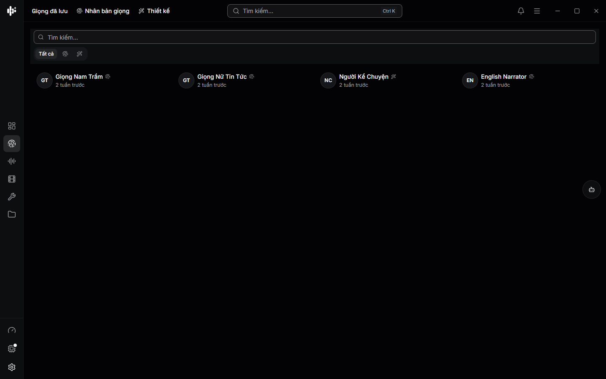

## Tính năng này làm gì

Trang **Giọng đã lưu** giúp bạn quản lý toàn bộ hồ sơ giọng nhân bản và giọng thiết kế đang có trên máy. Tại đây, bạn có thể tìm kiếm, nghe thử, đổi tên, cập nhật ảnh đại diện, thay mẫu âm thanh gốc hoặc xóa những giọng không còn dùng. Mọi dữ liệu hồ sơ và tệp âm thanh đều được xử lý và lưu trữ cục bộ trên thiết bị của bạn.

## Cần chuẩn bị

- Ít nhất một hồ sơ giọng đã tạo từ mục **Nhân bản giọng** hoặc **Thiết kế**.
- Ảnh định dạng PNG, JPG hoặc WebP dung lượng tối đa 5 MB (độ phân giải tối đa 16 megapixel) nếu bạn muốn thay ảnh đại diện.
- Tệp âm thanh định dạng WAV, MP3, M4A, FLAC, OGG, Opus, AAC hoặc WebM dung lượng tối đa 128 MiB nếu bạn muốn thay mẫu giọng nhân bản.

## Các bước

### 1. Mở danh sách giọng đã lưu

1. Bấm biểu tượng **Giọng nói** trên thanh điều hướng bên trái để mở trang **Giọng đã lưu**.
2. Nhập tên hồ sơ vào ô **Tìm kiếm…** để lọc nhanh giọng bạn cần tìm.
3. Chọn **Tất cả** hoặc các nút lọc kế bên để xem toàn bộ hồ sơ hay lọc theo nguồn tạo giọng.
4. Bấm **Nhân bản giọng** hoặc **Thiết kế** ở thanh trên cùng nếu bạn muốn tạo thêm giọng mới.

### 2. Nghe thử, sửa tên và ảnh đại diện

1. Bấm **Xem trước giọng nói** trên dòng hồ sơ bạn muốn kiểm tra để nghe lại mẫu âm thanh đã lưu.
2. Bấm **Sửa hồ sơ giọng** để mở khung chỉnh sửa chi tiết ở bên phải.
3. Nhập tên mới, nội dung lời thoại mẫu hoặc phong cách đọc trong khung chỉnh sửa.
4. Bấm **Đổi ảnh** hoặc kéo thả tệp vào vùng **Nhấp hoặc thả ảnh vào. PNG, JPG hoặc WebP tối đa 5 MB.** để tải ảnh đại diện lên; ứng dụng sẽ tự cắt ảnh về kích thước 256 × 256 và xóa siêu dữ liệu gốc, hoặc tự tạo chữ viết tắt từ chữ đầu và chữ cuối của tên giọng nếu bạn chọn **Xóa ảnh**.
5. Bấm **Lưu** để áp dụng thay đổi, hoặc bấm **Đóng** để đóng khung chỉnh sửa.

<!-- TODO: kiểm tra -->

### 3. Thay audio mẫu

1. Chọn **Sửa hồ sơ giọng** trên một hồ sơ thuộc nhóm giọng nhân bản.
2. Chọn tải lên tệp âm thanh mới hoặc thu âm trực tiếp để thay cho mẫu giọng hiện tại (áp dụng cho giọng nhân bản; giọng tạo từ **Thiết kế** được chỉnh qua mô tả giọng).
3. Nhập lời thoại của mẫu âm thanh mới, hoặc để trống ô lời thoại để model nhận diện giọng nói cục bộ tự động chép lời.
4. Bấm **Lưu** để cập nhật mẫu âm thanh mới mà vẫn giữ nguyên mã hồ sơ, tên, ảnh đại diện, ngôn ngữ và lịch sử tạo giọng.

<!-- TODO: kiểm tra -->

### 4. Xuất và nhập giọng

1. Mở **Thư viện** để tải và nhập các hồ sơ giọng mẫu hoặc giọng cộng đồng vào danh sách **Giọng đã lưu**.
2. Sửa hoặc thay mẫu âm thanh trên giọng đã nhập nếu muốn biến hồ sơ đó thành bản chỉnh sửa riêng của bạn; khi nhập lại cùng giọng đó từ **Thư viện**, ứng dụng sẽ tạo một hồ sơ riêng mà không ghi đè bản bạn đã sửa.

<!-- TODO: kiểm tra -->

### 5. Xóa giọng

1. Bấm **Xóa giọng** trên dòng hồ sơ bạn không còn sử dụng.
2. Bấm **Xác nhận** khi hộp thoại hỏi lại xuất hiện (hoặc bấm **Hủy** nếu muốn giữ lại hồ sơ).
3. Chờ ứng dụng xóa hồ sơ cùng tệp âm thanh mẫu, bản thu khóa giọng và ảnh đại diện tương ứng khỏi thư mục lưu trữ trên máy.

## Mẹo

- Khi bạn thay mẫu âm thanh mới cho một hồ sơ giọng nhân bản, trạng thái khóa giọng (**Đã khóa giọng nói! Đặc trưng giọng sẽ đồng nhất qua mọi lần tạo.**) và xác minh giọng cá nhân trước đó sẽ được đặt lại để khớp với người nói mới.
- Bấm trực tiếp vào tên một hồ sơ như **Giọng Nam Trầm**, **Giọng Nữ Tin Tức**, **Người Kể Chuyện** hoặc **English Narrator** sẽ chọn giọng đó để sử dụng ngay, trong khi bấm **Sửa hồ sơ giọng** giúp bạn chỉnh thông tin mà không làm đổi giọng đang chọn.
- Tính năng tìm ảnh đại diện trực tuyến chỉ gửi truy vấn khi bạn chủ động bấm tìm ảnh; nếu không bật tìm kiếm mạng, bạn luôn có thể dùng ảnh từ máy hoặc chữ cái viết tắt tạo cục bộ.

## Lỗi thường gặp

- Không tải được ảnh đại diện lên: kiểm tra lại định dạng tệp (chỉ nhận PNG, JPG, WebP), dung lượng không vượt quá 5 MB và độ phân giải không quá 16 megapixel.
- Không thay được mẫu âm thanh: kiểm tra tệp âm thanh có nằm trong các định dạng hỗ trợ (WAV, MP3, M4A, FLAC, OGG, Opus, AAC, WebM dưới 128 MiB) và đảm bảo bạn đang sửa giọng nhân bản chứ không phải giọng tạo bằng **Thiết kế**.
- Không tự động chép lời khi thay mẫu âm thanh: kiểm tra xem model nhận diện giọng nói cục bộ đã được cài đặt trong **Cài đặt** hay chưa, hoặc tự nhập lời thoại mẫu vào ô văn bản trước khi bấm **Lưu**.
- Thông báo dọn tệp chưa hoàn tất khi xóa giọng: hồ sơ đã được gỡ khỏi danh sách nhưng một số tệp âm thanh đang bận; bạn có thể kiểm tra nhật ký cục bộ của ứng dụng để xóa thủ công tệp còn sót.

## Bài liên quan

- [Nhân bản giọng](../nhan-ban-giong/)
- [Thiết kế giọng bằng mô tả](../thiet-ke-giong/)
- [Thư viện giọng](../thu-vien-giong/)
- [Công cụ: so sánh và chuyển giọng](../cong-cu/)
- [Cài đặt](../cai-dat/)
