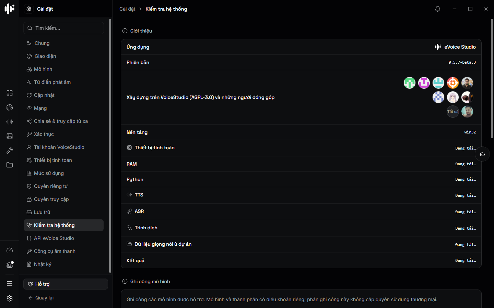

## Tính năng này làm gì

Bộ công cụ khắc phục sự cố giúp bạn xem nhật ký hoạt động, kiểm tra trạng thái phần cứng cùng các engine trên máy và tự xử lý lỗi phát sinh. Mọi thông tin chẩn đoán đều được thu thập cục bộ trên máy của bạn và tự động ẩn đường dẫn cá nhân hay khóa bảo mật trước khi bạn sao chép hoặc gửi báo cáo.

## Cần chuẩn bị

- Mở sẵn eVoice Studio trên máy tính.
- Nếu muốn dùng trợ lý sửa lỗi cục bộ cho mã nguồn, bạn cần cài sẵn một trong các công cụ dòng lệnh được hỗ trợ (Codex, Claude Code, OpenCode hoặc Pi) và mở thư mục mã nguồn có quyền ghi. Các thao tác kiểm tra hoặc khôi phục cài đặt ứng dụng thông thường không cần mã nguồn.
- Chỉ cần kết nối mạng và trình duyệt khi bạn muốn tải lại model bị thiếu hoặc gửi báo cáo lỗi lên GitHub.

## Các bước

### 1. Đọc nhật ký

1. Bấm vào **Cài đặt** ở thanh điều hướng bên trái, sau đó chọn **Nhật ký**.
2. Chọn **Backend** để xem nhật ký xử lý của hệ thống hoặc chọn **Giao diện** để xem nhật ký bảng điều khiển giao diện.
3. Nhập từ khóa vào ô **Tìm kiếm…** để lọc nhanh các dòng nhật ký đang hiển thị. Các dòng lỗi hiển thị màu đỏ, cảnh báo màu vàng và sự kiện sẵn sàng màu xanh lá.
4. Bấm **Làm mới** để cập nhật ngay ngoài chu kỳ tự làm mới mỗi ba giây, hoặc cuộn lên trên nếu bạn muốn tạm dừng cuộn tự động.
5. Bấm **Sao chép nhật ký hiển thị** để chép các dòng đang lọc vào bộ nhớ tạm, hoặc bấm **Xóa** và xác nhận để dọn trống nhật ký hiện tại.

### 2. Chạy chẩn đoán

1. Chọn **Kiểm tra hệ thống** trong trình đơn **Cài đặt** để mở bảng thông tin và trạng thái máy.
2. Xem mục **Giới thiệu** để đối chiếu **Ứng dụng**, **Phiên bản** và **Nền tảng** hiện tại.
3. Kiểm tra từng hạng mục phần cứng và môi trường gồm **Thiết bị tính toán**, **RAM** và **Python** để biết máy đang nhận GPU hay CPU.
4. Đối chiếu trạng thái sẵn sàng của các thành phần xử lý gồm **TTS**, **ASR**, **Trình dịch**, **Dữ liệu giọng nói & dự án** và dòng tổng hợp tại **Kết quả**.
5. Cuộn xuống mục **Ghi công mô hình** nếu bạn cần xem thông tin ghi công và điều khoản riêng của các model đang được hỗ trợ.

### 3. Dùng trợ lý sửa lỗi

1. Bấm **Hỏi eVoice Studio Agent** trên thanh công cụ của màn hình **Nhật ký** (hoặc nút nổi ở cạnh phải màn hình) để mở khung trợ lý mà không che khuất nội dung đang xem. Khi mở từ **Nhật ký**, các dòng lỗi và cảnh báo đang hiển thị sẽ được nạp sẵn làm ngữ cảnh.
2. Chọn công cụ trợ lý đã cài trên máy và nhập mô tả vào ô có gợi ý **Đã xảy ra lỗi gì? Mô tả các bước thực hiện, lỗi hiển thị hoặc kết quả mong đợi.**
3. Chọn chế độ **Chẩn đoán** nếu bạn chỉ muốn trợ lý kiểm tra trạng thái qua cầu nối API chỉ đọc, hoặc bấm **Sửa lỗi** khi gặp thông báo thiếu engine hay model để ứng dụng tự chọn engine tương thích, tải model cần thiết và kích hoạt lại.
4. Bấm **Dừng** bất cứ lúc nào nếu bạn muốn hủy quá trình chuẩn bị hoặc dừng tiến trình trợ lý đang chạy.

### 4. Báo lỗi qua GitHub bằng URL điền sẵn

1. Bấm **Báo lỗi** trên thông báo sự cố hoặc chọn **Báo lỗi (sao chép thông tin chẩn đoán)** trong bảng nhật ký khi bạn không thể tự khắc phục lỗi.
2. Kiểm tra thông báo **Đã sao chép báo cáo chẩn đoán — dán vào GitHub issue.** hoặc cửa sổ trình duyệt mở ra với URL GitHub đã điền sẵn thông tin.
3. Xem lại nội dung báo cáo trên trình duyệt của bạn. Ứng dụng đã tự lược bỏ đường dẫn thư mục cá nhân và các chuỗi giống khóa truy cập trước khi tạo nội dung.
4. Bấm gửi issue trực tiếp từ trình duyệt của bạn để hoàn tất báo cáo.

## Mẹo

- Khi chi tiết lỗi tổng hợp giọng nói xuất hiện, bạn có thể bấm trực tiếp vào liên kết trong thông báo để mở thẳng đến trang **Nhật ký**.
- Khi một tác vụ trên GPU chạy lâu khiến backend bận, chấm trạng thái chỉ chuyển sang màu vàng và giữ nguyên không gian làm việc; bạn chỉ cần đợi tác vụ hoàn tất thay vì khởi động lại ứng dụng.
- Nếu giao diện gặp sự cố hiển thị tạm thời, bạn có thể dùng tùy chọn **Tải lại giao diện** để nạp lại mà không làm gián đoạn backend.

## Lỗi thường gặp

- hiện thông báo **Nhật ký hệ thống trống. Hoạt động sẽ hiện tại đây khi backend ghi lại.** hoặc **Chưa có nhật ký bảng điều khiển giao diện.**: hệ thống chưa phát sinh sự kiện mới hoặc bạn vừa xóa nhật ký. Hãy thực hiện lại thao tác gây lỗi rồi bấm **Làm mới**.
- hiện thông báo **Không thể sao chép nhật ký**: quyền truy cập bộ nhớ tạm thời bị gián đoạn. Hãy bấm **Làm mới** và thử bấm lại **Sao chép nhật ký hiển thị**.
- hiện thông báo **Cài đặt Codex, Claude Code, OpenCode hoặc Pi để sửa lỗi cục bộ.**: máy của bạn chưa cài công cụ dòng lệnh nào được hỗ trợ. Hãy cài một trong các công cụ trên trước khi dùng trợ lý sửa lỗi.
- hiện thông báo **Mở bản mã nguồn VoiceStudio có quyền ghi để trợ lý có thể sửa lỗi.**: bạn đang yêu cầu sửa mã nguồn từ bản cài đặt đóng gói hoặc thư mục chỉ đọc. Với nhu cầu cài đặt model và chọn lại engine trong ứng dụng, chỉ cần dùng chế độ khôi phục ứng dụng mà không cần chọn thư mục mã nguồn.
- quá trình tạo giọng hoặc chép lời báo hết bộ nhớ hệ thống hoặc thiếu gói phụ thuộc Python: đóng bớt ứng dụng nặng, giải phóng model không dùng, hoặc mở mục **Mô hình** để cài đặt lại engine bị thiếu rồi bấm **Thử lại**.
- báo lỗi không tìm thấy công cụ xử lý đa phương tiện (FFmpeg hoặc yt-dlp): mở **Cài đặt**, chọn **Công cụ âm thanh** để khôi phục bản đi kèm của ứng dụng hoặc trỏ sang bản có sẵn trên hệ thống.
- không thể ghi âm trên macOS hoặc thiếu quyền hệ thống: mở **Cài đặt**, chọn **Quyền truy cập** để kiểm tra trạng thái cấp quyền micro và mở thẳng phần cài đặt hệ điều hành.
- tải model bị dừng giữa chừng do đầy ổ đĩa: mở **Cài đặt**, chọn **Lưu trữ** để kiểm tra dung lượng trống, dọn bớt dữ liệu hoặc chuyển thư mục lưu trữ sang ổ đĩa khác rồi bấm **Thử lại**.

## Bài liên quan

- [Bắt đầu với eVoice Studio](../bat-dau/)
- [Cài đặt](../cai-dat/)
- [Thư viện giọng](../thu-vien-giong/)
- [Lồng tiếng video](../long-tieng-video/)
- [Phiên âm và đọc chính tả](../phien-am/)
