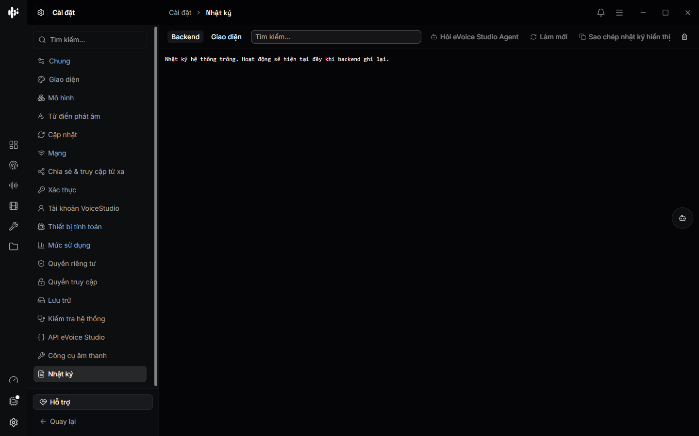

## Tính năng này làm gì

Trang **Nhật ký** và **Kiểm tra hệ thống** trong **Cài đặt** giúp bạn xem
---
title: Khắc phục sự cố
description: Đọc nhật ký, kiểm tra hệ thống, dùng trợ lý sửa lỗi cục bộ và báo lỗi qua GitHub cho eVoice Studio.
slug: khac-phuc-su-co
order: 17
group: library
updated: 2026-11-14
app_version: 0.5.7-beta.3
status: draft
---

## Tính năng này làm gì

Trang **Nhật ký** và **Kiểm tra hệ thống** giúp bạn theo dõi hoạt động của backend và giao diện ngay trên máy tính. Khi gặp sự cố tạo giọng, nhận diện giọng nói hoặc khởi động, bạn có thể lọc dòng lỗi, dùng **Hỏi eVoice Studio Agent** để chẩn đoán hoặc gửi báo cáo lỗi qua trình duyệt. Toàn bộ nhật ký được lưu cục bộ và tự động ẩn đường dẫn cá nhân cùng khóa xác thực trước khi xuất.

## Cần chuẩn bị

- Ứng dụng eVoice Studio đang mở trên máy của bạn.
- Nếu muốn dùng tính năng tự động chẩn đoán và sửa lỗi bằng trợ lý dòng lệnh, máy cần cài sẵn một trong các công cụ: Codex, Claude Code, OpenCode hoặc Pi.
- Nếu muốn sửa trực tiếp mã nguồn ứng dụng, bạn cần một thư mục mã nguồn VoiceStudio có quyền ghi trên ổ đĩa.

## Các bước

### 1. Đọc nhật ký

1. Mở **Cài đặt** ở thanh điều hướng bên trái, sau đó chọn **Nhật ký**.
2. Chọn **Backend** để xem nhật ký xử lý của máy chủ cục bộ, hoặc chọn **Giao diện** để xem nhật ký bảng điều khiển giao diện.
3. Nhập từ khóa vào ô **Tìm kiếm…** để lọc nhanh các dòng đang hiển thị. Các dòng lỗi hiển thị màu đỏ, cảnh báo màu vàng, và trạng thái sẵn sàng màu xanh lá.
4. Bấm **Làm mới** nếu muốn cập nhật ngay lập tức (màn hình cũng tự làm mới mỗi ba giây khi bạn đang cuộn ở cuối trang).
5. Bấm **Sao chép nhật ký hiển thị** để chép các dòng đang lọc vào bộ nhớ tạm, hoặc bấm **Xóa** (biểu tượng thùng rác) và xác nhận để làm trống nhật ký hiện tại.

### 2. Chạy chẩn đoán

1. Từ menu **Cài đặt**, bấm vào **Kiểm tra hệ thống**.
2. Xem mục **Giới thiệu** để kiểm tra thông tin **Ứng dụng**, **Phiên bản**, **Nền tảng**, **Thiết bị tính toán** (GPU hoặc CPU), **RAM** và phiên bản **Python**.
3. Kiểm tra trạng thái hoạt động của các nhóm mô hình gồm **TTS**, **ASR** và **Trình dịch**. Khi mới mở trang, các mục này có thể hiện **Đang tải…** trong vài giây.
4. Đối chiếu đường dẫn lưu trữ tại dòng **Dữ liệu giọng nói & dự án** và **Kết quả** để biết thư mục đang chứa dữ liệu trên ổ đĩa và kiểm tra dung lượng trống khi cần.

### 3. Dùng trợ lý sửa lỗi

1. Tại thanh công cụ của trang **Nhật ký** (hoặc nút nổi bên cạnh phải màn hình), bấm **Hỏi eVoice Studio Agent**. Khung trò chuyện sẽ mở ra và tự động đính kèm các dòng lỗi hoặc cảnh báo đang hiển thị.
2. Chọn công cụ trợ lý đã cài trên máy của bạn và nhập mô tả vào ô **Đã xảy ra lỗi gì? Mô tả các bước thực hiện, lỗi hiển thị hoặc kết quả mong đợi.**.
3. Chọn chế độ chỉ đọc để kiểm tra trạng thái ứng dụng qua cầu nối API cục bộ, hoặc bật chế độ tự động thực hiện để trợ lý chọn engine, cài đặt model còn thiếu và khởi động lại backend khi cần.
4. Khi gặp thông báo thiếu thành phần trên màn hình làm việc, bấm **Sửa lỗi** để ứng dụng tự chọn engine tương thích hoặc cài đặt model phù hợp với phần cứng của bạn.
5. Nếu bạn đang chạy từ bản mã nguồn có quyền ghi và muốn trợ lý sửa lỗi code, hãy đợi thông báo **Đã sửa xong. Xem lại thay đổi và tạo PR khi các bài kiểm tra liên quan đạt yêu cầu.** rồi kiểm tra lại các thay đổi trước khi áp dụng.

### 4. Báo lỗi qua GitHub bằng URL điền sẵn

1. Khi xuất hiện hộp thoại lỗi hoặc thông báo sự cố backend, bấm **Báo lỗi** (hoặc **Báo lỗi (sao chép thông tin chẩn đoán)** trên bảng nhật ký).
2. Ứng dụng sẽ tự động loại bỏ tên thư mục người dùng cùng các chuỗi giống token xác thực, sau đó mở trình duyệt web của bạn tới trang tạo issue trên GitHub với nội dung chẩn đoán được điền sẵn hoặc thông báo **Đã sao chép báo cáo chẩn đoán — dán vào GitHub issue.**.
3. Xem lại nội dung trên trình duyệt của bạn, bổ sung các bước tái hiện lỗi và bấm gửi trực tiếp từ trình duyệt. Ứng dụng không tự gửi dữ liệu ngầm nếu bạn không bấm gửi trên GitHub.

## Mẹo

- Khi bạn cuộn lên để đọc các dòng cũ trong **Nhật ký**, tính năng tự cuộn xuống cuối sẽ tạm dừng để không làm trôi mất dòng bạn đang đọc; cuộn xuống đáy để bật lại.
- Trợ lý trong **Hỏi eVoice Studio Agent** chỉ chạy khi bạn bấm gửi yêu cầu; việc mở khung trò chuyện không tự động gọi bất kỳ kết nối mạng hay tiến trình nào.
- Khi cần dừng một tiến trình sửa lỗi hoặc cài đặt đang chạy trong khung trợ lý, bạn có thể bấm **Dừng** bất kỳ lúc nào.

## Lỗi thường gặp

- màn hình hiện **Nhật ký hệ thống trống. Hoạt động sẽ hiện tại đây khi backend ghi lại.** hoặc **Chưa có nhật ký bảng điều khiển giao diện.**: hệ thống vừa khởi động hoặc vừa được xóa nhật ký; hãy chạy thử một tác vụ tạo giọng hoặc bấm **Làm mới** sau vài giây.
- tác vụ tạo âm thanh hoặc phiên âm chạy quá lâu và báo không kết nối được backend: một tác vụ nặng trên GPU hoặc CPU đang chiếm hết bộ nhớ (VRAM hoặc RAM) khiến hàng đợi bị nghẽn; hãy đợi tác vụ hiện tại kết thúc, đóng bớt ứng dụng nặng, hoặc chọn model nhỏ hơn (như faster-whisper bản medium/small) rồi bấm **Thử lại**.
- không tải được model có điều kiện cấp phép trên Hugging Face (lỗi 401 hoặc báo gated repo): mở trang của model đó trên Hugging Face bằng trình duyệt để chấp nhận điều khoản sử dụng, lưu token đọc vào mục **Xác thực** trong **Cài đặt**, sau đó thử tải lại.
- thiếu công cụ xử lý âm thanh hoặc nhập video thất bại: mở **Cài đặt**, chọn **Công cụ âm thanh** để kiểm tra đường dẫn FFmpeg hoặc cập nhật yt-dlp khi có nhu cầu sử dụng.
- hệ thống báo lỗi thiếu tệp thư viện Python dù đã cài đặt trước đó: phần mềm diệt virus hoặc dịch vụ đồng bộ đám mây (như OneDrive) có thể đã khóa hoặc cách ly tệp trong môi trường Python; hãy đặt thư mục môi trường ở ổ đĩa cục bộ thông thường và thêm vào danh sách loại trừ của trình diệt virus.
- khung trợ lý hiện **Chưa cài đặt** và **Cài đặt Codex, Claude Code, OpenCode hoặc Pi để sửa lỗi cục bộ.**: máy của bạn chưa có công cụ dòng lệnh tương ứng; hãy cài đặt một trong các công cụ trên nếu muốn dùng trợ lý, hoặc dùng **Sao chép nhật ký hiển thị** để tự kiểm tra.
- khung trợ lý hiện **Mở bản mã nguồn VoiceStudio có quyền ghi để trợ lý có thể sửa lỗi.**: tác vụ sửa mã nguồn đòi hỏi thư mục repo có quyền ghi; nếu bạn chỉ dùng bản cài đặt đóng gói thông thường, hãy dùng chế độ thao tác ứng dụng để cấu hình lại engine và model mà không cần mã nguồn.

## Bài liên quan

- [Bắt đầu với eVoice Studio](../bat-dau/)
- [Cài đặt](../cai-dat/)
- [Thư viện giọng](../thu-vien-giong/)
- [Lồng tiếng video](../long-tieng-video/)
- [Phiên âm và đọc chính tả](../phien-am/)
