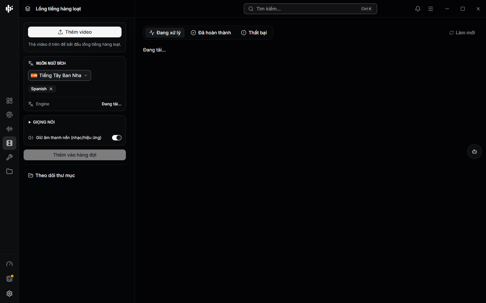

## Tính năng này làm gì

Trang **Lồng tiếng hàng loạt** giúp bạn lồng tiếng nhiều tệp video sang một hoặc nhiều ngôn ngữ đích trong cùng một lượt chạy trên máy cục bộ. Ứng dụng tự động tách âm thanh, chép lời, dịch, tạo giọng nói và trộn âm thanh cho từng video trong hàng đợi. Bạn cũng có thể bật **Theo dõi thư mục** để tự động đưa các video mới vào hàng đợi.

## Cần chuẩn bị

- Một hoặc nhiều tệp video cần lồng tiếng (định dạng `mp4`, `mkv`, `mov` hoặc `webm`).
- Engine nhận diện giọng nói, dịch thuật và tạo giọng nói đã sẵn sàng trên máy cho các ngôn ngữ bạn muốn dùng.
- Giọng đã lưu hoặc mẫu cài sẵn nếu bạn không muốn dùng giọng mặc định.

## Các bước

### 1. Thêm nhiều video vào danh sách chờ

Mở mục **Lồng tiếng** trên thanh điều hướng bên trái rồi chọn **Lồng tiếng hàng loạt**, hoặc dùng ô **Tìm kiếm…** để chuyển nhanh tới trang này.

Bấm **Thêm video** ở cột bên trái (hoặc ở giữa màn hình khi danh sách trống) để chọn nhiều tệp cùng lúc từ máy tính. Bạn cũng có thể kéo thả trực tiếp các tệp video vào khung **Thả video ở trên để bắt đầu lồng tiếng hàng loạt.** Nếu muốn bỏ bớt tệp trước khi gửi, bấm nút **Xóa** cạnh tên tệp đó.

### 2. Chọn ngôn ngữ đích và cấu hình chung

Chọn một hoặc nhiều ngôn ngữ trong khung **NGÔN NGỮ ĐÍCH**. Mỗi ngôn ngữ đã chọn hiển thị thành một thẻ nhỏ bên dưới; bấm dấu đóng trên thẻ nếu bạn muốn gỡ ngôn ngữ đó.

Mở mục **GIỌNG NÓI** để chọn giọng lồng tiếng. Chọn **Mặc định**, chọn một giọng bạn đã lưu, hoặc chọn trong nhóm **Mẫu cài sẵn**.

Bật hoặc tắt công tắc **Giữ âm thanh nền (nhạc/hiệu ứng)** tùy theo bạn muốn giữ lại nhạc nền và tiếng động gốc hay chỉ xuất giọng đọc mới. Sau khi thiết lập xong, bấm **Thêm vào hàng đợi** để đưa toàn bộ video vào danh sách xử lý. Các tệp gửi thành công sẽ rời khỏi danh sách chờ tải lên và chuyển sang hàng đợi.

### 3. Bật thư mục theo dõi (watch folder)

Bấm **Theo dõi thư mục** ở cuối cột bên trái và chọn một thư mục trên máy tính. Khi tính năng này hoạt động, mỗi tệp video mới được chép xong vào thư mục đó sẽ tự động được đưa vào hàng đợi với cấu hình ngôn ngữ, giọng nói và âm thanh nền bạn đang chọn. Bạn có thể bấm **Tạm dừng**, **Tiếp tục** hoặc **Dừng** bất cứ lúc nào.

### 4. Theo dõi và quản lý hàng đợi

Chọn các thẻ **Đang xử lý**, **Đã hoàn thành** hoặc **Thất bại** ở phía trên khung chính để lọc danh sách tác vụ, hoặc bấm **Làm mới** để cập nhật trạng thái ngay lập tức.

Theo dõi tiến độ của từng video qua các bước **🎬 Đang tách âm thanh…**, **📝 Đang chép lời…**, **🌐 Đang dịch…**, **🗣️ Đang tạo giọng nói…**, **🎛️ Đang trộn âm thanh…** và **✅ Hoàn tất** cùng phần trăm hoàn thành.

- Với tác vụ nằm trong **Đang xử lý**, bấm **Hủy** nếu bạn muốn dừng tác vụ đó.
- Với tác vụ trong **Đã hoàn thành**, bấm nút xuất tương ứng với từng mã ngôn ngữ để mở hộp thoại lưu tệp video `.mp4` về máy.
- Với tác vụ trong **Thất bại**, bấm **Thêm thông tin** để xem chi tiết nguyên nhân, sau đó bấm **Thử lại** để chạy lại.
- Để dọn một bản ghi đã kết thúc khỏi danh sách, bấm **Xóa** rồi bấm **Xóa** thêm lần nữa để xác nhận (hoặc bấm **Hủy** để giữ lại).

## Mẹo

- Chọn nhiều ngôn ngữ trong mục **NGÔN NGỮ ĐÍCH** trước khi bấm **Thêm vào hàng đợi** để ứng dụng xuất riêng từng bản video cho mỗi ngôn ngữ trong cùng một lần gửi.
- Tải lại giao diện không làm mất hay nhân đôi các tác vụ đang chạy, nhưng hàng đợi được giữ trong bộ nhớ nên bạn hãy đợi các tác vụ hoàn tất trước khi đóng hẳn ứng dụng.
- Bật **Giữ âm thanh nền (nhạc/hiệu ứng)** khi lồng tiếng vlog, phim hoặc video hướng dẫn có nhạc nền để bản lồng tiếng tự nhiên hơn.

## Lỗi thường gặp

- nút **Thêm vào hàng đợi** bị mờ không bấm được: kiểm tra xem bạn đã thêm ít nhất một video, chọn ít nhất một ngôn ngữ trong **NGÔN NGỮ ĐÍCH**, và phần engine không báo **Không có sẵn**.
- một số tệp vẫn nằm lại ở khung tải lên sau khi bấm **Thêm vào hàng đợi**: các tệp gửi thành công đã vào hàng đợi, chỉ những tệp gặp lỗi mới giữ lại trong danh sách để bạn kiểm tra thông báo lỗi và bấm **Thêm vào hàng đợi** lại.
- xuất hiện thông báo **Không thể theo dõi thư mục đó — chọn lại để thử lại.**: bấm **Theo dõi thư mục** và chọn lại thư mục có quyền truy cập hợp lệ trên máy của bạn.
- tác vụ chuyển sang thẻ **Thất bại** do thiếu gói dịch hoặc chưa chấp nhận giấy phép model: mở thẻ **Thất bại**, xem mục **Thêm thông tin**, xác nhận giấy phép hoặc cài đặt gói ngôn ngữ khi được hỏi rồi bấm **Thử lại**.

## Bài liên quan

- [Lồng tiếng video](../long-tieng-video/)
- [Nhân bản giọng](../nhan-ban-giong/)
- [Quản lý giọng đã lưu](../giong-da-luu/)
- [Phiên âm và đọc chính tả](../phien-am/)
- [Quy trình tự động](../quy-trinh/)
- [Khắc phục sự cố](../khac-phuc-su-co/)
