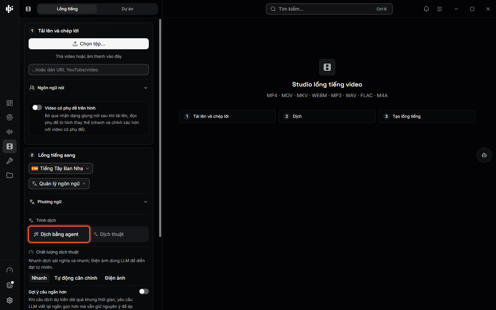

## Tính năng này làm gì

Trang **Lồng tiếng** giúp bạn tách lời nói và nhạc nền từ tệp video hoặc âm thanh, chép lời tự động, dịch sang một hoặc nhiều ngôn ngữ và tạo bản lồng tiếng hoàn chỉnh. Bạn có thể gán giọng riêng cho từng người nói, chỉnh sửa câu thoại trên timeline, xử lý phụ đề cứng (hardsub) và xuất tệp ngay trên máy. Mọi bước nhận dạng giọng nói, tách nhạc và tạo tiếng đều chạy cục bộ, chỉ kết nối mạng khi bạn tự nhập URL video hoặc chọn engine dịch trực tuyến.

## Cần chuẩn bị

- Một tệp video hoặc âm thanh hỗ trợ định dạng MP4, MOV, MKV, WEBM, MP3, WAV, FLAC hoặc M4A, hoặc một liên kết `http://` / `https://` hợp lệ.
- Engine nhận dạng giọng nói (ASR) và engine tạo giọng nói (TTS) đã cài sẵn trên máy (kiểm tra biểu tượng **Thiết bị cục bộ: Engine sẵn sàng** ở góc dưới bên trái).
- Nếu muốn dùng **Dịch bằng agent**, bạn cần cài sẵn một agent dòng lệnh trên máy (Codex, Claude Code, OpenCode hoặc Pi) hoặc cấu hình model LLM trong **Cài đặt**.
- Nếu muốn đọc hoặc xóa phụ đề in sẵn trên hình (hardsub), bạn cần cài thêm engine phụ đề khi được hỏi trong giao diện (khoảng 600 MB).

## Các bước

### 1. Mở trang Lồng tiếng

Bấm vào mục **Lồng tiếng** trên thanh điều hướng bên trái để mở **Studio lồng tiếng video**.

### 2. Chọn tệp video hoặc dán URL

Bấm **Chọn tệp…** trong mục **1 Tải lên và chép lời** để chọn tệp từ máy, hoặc kéo thả tệp trực tiếp vào vùng **Thả video hoặc âm thanh vào đây**. Nếu muốn lấy video từ mạng, bạn nhập đường dẫn vào ô **…hoặc dán URL YouTube/video** rồi bấm **Nhập**. Khi dán URL, bạn có thể mở mục **Nâng cao** để bật **Tải phụ đề có sẵn** hoặc bấm **Chọn bản xuất cookies.txt** dưới phần **Đăng nhập YouTube (tùy chọn)** (tệp cookie tối đa 1 MB).

### 3. Chọn ngôn ngữ nói và nguồn phụ đề

Bấm vào mục **Ngôn ngữ nói** để chọn ngôn ngữ gốc của video hoặc giữ nguyên **Tự động** để ứng dụng tự nhận diện, đồng thời nhập số lượng tại ô **Người nói** (từ 1 đến 20) nếu muốn gợi ý trước số người thoại. Nếu video có chữ in cứng trên khung hình và bạn muốn đọc chữ trên hình thay vì nhận dạng âm thanh, hãy bật công tắc **Video có phụ đề trên hình** trước khi tải tệp lên.

### 4. Chọn ngôn ngữ lồng tiếng

Chọn ngôn ngữ đích trong khung **2 Lồng tiếng sang**. Nếu muốn lồng tiếng sang nhiều ngôn ngữ cùng lúc, bạn bấm **Quản lý ngôn ngữ** rồi đánh dấu thêm các ngôn ngữ cần xuất. Với những ngôn ngữ có nhiều giọng vùng miền, bạn có thể mở mục **Phương ngữ** để chọn vùng miền phù hợp hoặc để **Mặc định**.

### 5. Chọn cách dịch và chất lượng dịch

Chọn phương thức dịch tại mục **Trình dịch**:

- Bấm **Dịch bằng agent** để giao toàn bộ kịch bản, bảng thuật ngữ và thời lượng từng câu cho agent trên máy hoặc LLM dịch sát ngữ cảnh và tự căn độ dài câu.
- Bấm **Dịch thuật** để dùng engine dịch đang bật (như Argos ngoại tuyến, NLLB, Google hoặc API), sau đó chọn một mức trong **Chất lượng dịch thuật**: **Nhanh** (dịch sát nghĩa, tốc độ cao), **Tự động căn chỉnh** (tự rút gọn câu bị tràn thời gian) hoặc **Điện ảnh** (dùng LLM diễn đạt tự nhiên hơn). Bạn cũng có thể bật **Gợi ý câu ngắn hơn** để nhận câu gợi ý ngắn gọn khi bản dịch dài hơn khung thời gian gốc.

### 6. Chép lời, dịch và gán giọng

Chờ ứng dụng tách âm thanh và chép lời xong, hoặc bấm **Nhập .srt** nếu bạn muốn thay bản chép lời bằng tệp phụ đề có sẵn. Khi danh sách đoạn thoại hiện ra ở khung chính, bạn bấm **Dịch tất cả** (hoặc **Dịch bằng agent**) ở thanh dưới cùng để dịch toàn bộ kịch bản, hoặc bấm **Dán bản dịch** trên thanh công cụ để nạp bản dịch từ tệp `.srt` / `.vtt` hay văn bản thuần. Tiếp theo, mở **Bảng phân vai** ở thanh bên trái và kéo giọng nói từ danh sách thả vào từng người nói để gán giọng.

### 7. Sửa từng đoạn trên timeline

Bấm vào bất kỳ dòng thoại nào trong danh sách để sửa nội dung bản dịch, hoặc kéo các khối trên thanh timeline phía trên để chỉnh điểm **Bắt đầu** và **Kết thúc**. Bạn có thể bấm vào tên người nói trên từng đoạn để đổi giọng riêng, chỉnh âm lượng, tốc độ nói và hướng dẫn cách đọc, hoặc bấm nút **Xem trước trực tiếp** để nghe thử câu đó. Trên thanh công cụ phía trên danh sách đoạn, bạn có thể mở menu **Thêm** để chọn **Dọn dẹp** (gộp các đoạn quá ngắn liền kề), **Mô phỏng cách thể hiện gốc** (tự điền hướng dẫn giọng đọc theo cao độ và nhịp độ của diễn viên gốc) hoặc **↺ Khôi phục** về bản chép lời gốc. Ngoài ra, mở mục **Căn thời gian** ở thanh bên trái để chọn chế độ khớp thời lượng như **Khớp khẩu hình**, **Cô đọng**, **Khớp thông minh** (kèm thanh trượt **Tốc độ nhanh nhất** và **Tốc độ chậm nhất**) hoặc **Kéo giãn video**.

### 8. Nhạc nền và phụ đề cứng (hardsub)

Chọn cách xử lý hình ảnh và nhạc nền ở thanh bên trái sau khi video đã chuẩn bị xong:

- Với video có chữ in cứng trên hình (hardsub), bạn kéo chọn vùng chứa chữ trên khung hình để đọc phụ đề theo từng khung hình hoặc xóa chữ khỏi video bằng các chế độ tái tạo nền (STTN, LaMa hoặc ProPainter).
- Với nhạc nền, bạn có thể giữ âm thanh môi trường và nhạc nền gốc bằng tùy chọn **Trộn nhạc nền** khi xuất, hoặc dùng bảng nhạc nền AI (kết nối với máy chủ ACE-Step cục bộ trên máy) để tạo nhạc không lời mới tự động giảm âm lượng khi có lời thoại.
<!-- TODO: kiểm tra tên nhãn tiếng Việt của các nút trong HardsubPanel và BgmPanel -->

### 9. Tạo lồng tiếng và xuất file

Bấm **Tạo lồng tiếng** ở góc dưới bên phải để bắt đầu tổng hợp giọng nói cho toàn bộ các đoạn. Khi hoàn tất, bạn chuyển qua lại giữa **Bản gốc** và các ngôn ngữ đã tạo trong khung **Xem trước** để nghe kiểm tra, hoặc bấm **Kiểm tra** trên thanh công cụ để rà soát độ lệch thời gian của từng câu. Cuối cùng, mở phần tùy chọn xuất ở thanh bên trái để chọn **Track mặc định:**, **Xuất các track:**, bật **Trộn nhạc nền**, **In phụ đề vào video** hoặc **Phụ đề kép**, rồi bấm **Xuất video** (hoặc **Xuất…**) để lưu tệp MP4, âm thanh WAV/MP3 hay tệp phụ đề rời về máy.

### 10. Lưu và mở lại dự án

Bấm vào thẻ **Dự án** ở đầu thanh bên trái (cạnh thẻ **Lồng tiếng**) để xem danh sách các dự án lồng tiếng đã lưu. Để lưu mới, đổi tên hoặc xóa dự án, bạn mở mục **Dự án** trên thanh điều hướng bên trái và chọn **Lưu dự án**. Nếu muốn chuyển toàn bộ người nói và câu thoại hiện tại sang trình dựng truyện, hãy bấm **Tạo câu chuyện** ở góc trên bên phải để mở trong trang **Truyện**.

## Mẹo

- Bấm tổ hợp phím `Ctrl+Z` / `Ctrl+Shift+Z` để hoàn tác hoặc làm lại tối đa 50 bước chỉnh sửa đoạn thoại, `Ctrl+D` để tách đoạn tại vị trí con trỏ và `Ctrl+M` để gộp với đoạn kế tiếp.
- Khi chỉ sửa lại vài câu sau khi đã tạo lồng tiếng, bạn không cần chạy lại toàn bộ video; ứng dụng tự giữ bộ nhớ đệm của các câu chưa đổi và chỉ tạo lại những đoạn vừa sửa.
- Chọn chế độ **Nhất quán** tại mục **Khớp giọng:** (trong phần **Căn thời gian**) nếu muốn mỗi người nói giữ một mẫu giọng tham chiếu cố định xuyên suốt video thay vì đổi theo từng câu (**Theo câu**).
- Đánh dấu ô chọn ở đầu nhiều dòng thoại để gán cùng một giọng, đổi ngôn ngữ hoặc xóa hàng loạt trong một thao tác.

## Lỗi thường gặp

- Không bấm được nút **Dịch bằng agent**: Máy của bạn chưa cài agent dòng lệnh (Codex, Claude Code, OpenCode hoặc Pi) và chưa cấu hình LLM. Hãy cài một trong các công cụ trên hoặc chuyển sang thẻ **Dịch thuật** để dùng engine dịch tích hợp.
- Chế độ **Điện ảnh** hoặc **Tự động căn chỉnh** tự chuyển về **Nhanh**: Ứng dụng chưa có model LLM khả dụng nên tự động dùng chế độ **Nhanh** và hiện liên kết dẫn tới phần cài đặt LLM.
- Không bật được **In phụ đề vào video** khi xuất: Bạn đang chọn chế độ căn thời gian **Kéo giãn video**. Chế độ này không hỗ trợ in cứng phụ đề trực tiếp; hãy xuất tệp phụ đề rời (SRT/VTT/ASS) hoặc đổi sang chế độ **Khớp thông minh** / **Khớp khẩu hình**.
- Báo lỗi tệp nguồn bị hỏng hoặc thiếu dung lượng khi tải lên: Kiểm tra xem tệp video gốc có phát được bình thường không và ổ đĩa còn đủ chỗ trống cho bản sao công việc hay không trước khi bấm **Đổi tệp** để tải lại.
- Tác vụ chép lời hoặc tạo lồng tiếng bị ngắt giữa chừng: Bấm **Tiếp tục** (hoặc **Thử lại** với bước chép lời) trên thanh thông báo khôi phục để chạy tiếp mà không cần tải lại tệp nguồn.

## Bài liên quan

- [Lồng tiếng hàng loạt](../long-tieng-hang-loat/)
- [Nhân bản giọng](../nhan-ban-giong/)
- [Quản lý giọng đã lưu](../giong-da-luu/)
- [Phiên âm và đọc chính tả](../phien-am/)
- [Truyện nhiều giọng](../truyen/)
- [Dự án](../du-an/)
- [Cài đặt](../cai-dat/)
- [Khắc phục sự cố](../khac-phuc-su-co/)
