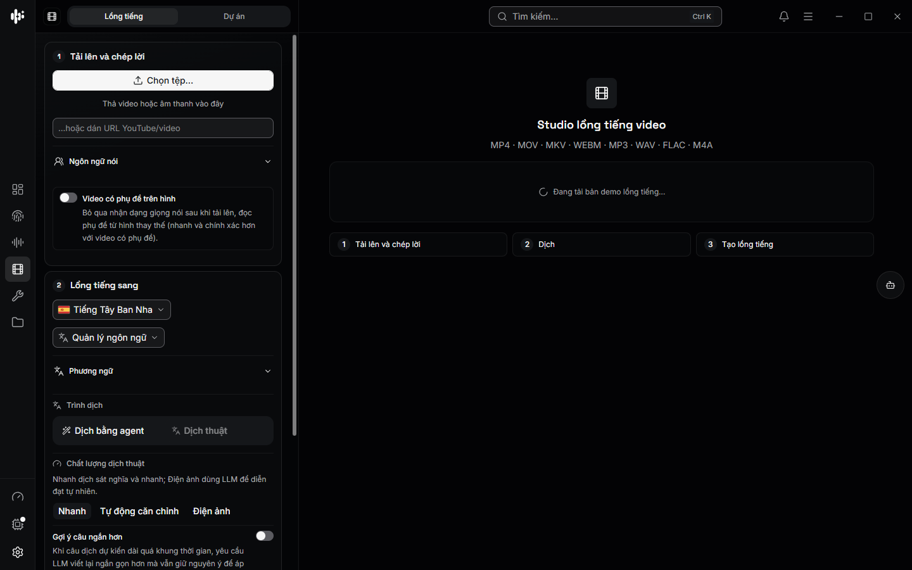
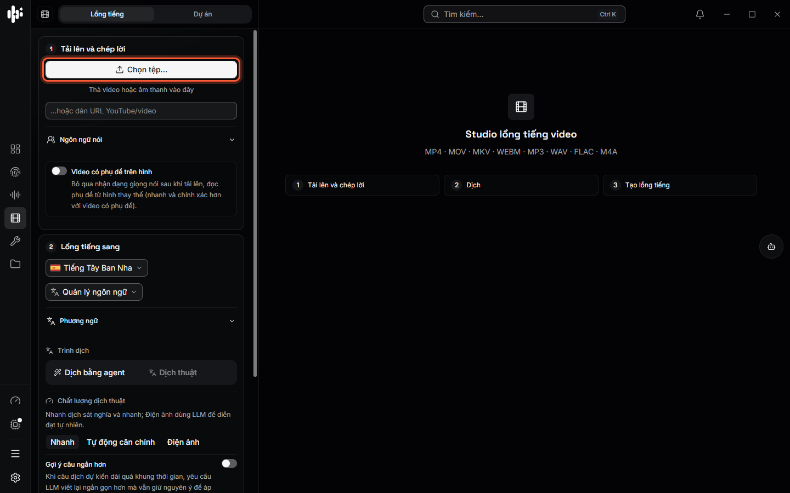
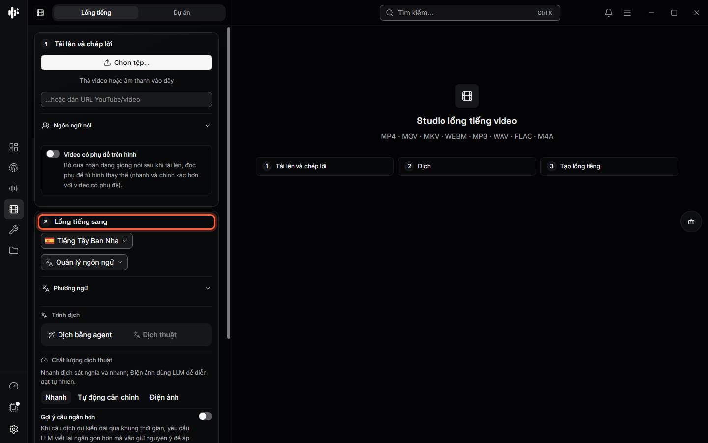

## Tính năng này làm gì

Trang **Lồng tiếng** giúp bạn tách giọng nói khỏi nhạc nền, chép lời, dịch sang một hoặc nhiều ngôn ngữ và tạo bản lồng tiếng khớp thời gian từng câu. Toàn bộ quy trình tách âm thanh, nhận dạng giọng nói và tổng hợp giọng chạy trực tiếp trên máy của bạn. Bạn có thể sửa văn bản từng đoạn, kéo chỉnh vị trí trên timeline và xuất video kèm phụ đề hoặc nhạc nền.

## Cần chuẩn bị

- Một tệp video hoặc âm thanh trên máy (hỗ trợ MP4, MOV, MKV, WEBM, MP3, WAV, FLAC, M4A), hoặc liên kết video hợp lệ khi bạn cần tải từ mạng.
- Đã cài đặt model nhận dạng giọng nói và engine tổng hợp giọng trong mục **Cài đặt**.
- Nếu muốn dùng **Dịch bằng agent**, máy cần cài sẵn một công cụ agent cục bộ (Codex, Claude Code, OpenCode, Pi hoặc Gemini qua Antigravity `agy`) hoặc cấu hình LLM trong phần cài đặt. Với Gemini, chỉ cần tài khoản Google (ví dụ gói Google AI Pro): mở **Cài đặt**, vào **Nhà cung cấp LLM**, chọn nhà cung cấp “Gemini · Google account (Antigravity CLI)”, bấm **Đăng nhập bằng Google**, đăng nhập trong trình duyệt rồi dán mã ủy quyền vào ô hiện ra. Mô hình Gemini chọn ở đó cũng là mô hình **Dịch bằng agent** dùng.
- Dung lượng ổ đĩa trống đủ để lưu bản sao nguồn và các tệp âm thanh tách ra trong lúc xử lý.

## Các bước

### 1. Mở trang Lồng tiếng và chọn video

Bấm vào **Lồng tiếng** ở thanh điều hướng bên trái để mở không gian làm việc **Studio lồng tiếng video**.

Bấm **Chọn tệp…** trong mục **1 Tải lên và chép lời** để chọn tệp từ máy, hoặc kéo thả tệp vào khung **Thả video hoặc âm thanh vào đây**. Nếu muốn dùng liên kết trực tuyến, hãy nhập địa chỉ vào ô **…hoặc dán URL YouTube/video** rồi bấm **Nhập**. Khi cần tải phụ đề có sẵn hoặc dùng tệp xác thực từ trình duyệt, bạn mở phần **Nâng cao** bên dưới ô liên kết, bật **Tải phụ đề có sẵn** hoặc bấm **Chọn bản xuất cookies.txt** (tệp có dung lượng tối đa 1 MB).

### 2. Chọn ngôn ngữ nói và xử lý phụ đề trên hình

Mở mục **Ngôn ngữ nói** để chỉ định ngôn ngữ gốc trong video hoặc giữ nguyên **Tự động** để ứng dụng tự nhận diện. Bạn cũng có thể nhập số lượng **Người nói** (từ 1 đến 20) để hỗ trợ bước phân tách giọng.

Nếu video đã có chữ in sẵn trên khung hình và bạn muốn đọc trực tiếp chữ đó thay vì nhận dạng âm thanh, hãy bật công tắc **Video có phụ đề trên hình** trước khi tải tệp lên. Nếu bạn đã có tệp phụ đề rời, hãy bấm **Nhập .srt** sau khi video tải xong để thay thế các đoạn hội thoại theo mốc thời gian của tệp `.srt`.

### 3. Chọn ngôn ngữ lồng tiếng

Chọn ngôn ngữ đích trong khung **2 Lồng tiếng sang**. Khi muốn lồng tiếng sang nhiều ngôn ngữ trong cùng một lần chạy, bạn bấm **Quản lý ngôn ngữ** để thêm các ngôn ngữ phụ. Nếu ngôn ngữ đích có nhiều biến thể vùng miền, hãy mở mục **Phương ngữ** để chọn phương ngữ phù hợp hoặc để **Mặc định**.

### 4. Chọn cách dịch và chất lượng dịch

Chọn phương thức dịch ở mục **Trình dịch**:

- Bấm **Dịch bằng agent** để giao toàn bộ hội thoại, bảng thuật ngữ và thời lượng từng câu cho agent trên máy hoặc LLM dịch và tự căn chỉnh độ dài câu.
- Bấm **Dịch thuật** để dùng engine dịch đang bật trong phần cài đặt.

Khi dùng **Dịch thuật**, bạn chọn một trong ba mức chất lượng:

- **Nhanh**: dịch sát nghĩa với tốc độ cao.
- **Tự động căn chỉnh**: điều chỉnh độ dài câu dịch cho vừa với khung thời gian nói.
- **Điện ảnh**: dùng LLM để diễn đạt câu thoại tự nhiên hơn.

Bạn có thể bật **Gợi ý câu ngắn hơn** để yêu cầu viết lại câu dịch ngắn gọn khi câu dự kiến dài quá khung thời gian. Nếu engine hỗ trợ, bạn có thể bật thêm **Bảng thuật ngữ tự động** và **Lượt tinh chỉnh** để giữ nhất quán tên riêng và thuật ngữ.

### 5. Chép lời, dịch và gán giọng

Chờ ứng dụng hoàn tất các bước trích xuất âm thanh, tách nhạc nền và chép lời. Khi danh sách đoạn thoại hiện ra:

1. Bấm **Dịch tất cả** (hoặc **Dịch bằng agent**) ở thanh dưới cùng để dịch toàn bộ bản chép lời sang ngôn ngữ đích. Nếu bạn đã có sẵn bản dịch bên ngoài, hãy bấm **Dán bản dịch** trên thanh công cụ để ghép vào các đoạn hiện có.
2. Mở **Bảng phân vai** ở cột bên trái để gán giọng trong mục **PHÂN VAI**. Bạn kéo một giọng từ danh sách **Hồ sơ nhân bản** hoặc **Mẫu thiết kế giọng** thả vào từng **Người nói**, hoặc giữ **Mặc định** để ứng dụng tự nhân bản từ giọng gốc trong video.
3. Mở mục **Căn thời gian** nếu muốn đổi cách khớp thời lượng câu nói: **Khớp khẩu hình** (giữ đúng khung giờ gốc), **Cô đọng**, **Khớp thông minh** (kèm thanh trượt **Tốc độ nhanh nhất** và **Tốc độ chậm nhất**) hoặc **Kéo giãn video**. Tại mục **Khớp giọng:**, bạn chọn **Theo câu** hoặc **Nhất quán** cho từng người nói.

### 6. Sửa từng đoạn trên timeline

Xem các khối thoại trên thanh timeline nằm phía trên danh sách đoạn:

- Kéo khối thoại để đổi vị trí bắt đầu, hoặc kéo hai cạnh đầu/cuối để thay đổi thời lượng của đoạn. Các đoạn bị chồng lấn thời gian sẽ được đánh dấu cảnh báo ngay trên timeline.
- Bấm vào nội dung văn bản của một đoạn bất kỳ để sửa trực tiếp lời dịch.
- Bấm vào tên người nói trên đoạn đó để mở khung tùy chọn riêng: đổi giọng nói cho riêng câu đó, chỉnh âm lượng, tốc độ, hướng dẫn cách đọc, hoặc nhập thời gian **Bắt đầu** và **Kết thúc**.
- Bấm nút **Xem trước trực tiếp** để nghe thử câu thoại vừa sửa mà không cần tạo lại toàn bộ video.
- Bấm nút **Thêm** trên thanh công cụ phía trên danh sách đoạn khi bạn cần chạy **Dọn dẹp** (gộp các mảnh vụn và đoạn ngắn liền kề), **Mô phỏng cách thể hiện gốc** (tự điền hướng dẫn giọng theo độ cao và nhịp độ của người nói gốc) hoặc **↺ Khôi phục** về bản chép lời gốc.
- Đánh dấu chọn nhiều đoạn để thực hiện thao tác hàng loạt như **Đặt giọng…**, **Đặt ngôn ngữ…**, **Xóa** hoặc **Bỏ chọn**.

### 7. Nhạc nền và phụ đề cứng (hardsub)

Thiết lập phần âm thanh nền và xử lý chữ in trên hình ở cột bên trái:

- Trong phần **Tùy chọn đầu ra:**, bật **Trộn nhạc nền** nếu bạn muốn giữ lại nhạc nền và âm thanh môi trường ngoài các khoảng thoại, hoặc tạo nhạc nền thay thế khi đã cấu hình máy chủ nhạc nền cục bộ.
- Nếu video gốc có phụ đề in cứng trên hình, bạn dùng bảng công cụ phụ đề trên hình ở cột trái để khoanh vùng chứa chữ trên khung hình, đọc nội dung phụ đề theo khung hình hoặc xóa chữ cũ khỏi mặt hình trước khi xuất.
- Nếu muốn gắn phụ đề mới vào tệp kết quả, hãy bật **In phụ đề vào video** (in cứng phụ đề lên hình) hoặc bật thêm **Phụ đề kép** để hiển thị bản dịch ở dòng trên và văn bản gốc in nghiêng ở dòng dưới.

### 8. Tạo lồng tiếng và xuất file

Bấm **Tạo lồng tiếng** ở góc dưới bên phải để bắt đầu tổng hợp âm thanh cho tất cả đoạn thoại. Sau khi tạo xong:

1. Dùng khung **Xem trước** ở cột bên trái để nghe và chuyển đổi giữa **Bản gốc** và bản lồng tiếng vừa tạo.
2. Bấm **Kiểm tra** trên thanh công cụ nếu bạn muốn rà soát lại độ khớp thời gian của các câu đã lồng tiếng.
3. Mở phần **Tùy chọn đầu ra:** ở cột bên trái, chọn **Track mặc định:** và đánh dấu các ngôn ngữ trong **Xuất các track:**.
4. Bấm **Xuất…** (hoặc **Xuất video**) để lưu video đã lồng tiếng, tệp âm thanh hoặc tệp phụ đề rời về máy. Nếu bạn chỉ sửa lại vài câu sau khi đã tạo xong, bạn chỉ cần chạy tạo lại cho những đoạn vừa thay đổi.

### 9. Lưu dự án

Chuyển sang thẻ **Dự án** ở đầu cột bên trái hoặc mở mục **Dự án** trên thanh điều hướng để bấm **Lưu dự án**. Các chỉnh sửa văn bản, ngôn ngữ đích, phân vai và tùy chọn xuất cũng được lưu tự động vào bản nháp trên máy để bạn tiếp tục làm việc khi mở lại ứng dụng. Khi muốn đổi sang tệp khác trong dự án hiện tại, bạn có thể bấm **Đổi tệp**, **Dùng liên kết** hoặc **Xóa video** ở mục đầu tiên.

## Mẹo

- Bấm **Tạo câu chuyện** ở thanh tiêu đề trên cùng nếu bạn muốn chuyển toàn bộ người nói, giọng đã gán và các câu thoại của bản lồng tiếng sang không gian **Truyện** để biên tập tiếp.
- Khi dịch các video có nhiều tên riêng hoặc thuật ngữ lặp lại, hãy mở bảng thuật ngữ trên thanh công cụ để ghim cách dịch cố định trước khi bấm **Dịch tất cả**.
- Sử dụng tổ hợp phím `Ctrl+Z` (hoặc `Cmd+Z`) để hoàn tác và `Ctrl+Shift+Z` để làm lại tối đa 50 thao tác chỉnh sửa đoạn thoại gần nhất.
- Trong ô sửa văn bản của một đoạn, bạn có thể nhấn `Ctrl+D` để tách đoạn tại vị trí con trỏ hoặc `Ctrl+M` để gộp với đoạn kế tiếp.

## Lỗi thường gặp

- ứng dụng báo tệp nguồn bị hỏng hoặc không đọc được khi tải lên: kiểm tra xem tệp gốc có phát bình thường bằng trình xem video trên máy hay không và ổ đĩa còn đủ chỗ trống không, sau đó chép lại tệp nguyên vẹn rồi bấm **Đổi tệp** để tải lại.
- nút **Dịch bằng agent** bị mờ không bấm được: máy của bạn chưa cài đặt agent dòng lệnh cục bộ (Codex, Claude Code, OpenCode, Pi, Antigravity) và chưa cấu hình LLM; hãy cài một trong các công cụ trên hoặc chuyển sang dùng **Dịch thuật**.
- dịch bằng Gemini báo lỗi tài khoản hoặc hết hạn mức: mở **Cài đặt**, vào **Nhà cung cấp LLM**, chọn “Gemini · Google account” để xem trạng thái đăng nhập. Nếu báo chưa đăng nhập, bấm **Đăng nhập bằng Google**; nếu đã đăng nhập mà hết hạn mức của một mô hình, hãy chọn mô hình Gemini khác (ví dụ Gemini 3.8 Flash) rồi dịch lại.
- chất lượng dịch tự chuyển về **Nhanh** khi bạn chọn **Điện ảnh** hoặc **Tự động căn chỉnh**: các chế độ này cần có LLM hoạt động; hãy kiểm tra lại cấu hình LLM trong mục **Cài đặt** rồi bấm **Dịch lại**.
- không bật được **In phụ đề vào video** khi xuất: chế độ căn thời gian **Kéo giãn video** không hỗ trợ in cứng phụ đề trực tiếp; hãy xuất phụ đề rời hoặc đổi mục **Căn thời gian** sang **Khớp khẩu hình** hoặc **Khớp thông minh**.
- quá trình chép lời hoặc tạo lồng tiếng bị gián đoạn giữa chừng: bấm **Tiếp tục** hoặc **Thử lại** trên thanh thông báo khôi phục ở đầu danh sách đoạn để chạy tiếp mà không cần tải lại video từ đầu.
- nút **Tạo câu chuyện** không bấm được: kiểm tra xem trang **Truyện** hoặc sách nói có đang chạy tiến trình tạo âm thanh nào không, hãy chờ hoàn tất hoặc bấm **Dừng** bên đó trước.

## Bài liên quan

- [Bắt đầu với eVoice Studio](../bat-dau/)
- [Lồng tiếng hàng loạt](../long-tieng-hang-loat/)
- [Nhân bản giọng](../nhan-ban-giong/)
- [Quản lý giọng đã lưu](../giong-da-luu/)
- [Truyện nhiều giọng](../truyen/)
- [Dự án](../du-an/)
- [Khắc phục sự cố](../khac-phuc-su-co/)
