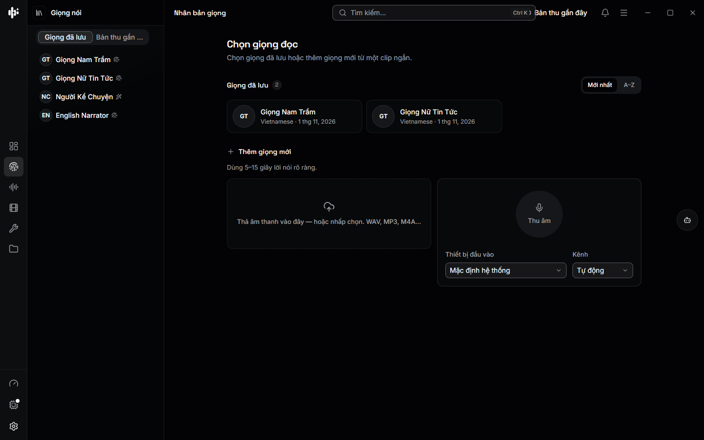
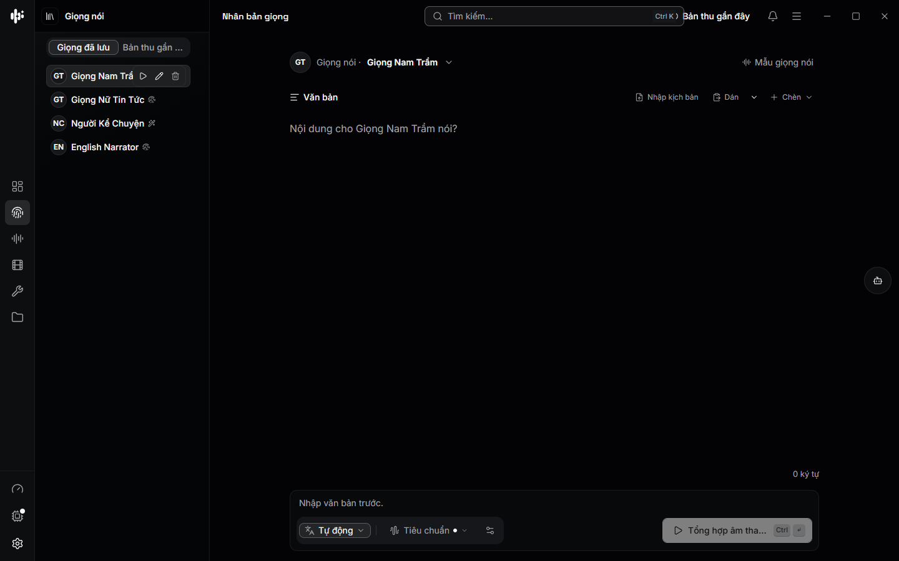

## Tính năng này làm gì

Trang **Nhân bản giọng** giúp bạn tạo ra bản thu mới mang âm sắc của một mẫu giọng có sẵn từ đoạn âm thanh dài 5–15 giây. Bạn có thể tải tệp âm thanh lên, thu âm trực tiếp hoặc chọn một hồ sơ trong **Giọng đã lưu** để đọc kịch bản mới. Mọi bước xử lý và tổng hợp đều diễn ra cục bộ ngay trên máy của bạn.

## Cần chuẩn bị

- Một engine tổng hợp tiếng nói hỗ trợ nhân bản đã sẵn sàng trên máy (thanh trạng thái góc dưới bên trái báo **Thiết bị cục bộ: Engine sẵn sàng**).
- Một đoạn âm thanh mẫu dài 5–15 giây với lời nói rõ ràng, không lẫn nhạc nền (định dạng WAV, MP3, M4A, FLAC, OGG, AAC hoặc WebM), hoặc micro hoạt động tốt nếu bạn thu âm trực tiếp.
- Sự đồng ý rõ ràng của chủ sở hữu giọng nói nếu bạn không dùng giọng của chính mình.

## Các bước

### 1. Mở trang Nhân bản giọng

Bấm vào mục **Giọng nói** ở thanh điều hướng bên trái để mở trang **Nhân bản giọng**. Tại khung **Chọn giọng đọc**, bạn sẽ thấy danh sách **Giọng đã lưu** cùng khu vực **Thêm giọng mới**.

### 2. Tải mẫu âm thanh lên

Kéo tệp âm thanh mẫu vào khung **Thả âm thanh vào đây — hoặc nhấp chọn. WAV, MP3, M4A…** hoặc bấm vào khung này để chọn tệp từ máy tính. Hãy ưu tiên đoạn thu dài 5–15 giây có giọng đọc rõ ràng.

### 3. Hoặc thu âm trực tiếp

Chọn micro trong ô **Thiết bị đầu vào** và chế độ trong ô **Kênh** nếu bạn muốn tự đọc mẫu. Bấm nút **Thu âm**, đọc một đoạn ngắn từ 5–15 giây rồi bấm **Dừng ghi**.

### 4. Kiểm tra bản chép lời mẫu và lưu thành giọng

Xem nội dung tại mục **Bản chép lời** sau khi có âm thanh tham chiếu; bạn có thể tự nhập lời của đoạn mẫu, bấm **Chép lời lại** hoặc để trống cho engine tự nghe. Nhập tên vào ô **Tên hồ sơ** rồi bấm **Lưu** trong mục **Lưu thành hồ sơ giọng** nếu bạn muốn giữ lại giọng này cho các lần sau.

### 5. Chọn giọng đã lưu

Bấm vào một hồ sơ trong danh sách **Giọng đã lưu** (chẳng hạn **Giọng Nam Trầm** hoặc **Giọng Nữ Tin Tức**) để chuyển sang khung soạn kịch bản. Nếu đang ở màn hình soạn thảo và muốn chuyển sang giọng khác, hãy bấm nút **Đổi giọng** ở phía trên khung **Văn bản**.

### 6. Nhập kịch bản, chọn ngôn ngữ và chất lượng rồi tổng hợp âm thanh

Nhập nội dung cần đọc vào khung **Văn bản**, bấm **Dán** để dán nhanh từ bộ nhớ tạm, hoặc bấm **Nhập kịch bản** và **Chèn token biểu cảm** khi cần. Chọn **Ngôn ngữ** (mặc định là **Tự động**), chọn mức chất lượng tại nút **Chất lượng âm thanh: Tiêu chuẩn**, mở **Điều chỉnh giọng nói** nếu muốn chỉnh **Tốc độ**, **Thời lượng (s)**, **Khử nhiễu** hoặc **Hậu xử lý**, sau đó bấm **Tổng hợp âm thanh**.

### 7. Nghe bản tạo và lưu kết quả

Nghe lại âm thanh vừa tạo tại khung **Bản thu mới nhất** hoặc bấm nút **Bản thu gần đây** ở thanh trên cùng để xem lại các lần tạo trước. Bấm **Lưu dưới dạng…** để xuất tệp âm thanh ra máy, hoặc bấm **Mẫu giọng nói** để mở bảng **Âm thanh tham chiếu** và chọn **Lưu thành hồ sơ giọng** nếu bạn đang dùng mẫu âm thanh lẻ chưa lưu.

### 8. Nguyên tắc sử dụng có trách nhiệm

Chỉ nhân bản giọng của chính bạn hoặc của người đã đồng ý rõ ràng cho phép bạn sử dụng giọng của họ. Không dùng tính năng này để mạo danh người khác hoặc tạo nội dung gây hiểu lầm.

## Mẹo

- Nhấn tổ hợp phím `Ctrl` + `Enter` (hoặc `⌘` + `Enter` trên macOS) sau khi nhập xong kịch bản để chạy **Tổng hợp âm thanh** ngay mà không cần rời bàn phím.
- Bật **Khử nhiễu** hoặc **Hậu xử lý** trong bảng **Điều chỉnh giọng nói** khi mẫu âm thanh tham chiếu có tạp âm nhỏ hoặc bạn muốn làm mượt âm thanh đầu ra.
- Bấm nút **Xem trước giọng nói** (biểu tượng phát) trên từng mục ở cột **Giọng đã lưu** bên trái để nghe thử giọng mẫu trước khi chọn.

## Lỗi thường gặp

- nút **Tổng hợp âm thanh** bị mờ và không bấm được: kiểm tra xem bạn đã chọn giọng hoặc tải **Âm thanh tham chiếu** lên chưa, đã nhập nội dung vào khung **Văn bản** chưa, và engine tổng hợp tiếng nói đã cài đặt sẵn sàng chưa.
- giọng tổng hợp nghe bị rè, ngắt quãng hoặc không giống mẫu: bấm **Mẫu giọng nói** để kiểm tra lại clip gốc, bật **Khử nhiễu** trong **Điều chỉnh giọng nói**, hoặc bấm **Đổi giọng** để thay bằng một đoạn thu sạch dài 5–15 giây không có nhạc nền.
- hệ thống đọc lệch chữ ở những từ đầu câu: mở **Mẫu giọng nói**, kiểm tra ô **Bản chép lời** và sửa lại cho khớp chính xác với những gì người nói đọc trong đoạn âm thanh mẫu, hoặc bấm **Chép lời lại**.

## Bài liên quan

- [Bắt đầu với eVoice Studio](../bat-dau/)
- [Quản lý giọng đã lưu](../giong-da-luu/)
- [Thiết kế giọng bằng mô tả](../thiet-ke-giong/)
- [Thư viện giọng](../thu-vien-giong/)
- [Công cụ: so sánh và chuyển giọng](../cong-cu/)
