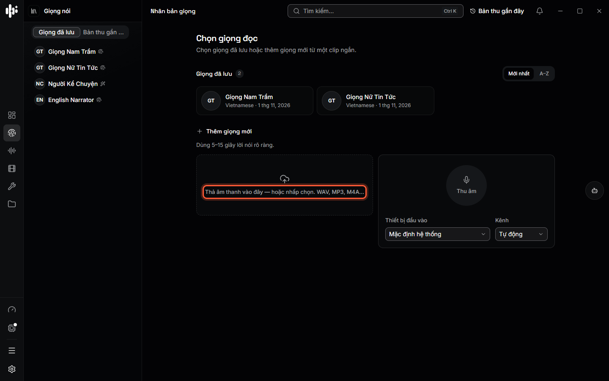
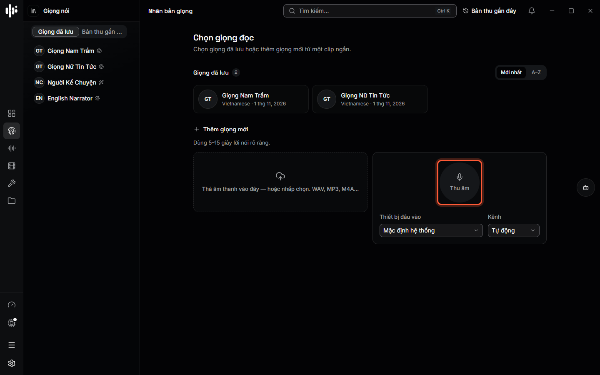
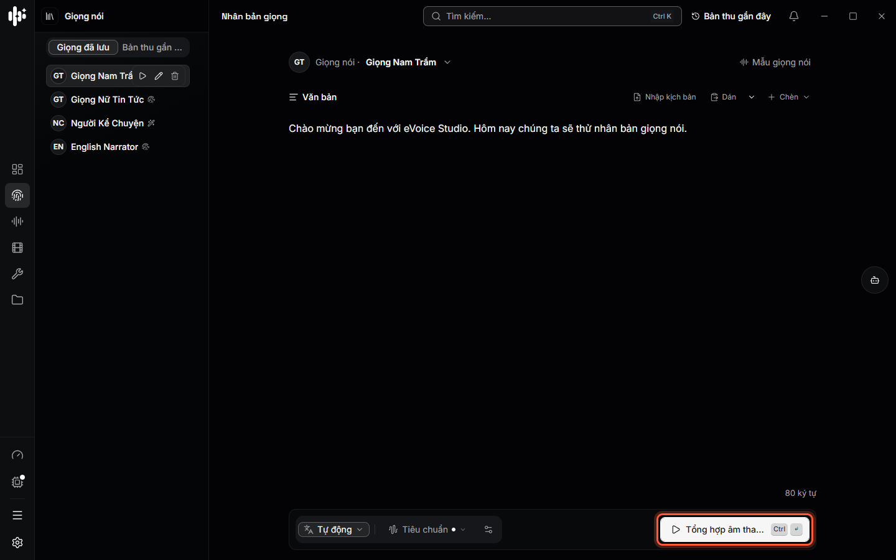

## Tính năng này làm gì

Trang **Nhân bản giọng** tạo lời đọc mới từ một đoạn âm thanh mẫu ngắn 5–15 giây hoặc từ hồ sơ trong **Giọng đã lưu**. Mọi bước chép lời mẫu và tổng hợp tiếng nói đều chạy cục bộ bằng engine trên máy của bạn. Bạn chỉ nên nhân bản giọng của chính mình hoặc của người đã đồng ý rõ ràng.

## Cần chuẩn bị

- Một engine tạo tiếng nói đã sẵn sàng trên máy (thanh trạng thái góc dưới bên trái báo **Thiết bị cục bộ: Engine sẵn sàng**).
- Đoạn âm thanh mẫu dài 5–15 giây, giọng đọc rõ ràng, không lẫn nhạc nền hay tạp âm (định dạng WAV, MP3, M4A, FLAC, OGG, AAC hoặc WebM), hoặc micro kết nối sẵn nếu muốn thu trực tiếp.
- Sự đồng ý rõ ràng của chủ giọng nói trước khi nhân bản và sử dụng.

## Các bước

### 1. Mở trang Nhân bản giọng

Bấm biểu tượng **Giọng nói** trên thanh điều hướng bên trái để mở trang **Nhân bản giọng**. Khi chưa chọn giọng, màn hình chính hiển thị phần **Chọn giọng đọc** gồm danh sách **Giọng đã lưu** và khu vực **Thêm giọng mới**.

### 2. Tải lên file âm thanh mẫu

Kéo file âm thanh mẫu (5–15 giây lời nói rõ ràng) thả vào khung **Thả âm thanh vào đây — hoặc nhấp chọn. WAV, MP3, M4A…**, hoặc bấm vào khung này để chọn file từ máy tính.

### 3. Hoặc thu âm trực tiếp và kiểm tra bản chép lời

Chọn micro ở mục **Thiết bị đầu vào** và chế độ ở mục **Kênh** nếu bạn muốn thu trực tiếp, sau đó bấm **Thu âm** để đọc mẫu 5–15 giây rồi bấm **Dừng ghi** khi hoàn tất.

Kiểm tra nội dung tại mục **Bản chép lời** sau khi thêm âm thanh mẫu. Bạn có thể tự nhập lời nói của đoạn mẫu, để trống cho engine tự nghe, hoặc bấm **Chép lời lại** khi cần nhận diện lại. Để dùng lại mẫu này cho các lần sau, nhập tên vào ô **Tên hồ sơ** trong phần **Lưu thành hồ sơ giọng** rồi bấm **Lưu**.

### 4. Chọn giọng đã lưu

Chọn một hồ sơ giọng có sẵn trong danh sách **Giọng đã lưu** ở cột trái hoặc trong mục **Chọn giọng đọc** (có thể lọc qua ô **Tìm kiếm…** hoặc sắp xếp theo **Mới nhất**, **A–Z**). Khi muốn đổi sang giọng khác hoặc kiểm tra lại âm thanh gốc, bấm **Đổi giọng** hoặc **Mẫu giọng nói** ở phía trên khung soạn thảo.

### 5. Nhập kịch bản, chọn ngôn ngữ và tổng hợp âm thanh

Nhập nội dung cần đọc vào khung **Văn bản**, hoặc dùng các nút **Nhập kịch bản**, **Dán** và **Chèn token biểu cảm** ở góc trên bên phải khung soạn thảo.

Chọn ngôn ngữ đọc ở menu **Ngôn ngữ** (mặc định là **Tự động**), chọn mức chất lượng tại nút **Chất lượng âm thanh: Tiêu chuẩn**, hoặc bấm **Điều chỉnh giọng nói** nếu cần chỉnh **Tốc độ**, **Thời lượng (s)**, **Khử nhiễu** và **Hậu xử lý**. Sau đó bấm **Tổng hợp âm thanh** (hoặc nhấn tổ hợp phím Ctrl + Enter) để bắt đầu tạo tiếng nói.

### 6. Nghe bản tạo và lưu kết quả

Bấm **Phát** trong khu vực **Bản thu mới nhất** để nghe thử kết quả ngay khi quá trình tổng hợp hoàn tất, rồi bấm **Lưu dưới dạng…** để xuất file âm thanh hoặc **Hiển thị trong thư mục** để mở vị trí lưu trên máy. Bạn có thể mở **Bản thu gần đây** ở thanh trên cùng để nghe lại các bản đã tạo, hoặc lưu mẫu âm thanh đang dùng vào **Giọng đã lưu** qua mục **Lưu thành hồ sơ giọng**.

## Mẹo

- Dùng đoạn mẫu 5–15 giây thu ở nơi yên tĩnh, một người nói, âm lượng đều và không có nhạc nền để giọng nhân bản rõ và giống mẫu nhất.
- Điền chính xác **Bản chép lời** khớp với từng từ trong đoạn mẫu giúp tránh hiện tượng nuốt chữ hoặc lặp từ ở đầu câu.
- Bấm nút **Xem trước giọng nói** (biểu tượng phát trên thẻ giọng trong **Giọng đã lưu**) để nghe lại mẫu gốc trước khi chọn giọng đọc kịch bản dài.
- Nếu kết quả có tạp âm từ mẫu gốc, bấm **Điều chỉnh giọng nói** ở thanh dưới và bật **Khử nhiễu** hoặc **Hậu xử lý**; bấm **Đặt lại về mặc định** khi muốn khôi phục thông số ban đầu.
- Chỉ nhân bản giọng của chính bạn hoặc của người đã cho phép sử dụng.

## Lỗi thường gặp

- nút **Tổng hợp âm thanh** bị mờ và không bấm được: kiểm tra thông báo phía trên thanh điều khiển xem bạn đã chọn giọng hoặc thêm **Âm thanh tham chiếu**, đã nhập nội dung vào ô **Văn bản**, và đã cài đặt engine TTS trong **Cài đặt** hay chưa.
- không chọn được file âm thanh mẫu khi tải lên: kiểm tra lại định dạng file, ứng dụng chỉ nhận các tệp WAV, MP3, M4A, FLAC, OGG, AAC hoặc WebM.
- thu âm trực tiếp không có tín hiệu tiếng nói: kiểm tra lại micro đang chọn ở mục **Thiết bị đầu vào**, đổi tùy chọn **Kênh** về **Tự động**, và đảm bảo hệ điều hành đã cấp quyền micro cho ứng dụng.
- giọng tạo ra phát âm sai từ đầu câu hoặc nhịp đọc không tự nhiên: bấm **Mẫu giọng nói** để mở bảng **Âm thanh tham chiếu**, kiểm tra và sửa lại nội dung trong ô **Bản chép lời** cho khớp với lời nói thực tế của mẫu.

## Bài liên quan

- [Bắt đầu với eVoice Studio](../bat-dau/)
- [Quản lý giọng đã lưu](../giong-da-luu/)
- [Thiết kế giọng bằng mô tả](../thiet-ke-giong/)
- [Thư viện giọng](../thu-vien-giong/)
- [Công cụ: so sánh và chuyển giọng](../cong-cu/)
- [Lồng tiếng video](../long-tieng-video/)
