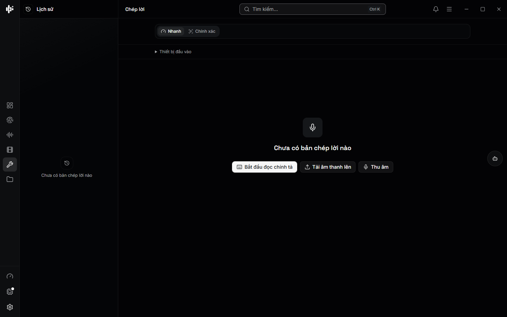

## Tính năng này làm gì

Trang **Chép lời** chuyển giọng nói từ file âm thanh hoặc từ micrô thành văn bản ngay trên máy của bạn mà không cần gửi dữ liệu lên mạng. Bạn có thể chọn chế độ xử lý nhanh hoặc kèm dấu thời gian chi tiết, quản lý danh sách kết quả trong bảng **Lịch sử**, và dùng tính năng **Đọc chính tả** để nhập văn bản trực tiếp vào ứng dụng khác bằng phím tắt toàn cục.

## Cần chuẩn bị

- Một model đọc chính tả hoặc ASR đã cài sẵn trên máy (chẳng hạn Whisper Tiny cho hơn 90 ngôn ngữ hoặc Parakeet TDT v3 cho 25 ngôn ngữ châu Âu). Nếu máy chưa có model, trang **Chép lời** sẽ hiển thị danh sách model kèm dung lượng để bạn bấm tải từ Hugging Face khi có kết nối mạng.
- Một file âm thanh (`.wav`, `.mp3`, `.m4a`, `.flac`, `.ogg`, `.webm`) hoặc micrô đang hoạt động và đã được hệ điều hành cấp quyền truy cập.

## Các bước

### 1. Chép lời một file âm thanh hoặc thu âm mới

1. Bấm **Thêm** trên thanh điều hướng bên trái để mở trang **Chép lời** (hoặc tìm qua ô **Tìm kiếm…** ở thanh trên cùng).
2. Chọn chế độ ở thanh công cụ phía trên:
   - Chọn **Nhanh** để dùng model đọc chính tả có độ trễ thấp.
   - Chọn **Chính xác** để dùng model ASR tạo bản chép lời kèm dấu thời gian chi tiết theo từng đoạn.
3. Bấm mở mục **Thiết bị đầu vào** nếu bạn muốn chọn micrô hoặc kênh thu (mono/stereo) trước khi thu.
4. Bấm **Tải âm thanh lên** rồi chọn file âm thanh trên máy để bắt đầu chép lời, hoặc bấm **Thu âm** để ghi âm một đoạn mới rồi dừng lại để ứng dụng xử lý. Khi đang xử lý, bạn có thể bấm **Hủy** nếu muốn dừng thao tác.

### 2. Xem và quản lý lịch sử phiên âm

1. Chọn một mục trong cột **Lịch sử** ở bên trái để xem toàn bộ nội dung văn bản, ngôn ngữ nhận diện và thời lượng. Khi có nhiều mục, nhập từ khóa vào ô **Tìm kiếm bản chép lời…** để lọc nhanh.
2. Bấm mở mục **Đoạn** bên dưới văn bản (khi chép lời ở chế độ **Chính xác**) để xem dấu thời gian của từng câu. Nếu bạn có bật làm sạch văn bản bằng model cục bộ, bấm mở **Bản chép lời gốc** để đối chiếu nội dung trước khi xử lý.
3. Bấm **Sao chép** để chép nội dung vào bảng nhớ tạm, bấm **Xuất** để lưu bản đang chọn thành file `.txt`, hoặc bấm **Xóa** để bỏ mục đó khỏi danh sách.
4. Bấm **Xuất** ở cuối cột **Lịch sử** nếu muốn lưu toàn bộ danh sách (tối đa 200 bản gần nhất), hoặc bấm **Xóa** rồi bấm **Xác nhận** để làm trống toàn bộ lịch sử.

### 3. Bật đọc chính tả trực tiếp

1. Bấm **Bắt đầu đọc chính tả** ở giữa trang (khi danh sách còn trống) hoặc bấm **Đọc chính tả** trên thanh công cụ để bắt đầu nói trực tiếp vào micrô.
2. Bấm **Tạm dừng** nếu cần ngắt quãng giữa chừng và bấm **Tiếp tục** để nói tiếp trong cùng phiên.
3. Bấm **Dừng** để kết thúc phiên nói và lưu văn bản vào cột **Lịch sử**, hoặc bấm **Hủy** (hoặc **Đóng** trên cửa sổ thu nổi) để hủy phiên đang thu.

### 4. Đặt phím tắt đọc chính tả toàn cục

1. Bấm **Cài đặt** ở góc dưới bên trái để mở phần thiết lập model và phím tắt cho **Đọc chính tả**.
2. Chọn kiểu kích hoạt phím tắt phù hợp với thói quen của bạn (nhấn giữ phím để nói và thả ra để dừng, hoặc bấm một lần để bắt đầu và bấm lần nữa để kết thúc), sau đó ghi tổ hợp phím mong muốn và bấm **Lưu**.
3. Đặt con trỏ chuột vào ô nhập văn bản của bất kỳ ứng dụng nào trên máy, nhấn phím tắt vừa đặt và bắt đầu nói. Khi hoàn tất, eVoice Studio sẽ tự động chèn văn bản vào cửa sổ đó (hoặc giữ sẵn trong bảng nhớ tạm để bạn dán nếu hệ điều hành hạn chế quyền điều khiển cửa sổ).

## Mẹo

- Kết hợp với nhân bản giọng: Từ một bản chép lời trong **Lịch sử**, bạn có thể chuyển thẳng nội dung và ngôn ngữ đã nhận diện sang trang nhân bản giọng để làm văn bản mẫu mà không cần gõ lại.
- Bật làm sạch văn bản tự động: Trong phần **Cài đặt** của model **Đọc chính tả**, bạn có thể bật các tùy chọn **Xóa từ đệm**, **Áp dụng tự sửa lời nói** và **Giữ thuật ngữ kỹ thuật**. Bản gốc vẫn luôn được giữ lại trong mục **Bản chép lời gốc**.
- Thu âm khi đang phát tiếng: Nếu bạn vừa phát âm thanh trong ứng dụng vừa đọc chính tả, hãy bật tùy chọn **Bật khử tiếng vọng khi đọc chính tả** để loại âm thanh phát ra khỏi micrô.
- Bảo vệ bảng nhớ tạm: Khi chèn văn bản sang ứng dụng khác, eVoice Studio tự động lưu và khôi phục nội dung bảng nhớ tạm trước đó của bạn để không làm mất dữ liệu bạn đã sao chép.

## Lỗi thường gặp

- Thông báo **Không thể bắt đầu đọc chính tả. Kiểm tra quyền truy cập micrô rồi thử lại.**: Hệ điều hành đang chặn quyền dùng micrô hoặc không tìm thấy thiết bị thu. Hãy cấp quyền micrô cho ứng dụng trong phần cài đặt hệ điều hành và kiểm tra lại mục **Thiết bị đầu vào**.
- Thông báo **Chép lời thất bại**: Quá trình nhận diện gặp sự cố hoặc model chưa sẵn sàng. Bấm **Chi tiết** để xem nguyên nhân cụ thể và bấm **Thử lại** để chạy lại trên file đã chọn, hoặc kiểm tra lại model trong **Cài đặt**.
- Thông báo **Làm sạch văn bản quá thời gian. Đã giữ nguyên bản chép lời gốc.** hoặc **Làm sạch văn bản thất bại. Đã giữ nguyên bản chép lời gốc.**: Bước tinh chỉnh văn bản không hoàn tất kịp, nhưng văn bản nhận diện thô vẫn được lưu đầy đủ để bạn sử dụng.
- Văn bản đọc chính tả không tự dán vào ứng dụng đích: Trên macOS khi chưa cấp quyền Trợ năng (Accessibility), trên Windows khi cửa sổ đích từ chối kích hoạt, hoặc trên môi trường Linux Wayland mặc định, ứng dụng sẽ giữ toàn bộ văn bản trong bảng nhớ tạm để bạn dán thủ công bằng `Ctrl+V` hoặc `Command+V`.

## Bài liên quan

- [Bắt đầu với eVoice Studio](../bat-dau/)
- [Nhân bản giọng](../nhan-ban-giong/)
- [Lồng tiếng video](../long-tieng-video/)
- [Cài đặt](../cai-dat/)
- [Khắc phục sự cố](../khac-phuc-su-co/)
