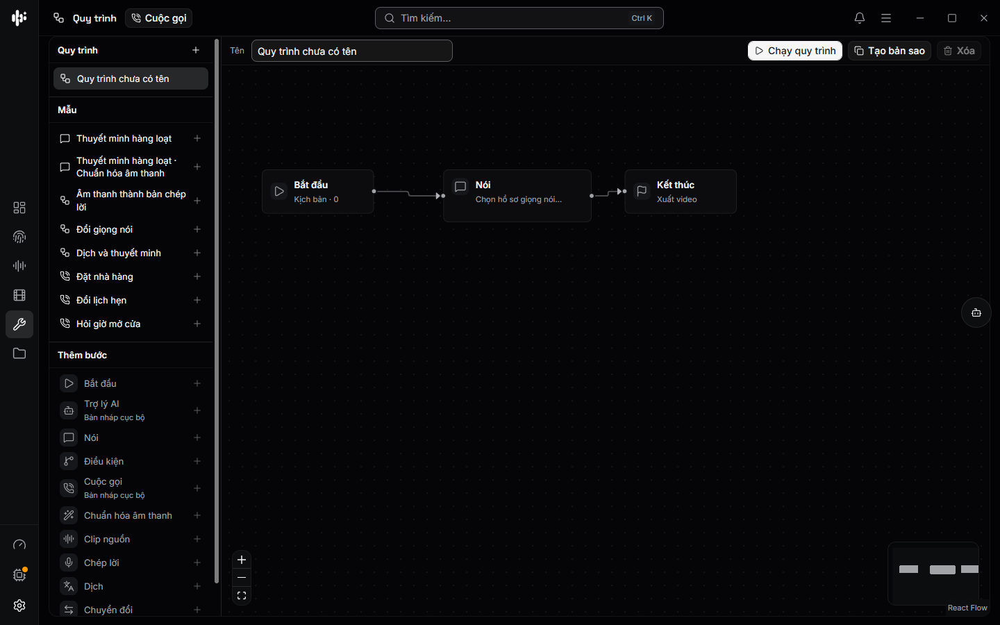

## Tính năng này làm gì

Trang **Quy trình** giúp bạn ghép các bước xử lý văn bản và âm thanh trên một khung vẽ trực quan để chạy tự động qua danh sách nhiều mục đầu vào ngay trên máy. Bạn có thể nối các bước từ kịch bản hoặc tệp âm thanh qua chép lời, dịch, đọc văn bản, chuyển đổi giọng, rẽ nhánh theo điều kiện và chuẩn hóa âm lượng mà không cần thao tác lặp lại từng mục. Toàn bộ bản nháp, tiến trình chạy và kết quả đều lưu cục bộ để bạn dừng hoặc chạy tiếp bất cứ lúc nào.

## Cần chuẩn bị

- Thiết bị ở trạng thái **Thiết bị cục bộ: Engine sẵn sàng** ở thanh bên trái.
- Ít nhất một giọng đã lưu nếu quy trình có bước **Nói** hoặc **Chuyển đổi**.
- Nội dung đầu vào: danh sách kịch bản văn bản (tối đa 50 mục mỗi lần chạy, mỗi kịch bản tối đa 20.000 ký tự, phân cách nhau bằng dòng `---` hoặc nhập từ tệp) hoặc các tệp âm thanh (tối đa 50 clip, mỗi tệp tối đa 64 MiB).

## Các bước

### 1. Tạo quy trình mới hoặc chọn mẫu có sẵn

- Bấm biểu tượng công cụ ở thanh điều hướng bên trái (mục **Thêm**) để mở trang **Quy trình**.
- Bấm nút **Quy trình mới** (biểu tượng dấu cộng ở góc phải mục **Quy trình**) để tạo bản nháp trống, hoặc chọn một mẫu dựng sẵn trong mục **Mẫu** như **Thuyết minh hàng loạt**, **Thuyết minh hàng loạt · Chuẩn hóa âm thanh**, **Âm thanh thành bản chép lời**, **Đổi giọng nói** hay **Dịch và thuyết minh**.
- Nhập tên dễ nhớ vào ô **Tên** ở thanh công cụ phía trên khung vẽ để thay cho tên mặc định **Quy trình chưa có tên**.

### 2. Thêm và nối các bước trên khung vẽ

- Bấm vào bước cần dùng trong mục **Thêm bước** ở cột trái để đưa lên khung vẽ:
  - Bước đầu vào: **Bắt đầu** (nhận danh sách kịch bản văn bản) hoặc **Clip nguồn** (nhận danh sách tệp âm thanh).
  - Bước xử lý: **Nói**, **Chép lời**, **Dịch**, **Chuyển đổi**, **Chuẩn hóa âm thanh** và **Điều kiện**.
  - Bước đích: **Kết thúc** để xuất kết quả đầu ra.
- Kéo các khối trên khung vẽ để sắp xếp vị trí, hoặc chọn một bước rồi dùng các phím mũi tên trên bàn phím để di chuyển.
- Kéo từ chấm tròn bên phải của bước trước sang chấm tròn bên trái của bước tiếp theo để nối đường dẫn dữ liệu. Các bước phải khớp kiểu dữ liệu: văn bản đi vào **Dịch**, **Nói** hoặc **Điều kiện**; âm thanh đi vào **Chép lời** hoặc **Chuyển đổi**; giọng đọc tạo ra đi vào **Chuẩn hóa âm thanh**.
- Chọn từng bước trên khung vẽ để mở bảng **Chi tiết bước** ở bên phải, đặt **Tên bước** và cấu hình thông số riêng. Với bước **Điều kiện**, nhập cụm từ vào **Văn bản cần tìm**, chọn kiểu **Khớp** (**Chứa**, **Đúng bằng**, **Bắt đầu bằng** hoặc **Kết thúc bằng**), rồi nối đủ cả hai nhánh **Có** (cổng trên) và **Không** (cổng dưới).
- Bấm **Xóa bước** trong bảng **Chi tiết bước** hoặc nhấn phím `Delete` / `Backspace` khi đang chọn một bước hay đường nối để gỡ khỏi khung vẽ.

### 3. Chạy quy trình

- Bấm **Chạy quy trình** ở góc trên bên phải khung vẽ để mở bảng chạy và kiểm tra tính hợp lệ của toàn bộ sơ đồ.
- Chọn hoặc kiểm tra danh sách mục đầu vào từ bước **Bắt đầu** hoặc **Clip nguồn**, sau đó xác nhận bắt đầu chạy.
- Theo dõi từng mục được xử lý tuần tự qua các bước trên sơ đồ. Nếu muốn tạm nghỉ, bấm **Dừng**; các bước đã hoàn thành đều được lưu dấu mốc để lần chạy tiếp theo tiếp tục ngay từ bước dở dang mà không phải tạo lại từ đầu.

### 4. Xem và lưu kết quả

- Bấm **Phát** trên từng mục đã hoàn thành để nghe thử kết quả âm thanh hoặc xem nội dung văn bản đầu ra ngay trong bảng chạy.
- Bấm **Lưu** trên mục bạn muốn xuất để mở hộp thoại lưu tệp của hệ điều hành (kết quả văn bản lưu thành tệp `.txt`, âm thanh lưu thành tệp `.wav`). Ứng dụng không tự động tải tệp xuống khi bạn chưa bấm **Lưu**.

## Mẹo

- Bấm **Tạo bản sao** trên thanh công cụ khi muốn thử nghiệm thay đổi giọng đọc, nhánh **Điều kiện** hoặc mức **Chuẩn hóa âm thanh** mà vẫn giữ nguyên quy trình gốc cùng kết quả đã chạy.
- Dùng các nút **Zoom In**, **Zoom Out** và **Fit View** ở góc dưới bên trái khung vẽ để bao quát toàn bộ sơ đồ khi quy trình có nhiều nhánh.
- Hai nhánh xuất phát từ bước **Điều kiện** có thể gộp lại vào một bước chung phía sau, miễn là cả hai nhánh đều trả về cùng một kiểu dữ liệu (cùng là văn bản hoặc cùng là âm thanh). Nếu nối trực tiếp một nhánh từ **Điều kiện** tới **Kết thúc**, văn bản đầu vào sẽ được giữ nguyên để xuất ra tệp `.txt`.
- Nhóm mẫu **Đặt nhà hàng**, **Đổi lịch hẹn**, **Hỏi giờ mở cửa** và hai bước **Trợ lý AI**, **Cuộc gọi** có nhãn **Bản nháp cục bộ** dùng để phác thảo kịch bản cuộc gọi; khi chọn bước **Cuộc gọi**, bạn có thể bấm **Chuẩn bị cuộc gọi** hoặc nút **Cuộc gọi** trên thanh tiêu đề để chuyển thông tin sang màn hình cuộc gọi.

## Lỗi thường gặp

- không chạy được quy trình khi trên khung vẽ có bước **Trợ lý AI** hoặc **Cuộc gọi**: hai bước này chỉ là **Bản nháp cục bộ** để thiết kế kịch bản, không thực thi trong luồng xử lý hàng loạt. Hãy chọn bước đó và bấm **Xóa bước** trước khi bấm **Chạy quy trình**.
- báo lỗi không khớp kiểu dữ liệu hoặc thiếu kết nối trước khi chạy: kiểm tra lại thứ tự nối giữa các bước (ví dụ: không nối đầu ra âm thanh vào bước **Điều kiện** hoặc **Dịch**, chỉ nối bước **Chuẩn hóa âm thanh** ngay sau bước tạo giọng đọc) và đảm bảo cả hai cổng **Có** lẫn **Không** của bước **Điều kiện** đều đã được nối tới bước đích.
- một mục bị lỗi làm quy trình dừng lại giữa chừng: quy trình không tự bỏ qua mục lỗi để tránh mất dấu dữ liệu. Hãy xem thông báo lỗi tại mục đó, chỉnh lại đầu vào hoặc kiểm tra model rồi bấm **Thử lại** để chạy tiếp từ dấu mốc đã lưu.
- kết quả đã chạy bị đặt lại khi chỉnh sửa quy trình: việc đổi giọng đọc, ngôn ngữ, tốc độ, mức chuẩn hóa, cụm từ trong **Điều kiện** hoặc đường nối sẽ làm mới tiến trình chạy. Nếu chỉ đổi **Tên**, **Tên bước** hoặc kéo vị trí các khối trên khung vẽ thì kết quả đã hoàn thành vẫn được giữ nguyên.
- nút **Xóa** quy trình bị mờ không bấm được: ứng dụng luôn giữ lại ít nhất một quy trình trong danh sách. Hãy bấm **Quy trình mới** trước nếu bạn muốn xóa quy trình hiện tại.

## Bài liên quan

- [Bắt đầu với eVoice Studio](../bat-dau/)
- [Quản lý giọng đã lưu](../giong-da-luu/)
- [Phiên âm và đọc chính tả](../phien-am/)
- [Công cụ: so sánh và chuyển giọng](../cong-cu/)
- [Lồng tiếng hàng loạt](../long-tieng-hang-loat/)
- [Khắc phục sự cố](../khac-phuc-su-co/)
