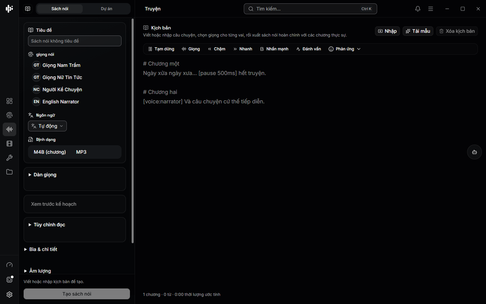

## Tính năng này làm gì

Trang **Sách nói** biến bản thảo dài hoặc file sách điện tử thành sách nói hoàn chỉnh có chia chương rõ ràng. Bạn có thể chèn thẻ đánh dấu nhịp nghỉ, gán nhiều giọng đọc cho từng vai, nghe thử từng chương và xuất ra file âm thanh hoặc video ngắn ngay trên máy. Toàn bộ quá trình tổng hợp giọng chạy cục bộ trên GPU hoặc CPU mà không cần kết nối mạng.

## Cần chuẩn bị

- Ít nhất một giọng đọc trong mục [Quản lý giọng đã lưu](../giong-da-luu/) hoặc vừa tạo tại trang [Nhân bản giọng](../nhan-ban-giong/).
- Engine giọng nói ở trạng thái **Thiết bị cục bộ: Engine sẵn sàng** (kiểm tra trong trang [Cài đặt](../cai-dat/) nếu chưa tải model).
- Nội dung văn bản hoặc file sách định dạng `.txt`, `.md`, `.epub` hoặc `.pdf`.

## Các bước

### 1. Mở trang và nhập sách

Bấm vào mục **Truyện** trên thanh điều hướng bên trái rồi chọn **Sách nói** ở góc trên (hoặc tìm trong ô **Tìm kiếm…**).

Nhập tên sách vào ô **Tiêu đề** ở cột bên trái (mặc định là **Sách nói không tiêu đề**). Tại khung **Kịch bản** bên phải, bấm nút **Nhập** để tải file `.txt`, `.md`, `.epub` hoặc `.pdf` từ máy tính, hoặc gõ trực tiếp nội dung vào khung soạn thảo. Nếu muốn thử nhanh, bấm **Tải mẫu** để điền kịch bản mẫu; khi cần làm trống toàn bộ nội dung, bấm **Xóa kịch bản**.

### 2. Đánh dấu chương và nhịp đọc

Nhập ký hiệu `# Tên chương` ở đầu dòng (ví dụ `# Chương một`) để tách chương mới. Khi bạn nhập file `.epub` hoặc bản thảo đã có tiêu đề Markdown cấp 1, ứng dụng tự giữ nguyên cấu trúc chương.

Bấm các nút trên thanh công cụ phía trên khung **Kịch bản** để chèn thẻ điều khiển vào vị trí con trỏ:

- **Tạm dừng**: chèn khoảng nghỉ (ví dụ `[pause 500ms]`).
- **Giọng**: chèn thẻ đổi người đọc theo dạng `[voice:NAME]`.
- **Chậm** hoặc **Nhanh**: điều chỉnh tốc độ đọc cho đoạn văn bản.
- **Nhấn mạnh**, **Đánh vần**, **Phản ứng**: thêm sắc thái nhấn giọng, đọc từng chữ cái hoặc biểu cảm.

### 3. Cài đặt giọng đọc và thông tin sách

Chọn một giọng mặc định trong danh sách **giọng nói** ở cột bên trái. Chọn ngôn ngữ đầu ra tại mục **Ngôn ngữ** (mặc định là **Tự động**) và chọn kiểu file tại mục **Định dạng** gồm **M4B (chương)** hoặc **MP3**.

Bấm mở các thẻ thu gọn bên dưới để thiết lập chi tiết hơn:

- **Dàn giọng**: gán giọng đọc đã lưu cho từng thẻ `[voice:NAME]` xuất hiện trong kịch bản.
- **Tùy chỉnh đọc**: chỉnh **Số bước**, **CFG**, **Nhiệt độ vị trí**, bật **Đọc khác nhau cho dòng lặp**, chỉnh **Khoảng nghỉ giữa các dòng**, **Khoảng nghỉ giữa các đoạn**, hoặc bật **Cắt khoảng lặng của engine**. Nếu dùng engine IndexTTS2, bạn có thể nhập thêm **Mô tả cảm xúc** và **Mức độ cảm xúc**.
- **Bìa & chi tiết**: bấm **Thêm bìa** để tải ảnh bìa (JPEG/PNG), điền **Tác giả**, **Người kể chuyện**, **Năm**, **Thể loại**, **Mô tả**, và thiết lập bảng **Phát âm** (**Thêm từ**, điền ô **Từ** và **Đọc là…** cho các từ viết tắt hoặc tên riêng).
- **Âm lượng**: giữ **Âm lượng: tắt** hoặc chọn chuẩn hóa âm lượng **Chuẩn hóa (ACX)** hay **Chuẩn hóa (podcast)**.

### 4. Xem trước và tạo sách nói

Bấm mở mục **Xem trước kế hoạch** để kiểm tra danh sách chương được tách từ kịch bản và nghe thử từng chương trước khi xuất toàn bộ. Khi mọi thiết lập hợp lệ (hiện thông báo **✅ Mọi thứ đều ổn — không phát hiện vấn đề**), bấm nút **Tạo sách nói** ở góc dưới bên trái.

Trong lúc máy đang tổng hợp và hiện trạng thái **Đang ghép sách nói…**, bạn có thể bấm **Dừng** bất cứ lúc nào. Các chương đã hoàn thành được giữ lại trong bộ nhớ đệm; lần sau bạn chỉ cần bấm **Tiếp tục** trong mục **Sách nói bị gián đoạn** để ghép nốt những chương còn lại.

### 5. Nghe với chữ chạy theo audio

Chọn khu vực **Sách nói đã sẵn sàng** hiện ra ở cuối trang sau khi quá trình tạo hoàn tất. Bấm **Phát** trên trình phát để nghe toàn bộ sách nói, chuyển nhanh giữa các chương và bật chế độ **Đọc theo** để chữ trong kịch bản tự động cuộn và tô sáng khớp với giọng đọc đang phát.

### 6. Xuất file âm thanh và video ngắn

Bấm **Tải xuống** ở góc phải mục **Sách nói đã sẵn sàng** để lưu file `.m4b` hoặc `.mp3` về máy. Nếu bạn dùng định dạng **MP3** hoặc cần mốc thời gian đăng kèm mô tả podcast, bấm **Tải danh sách chương (.txt)** để lưu bảng mốc giờ từng chương.

Nếu muốn trích một đoạn ngắn đăng mạng xã hội, mở khung **Clip audiogram** ngay bên dưới trình phát: nhập thời điểm **Bắt đầu (m:ss)**, **Độ dài (giây)**, chọn **Khổ** khung hình (**Vuông**, **Ngang** hoặc **Dọc**), điền **Tiêu đề trên video** rồi bấm **Tạo video**.

## Mẹo

- Chọn định dạng **M4B (chương)** khi nghe trên các ứng dụng sách nói chuyên dụng để giữ nguyên danh mục chương và ảnh bìa bên trong một file duy nhất.
- Chuyển sang thẻ **Dự án** ở đầu cột bên trái rồi bấm **Lưu** để cất giữ toàn bộ kịch bản, dàn giọng và thiết lập cho những cuốn sách làm dở.
- Khai báo trước tên nhân vật nước ngoài hoặc thuật ngữ chuyên ngành trong phần **Phát âm** để giọng đọc thống nhất xuyên suốt các chương mà không phải sửa lại văn bản gốc.
- Khi nghe thử trong **Xem trước kế hoạch**, các chương đã nghe thử sẽ được lưu vào bộ nhớ đệm và tái sử dụng ngay khi bạn bấm **Tạo sách nói**, giúp tiết kiệm thời gian chờ.

## Lỗi thường gặp

- Nút **Tạo sách nói** bị khóa kèm thông báo **Viết hoặc nhập kịch bản để tạo.** hoặc **Chọn giọng mặc định hoặc gán giọng cho từng dòng.**: kiểm tra lại xem khung **Kịch bản** đã có nội dung chưa và bạn đã bấm chọn một hồ sơ trong mục **giọng nói** chưa.
- Thông báo **Một từ phát âm bị liệt kê hai lần. Xóa mục trùng để tạo.**: mở thẻ **Bìa & chi tiết**, tìm đến mục **Phát âm** và bấm **Xóa** ở dòng từ vựng bị lặp.
- Thông báo **Engine giọng nói chưa sẵn sàng. Kiểm tra Cài đặt → Engine.**: mở trang [Cài đặt](../cai-dat/) để kiểm tra trạng thái model hoặc bấm **Tốc độ / chất lượng** trên thanh trạng thái dưới cùng để chọn engine đã cài đặt.
- Thông báo **Đang tạo một sách nói khác. Chờ hoàn tất hoặc dừng lại trước.**: chờ tiến trình đang chạy ở trang **Truyện** hoặc **Sách nói** kết thúc, hoặc bấm **Dừng** trước khi tạo bản mới.

## Bài liên quan

- [Truyện nhiều giọng](../truyen/)
- [Nhân bản giọng](../nhan-ban-giong/)
- [Quản lý giọng đã lưu](../giong-da-luu/)
- [Thiết kế giọng bằng mô tả](../thiet-ke-giong/)
- [Dự án](../du-an/)
- [Khắc phục sự cố](../khac-phuc-su-co/)
