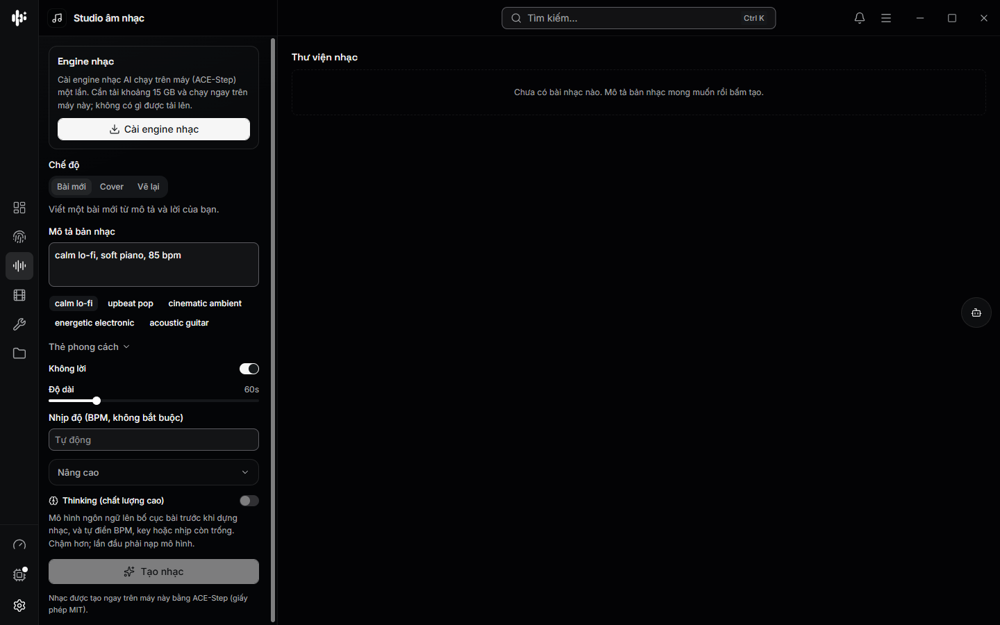

## Tính năng này làm gì

**Studio âm nhạc** giúp bạn sáng tác nhạc có lời hoặc nhạc không lời ngay trên máy tính bằng engine ACE-Step. Ngoài việc tạo bài mới từ mô tả và lời hát, bạn còn có thể tạo bản cover, vẽ lại một đoạn, kéo dài thời lượng hoặc tách và thêm nhạc cụ cho bản nhạc sẵn có. Toàn bộ quá trình xử lý diễn ra cục bộ trên máy và lưu trực tiếp vào thư viện cá nhân.

## Cần chuẩn bị

- Dung lượng ổ cứng trống tối thiểu khoảng 15 GB để cài đặt engine ACE-Step và model mặc định trong lần đầu sử dụng (cần thêm khoảng 1,4 GB đến 4,8 GB nếu tải thêm model ngôn ngữ hoặc các model mở rộng).
- Kết nối mạng trong lần đầu tiên bấm tải engine hoặc khi tải thêm model phụ trợ; sau khi tải xong, tính năng chạy hoàn toàn ngoại tuyến.
- GPU có trên 6 GB bộ nhớ nếu bạn muốn bật chế độ **Thinking (chất lượng cao)**.
- File âm thanh định dạng WAV, MP3, FLAC, OGG hoặc M4A (tối đa 100 MB và 10 phút) nếu bạn muốn tải nhạc từ ngoài vào để làm **Bài gốc** hoặc **Âm thanh tham chiếu**.

## Các bước

### 1. Mở Studio âm nhạc và cài engine ACE-Step

1. Chọn **Truyện** ở thanh điều hướng bên trái hoặc mở từ tìm kiếm nhanh để vào **Studio âm nhạc**.
2. Bấm **Cài engine nhạc** trong khung **Engine nhạc** nếu bạn mở tính năng này lần đầu tiên.
3. Chờ ứng dụng tải mã nguồn, môi trường Python và model về máy (tổng dung lượng khoảng 15 GB). Nếu kết nối mạng bị ngắt giữa chừng, các phần đã tải vẫn được giữ lại để bạn bấm cài tiếp mà không phải tải lại từ đầu.

### 2. Chọn chế độ và viết mô tả, lời bài hát

1. Chọn **Bài mới** tại mục **Chế độ** để sáng tác từ đầu. Ngoài ra, bạn có thể chọn **Cover**, **Vẽ lại**, **Kéo dài**, hoặc các chế độ xử lý nhạc cụ gồm **Tách**, **Thêm lớp**, **Hoàn thiện** (ba chế độ cuối cần chọn model Base trong phần **Nâng cao**).
2. Nhập phong cách, nhạc cụ và nhịp điệu mong muốn vào ô **Mô tả bản nhạc**, hoặc bấm chọn nhanh các mẫu gợi ý như **calm lo-fi**, **upbeat pop**, **cinematic ambient**, **energetic electronic**, **acoustic guitar**.
3. Bấm **Thẻ phong cách** nếu muốn mở danh sách từ khóa gợi ý theo **Thể loại**, **Nhạc cụ** và **Cảm xúc** để ghép thêm vào ô mô tả.
4. Giữ công tắc **Không lời** bật nếu bạn chỉ muốn tạo nhạc nền. Nếu muốn tạo bài có giọng hát, hãy tắt **Không lời**, nhập nội dung vào ô **Lời bài hát** (có thể bấm các thẻ cấu trúc như `[verse]`, `[chorus]` để định hình bố cục đoạn hát) và chọn **Ngôn ngữ giọng hát** phù hợp.
5. Kéo thanh trượt **Độ dài** để chọn thời lượng bản nhạc (từ 10 đến 240 giây) và nhập **Nhịp độ (BPM, không bắt buộc)** hoặc để trống cho máy tự chọn **Tự động**.

### 3. Tinh chỉnh nâng cao và tạo nhạc

1. Mở mục **Nâng cao** nếu bạn muốn đổi **Mô hình** (mặc định là Turbo 8 bước, hoặc tải thêm SFT và Base), chọn **Giọng (key)**, **Nhịp**, nhập **Seed ngẫu nhiên mới**, chọn **Số bản** muốn tạo cùng lúc (từ 1 đến 4 bản), chỉnh **Số bước**, **Cách lấy mẫu** (**Ổn định (ODE)** hoặc **Biến hoá (SDE)**), chọn **Định dạng file** (WAV, FLAC, MP3), chọn **Âm thanh tham chiếu** hoặc gắn thêm file LoRA.
2. Bật **Thinking (chất lượng cao)** nếu máy có GPU trên 6 GB bộ nhớ để mô hình ngôn ngữ lên bố cục bài trước khi dựng nhạc và tự điền BPM, giọng hoặc nhịp còn để trống. Khi mô hình ngôn ngữ đã sẵn sàng, bạn cũng có thể bấm **Trau chuốt bằng mô hình ngôn ngữ** rồi bấm **Áp dụng** để nhận gợi ý chỉnh sửa mô tả và thông số.
3. Bấm **Tạo nhạc** và chờ quá trình xử lý hoàn tất. Ở bài đầu tiên, hệ thống có thể mất vài phút để nạp model vào bộ nhớ.

### 4. Nghe thử, chỉnh sửa tiếp và tải về

1. Bấm vào bản nhạc vừa xuất hiện trong danh sách **Thư viện nhạc** ở khung bên phải để phát và xem dạng sóng âm thanh.
2. Sử dụng các nút thao tác nhanh trên bản nhạc đang chọn gồm **Dùng lại thiết lập** để đưa toàn bộ thông số của bài đó quay lại biểu mẫu, hoặc chọn **Cover**, **Vẽ lại**, **Kéo dài** để lấy bài nhạc này làm **Bài gốc** cho lần biến tấu tiếp theo.
3. Bấm nút **Tải bài nhạc** (biểu tượng tải xuống) cạnh tên bài trong danh sách **Thư viện nhạc** để lưu file âm thanh về máy, hoặc bấm **Xóa bài nhạc** (biểu tượng thùng rác) nếu không muốn giữ lại.

## Mẹo

- Kết hợp từ khóa bằng tiếng Anh từ mục **Thẻ phong cách** vào ô **Mô tả bản nhạc** giúp model ACE-Step nhận diện thể loại, nhạc cụ và sắc thái âm nhạc chính xác hơn.
- Khi viết **Lời bài hát**, hãy đặt các nhãn phân đoạn như `[intro]`, `[verse]`, `[chorus]`, `[bridge]`, `[outro]` trên từng dòng riêng biệt để định hướng rõ cấu trúc bài hát.
- Trong mục **Nâng cao**, chọn **Số bản** từ 2 đến 4 khi bạn muốn thử nhiều biến thể cùng lúc cho một ý tưởng; ứng dụng sẽ lưu mỗi biến thể thành một bài riêng trong **Thư viện nhạc** để bạn so sánh.
- Sau khi tạo nhạc xong, nếu chưa cần tạo bài tiếp theo và muốn dành VRAM cho việc lồng tiếng hoặc phiên âm, hãy bấm **Giải phóng bộ nhớ GPU** ở cuối cột điều khiển bên trái (nếu không bấm, engine nhạc cũng sẽ tự dừng sau 5 phút nghỉ).

## Lỗi thường gặp

- các nút chế độ **Tách**, **Thêm lớp** và **Hoàn thiện** bị mờ không bấm được: các chế độ xử lý từng lớp nhạc cụ này chỉ hoạt động trên model Base. Bạn hãy mở mục **Nâng cao**, chọn Base tại phần **Mô hình** và tải model này về máy trước khi sử dụng.
- công tắc **Thinking (chất lượng cao)** không bật được và báo cần GPU có hơn 6 GB bộ nhớ: tính năng này yêu cầu GPU rời có trên 6 GB VRAM. Với GPU từ 6 GB đến 12 GB, bạn cần bấm tải thêm mô hình ngôn ngữ 0.6B (khoảng 1,4 GB) ngay bên dưới công tắc trước khi bật.
- báo lỗi GPU đang bận khi bấm **Tạo nhạc**: engine nhạc ACE-Step không dùng chung GPU cùng lúc với các tác vụ lồng tiếng, phiên âm hoặc xóa phụ đề cứng. Bạn hãy chờ tác vụ đang chạy hoàn tất rồi bấm **Tạo nhạc** lại.
- giọng hát phát âm sai hoặc không rõ lời: kiểm tra lại mục **Ngôn ngữ giọng hát** dưới ô **Lời bài hát** và chọn đúng ngôn ngữ bạn đã dùng để viết lời.
- quá trình cài đặt **Engine nhạc** bị dừng giữa chừng do mạng chậm: ứng dụng tự động giữ lại các file đã tải trên ổ cứng, bạn chỉ cần kiểm tra lại kết nối mạng và bấm **Cài engine nhạc** để tiếp tục từ phần đang dở.

## Bài liên quan

- [Lồng tiếng video](../long-tieng-video/)
- [Truyện nhiều giọng](../truyen/)
- [Sách nói](../sach-noi/)
- [Video quảng cáo (Promo)](../video-quang-cao/)
- [Trình dựng video](../trinh-dung-video/)
- [Khắc phục sự cố](../khac-phuc-su-co/)
