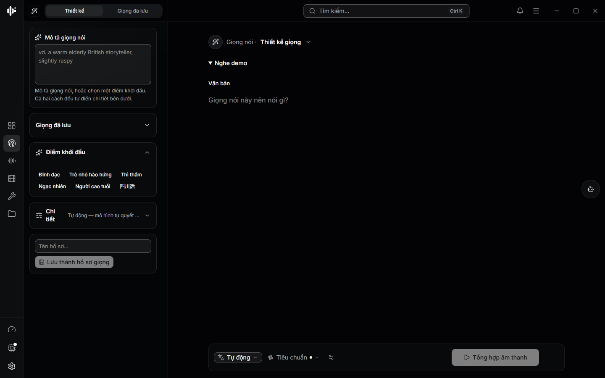

## Tính năng này làm gì

Trang **Thiết kế** giúp bạn tạo ra giọng nói hoàn toàn mới chỉ từ mô tả bằng chữ hoặc các gợi ý có sẵn mà không cần chuẩn bị file thu âm mẫu. Model chạy cục bộ trên máy sẽ tự động nhận diện đặc điểm như giới tính, độ tuổi, cao độ, âm điệu và đọc thử văn bản của bạn. Khi ưng ý, bạn có thể lưu thiết kế đó thành hồ sơ giọng để tái sử dụng ở các tính năng khác.

## Cần chuẩn bị

- Một engine hỗ trợ thiết kế giọng đã cài đặt và hiển thị trạng thái **Thiết bị cục bộ: Engine sẵn sàng** (ví dụ: OmniVoice, Qwen3-TTS VoiceDesign, VoxCPM2 hoặc audio.cpp).
- Kịch bản văn bản ngắn gọn để nghe thử và đánh giá chất giọng trước khi lưu.

## Các bước

### 1. Viết mô tả giọng hoặc chọn tính cách có sẵn

1. Bấm **Giọng nói** ở thanh điều hướng bên trái, sau đó chọn thẻ **Thiết kế** ở thanh trên cùng.
2. Nhập đặc điểm giọng bạn muốn vào ô **Mô tả giọng nói** (hỗ trợ viết bằng tiếng Anh, tiếng Trung hoặc kết hợp cả hai, ngăn cách bằng dấu phẩy).
3. Chọn một gợi ý trong mục **Điểm khởi đầu** như **Đĩnh đạc**, **Trẻ nhỏ hào hứng**, **Thì thầm**, **Ngạc nhiên**, **Người cao tuổi** hoặc **四川话** nếu bạn muốn bắt đầu nhanh từ mẫu có sẵn.

### 2. Tạo bản nghe thử

1. Nhập nội dung cần đọc vào ô **Văn bản**, hoặc mở mục **Nghe demo** để điền nhanh câu mẫu kèm thiết lập tương ứng.
2. Chọn ngôn ngữ đọc tại menu **Ngôn ngữ** (mặc định là **Tự động**).
3. Bấm **Chất lượng âm thanh: Tiêu chuẩn** hoặc **Điều chỉnh giọng nói** ở thanh công cụ phía dưới nếu cần chỉnh thêm thông số đầu ra.
4. Bấm **Tổng hợp âm thanh** để model tạo bản thu thử và phát kết quả ngay trên màn hình.

### 3. Chỉnh mô tả và chi tiết giọng

1. Mở mục **Chi tiết** ở cột bên trái để tự chọn từng thuộc tính (giới tính, độ tuổi, cao độ, phong cách **Thì thầm**, giọng vùng miền tiếng Anh hoặc phương ngữ tiếng Trung). Mỗi nhóm thuộc tính chỉ nhận một giá trị tại một thời điểm; các phần để trống sẽ được model tự quyết định.
2. Sửa lại nội dung trong ô **Mô tả giọng nói** hoặc đổi số seed trong mục **Chi tiết** nếu bạn muốn giữ nguyên đặc điểm nhưng tạo ra một màu giọng khác, rồi bấm **Tổng hợp âm thanh** để nghe lại.

### 4. Lưu thành giọng

1. Nhập tên bạn muốn đặt vào ô **Tên hồ sơ** ở cuối cột bên trái.
2. Bấm **Lưu thành hồ sơ giọng** để cất cấu hình giọng và số seed hiện tại vào danh sách.
3. Mở mục **Giọng đã lưu** (hoặc bấm **Đổi giọng** ở khung bên phải) để chọn lại giọng vừa tạo, bấm **Xem trước giọng nói** để nghe mẫu nhận diện, hoặc bấm biểu tượng cây bút để sửa hồ sơ.

## Mẹo

- Với họ model OmniVoice, bạn chỉ cần gõ ngắn gọn những thuộc tính mình quan tâm (chẳng hạn `"female, young adult, high pitch"`), không phân biệt chữ hoa hay chữ thường; các thuộc tính bỏ trống sẽ do model tự điền.
- Với các engine nhận mô tả tự do như Qwen3-TTS VoiceDesign, VoxCPM2 hay audio.cpp, toàn bộ câu bạn viết trong **Mô tả giọng nói** được chuyển thẳng cho model nên bạn có thể miêu tả chất giọng chi tiết hơn.
- Lưu hồ sơ giọng không bắt máy phải tải hay nạp engine ngay lập tức: nếu engine đang nạp sẵn, ứng dụng sẽ tạo luôn mẫu âm thanh nhận diện; nếu chưa, mẫu sẽ được tạo khi bạn bấm **Xem trước giọng nói** lần đầu.
- Khi bạn chọn một giọng trong **Giọng đã lưu**, mọi lần đọc tiếp theo đều bám theo mẫu đã lưu để giữ chất giọng đồng nhất; nếu bạn sửa **Mô tả giọng nói**, đổi mục **Chi tiết** hoặc đổi seed, bản nháp sẽ tách thành một thiết kế mới.
- Mở lại một lượt tạo (take) trong lịch sử sẽ khôi phục nguyên vẹn phần mô tả và các lựa chọn chi tiết đã dùng cho lượt đó.

## Lỗi thường gặp

- nút **Tổng hợp âm thanh** bị mờ và vùng thông báo báo engine không hỗ trợ thiết kế giọng: một số engine như IndexTTS2, MOSS-TTS v1.5, MOSS-TTS-Nano, dots.tts, Confucius4, GPT-SoVITS, Supertonic-3 và OmniVoice GGUF chỉ nhân bản từ mẫu âm thanh chứ không tạo giọng từ mô tả. Hãy chuyển sang engine hỗ trợ thiết kế giọng trong phần cài đặt model, hoặc chọn một giọng thiết kế đã có sẵn mẫu trong **Giọng đã lưu**.
- chọn giọng tiếng Anh hoặc phương ngữ tiếng Trung nhưng giọng đọc không thay đổi: thuộc tính giọng vùng miền tiếng Anh chỉ có tác dụng khi **Văn bản** là tiếng Anh, và phương ngữ tiếng Trung (như **四川话**) chỉ áp dụng khi **Văn bản** là tiếng Trung. Hãy kiểm tra lại ngôn ngữ kịch bản và mục **Ngôn ngữ**.
- báo lỗi **Không lưu được hồ sơ giọng nói** khi bấm **Lưu thành hồ sơ giọng**: kiểm tra xem ô **Tên hồ sơ** đã được nhập tên hợp lệ chưa và chờ quá trình phân tích mô tả hoặc tổng hợp âm thanh hoàn tất rồi thử lưu lại.

## Bài liên quan

- [Bắt đầu với eVoice Studio](../bat-dau/)
- [Nhân bản giọng](../nhan-ban-giong/)
- [Quản lý giọng đã lưu](../giong-da-luu/)
- [Thư viện giọng](../thu-vien-giong/)
- [Truyện nhiều giọng](../truyen/)
- [Lồng tiếng video](../long-tieng-video/)
