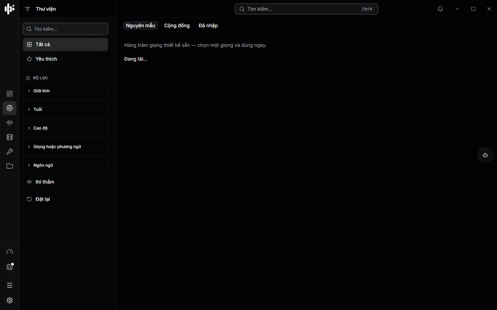

## Tính năng này làm gì

**Thư viện** cung cấp hàng trăm giọng mẫu thiết kế sẵn chạy trực tiếp trên máy để bạn chọn và dùng ngay. Bạn có thể lọc giọng theo giới tính, độ tuổi, cao độ, phương ngữ hoặc ngôn ngữ, nghe thử trước khi tạo hồ sơ, nhập gói giọng `.ovsvoice` hoặc mở danh mục giọng từ cộng đồng khi cần.

## Cần chuẩn bị

- Máy đã mở eVoice Studio và góc dưới thanh bên báo **Thiết bị cục bộ: Engine sẵn sàng**.
- Tệp âm thanh, đường dẫn video/âm thanh hoặc gói giọng `.ovsvoice` (tối đa 100 MB) nếu bạn muốn nhập giọng từ bên ngoài.
- Kết nối mạng nếu bạn muốn mở thẻ **Cộng đồng**, tìm kiếm video/âm thanh trực tuyến hoặc gửi mẫu giọng lên thư viện chung.

## Các bước

### 1. Duyệt và lọc giọng mẫu

1. Bấm biểu tượng **Giọng nói** ở thanh điều hướng bên trái rồi mở mục **Thư viện** (hoặc tìm trong ô **Tìm kiếm…** ở thanh trên cùng).
2. Chọn thẻ **Nguyên mẫu** ở phía trên để xem kho giọng thiết kế sẵn có sẵn trên máy.
3. Nhập từ khóa vào ô **Tìm kiếm…** ở cột bên trái để tìm theo tên hoặc mô tả giọng.
4. Chọn **Tất cả** để xem toàn bộ danh mục, hoặc bấm **Yêu thích** để chỉ lọc các giọng bạn đã gắn dấu sao.
5. Mở từng mục trong phần **Bộ lọc** gồm **Giới tính**, **Tuổi**, **Cao độ**, **Giọng hoặc phương ngữ**, **Ngôn ngữ**, hoặc bật **thì thầm** để thu hẹp kết quả.
6. Bấm **Đặt lại** ở cuối cột bên trái nếu muốn xóa toàn bộ điều kiện lọc và từ khóa đang áp dụng.

### 2. Nghe thử và đánh dấu yêu thích

1. Bấm nút **Xem trước** (hoặc **Phát** / **Tạm dừng**) trên thẻ giọng bất kỳ để nghe đoạn âm thanh mẫu.
2. Bấm biểu tượng ngôi sao **Yêu thích** cạnh tên giọng để lưu lại vào danh sách riêng trên máy.
3. Bấm **Tải thêm** ở cuối danh sách khi muốn xem tiếp các trang giọng mẫu còn lại.

### 3. Dùng hoặc nhập giọng

1. Bấm **Dùng giọng này** trên thẻ giọng bạn ưng ý để ứng dụng tạo hồ sơ giọng và chuyển các thuộc tính cùng seed sang màn hình **Thiết kế giọng**.
2. Bấm nút **Thao tác khác** cạnh nút **Dùng giọng này** nếu muốn đưa thẳng giọng đó vào tính năng khác: chọn **Dùng trong Kể chuyện**, **Đặt mặc định cho Sách nói** hoặc **Mở trong Thiết kế giọng**.
3. Chuyển sang thẻ **Đã nhập** ở thanh phía trên khi bạn muốn lấy mẫu giọng từ tệp hoặc đường dẫn.
4. Nhập vào ô **Dán URL video/âm thanh hoặc nhập để tìm kiếm…** rồi bấm **Tìm kiếm** hoặc **Tải xuống**, hoặc bấm **Tải tệp lên** để chọn tệp âm thanh từ máy.
5. Bấm **Nhập gói giọng mẫu .ovsvoice** nếu bạn có sẵn tệp gói giọng chia sẻ từ máy khác (tối đa 100 MB).
6. Bấm **Cắt** (hoặc **Cắt âm thanh**) trên mục trong **Clip đã nhập** để chọn đoạn âm thanh rõ nhất, sau đó bấm **Nhân bản giọng từ hồ sơ** hoặc **Dùng giọng này** để lưu thành giọng của bạn.

### 4. Duyệt thư viện cộng đồng

1. Bấm thẻ **Cộng đồng** ở phía trên khi bạn muốn xem thêm các mẫu giọng do người dùng khác chia sẻ. Tính năng này chỉ kết nối mạng khi bạn chủ động mở thẻ **Cộng đồng**.
2. Bấm **Xem trước** để nghe thử, gắn sao **Yêu thích** hoặc bấm **Dùng giọng này** để tạo hồ sơ thiết kế giọng trên máy tương tự như thẻ **Nguyên mẫu**.
3. Bấm **Gửi mẫu cài sẵn** hoặc **Gửi giọng nói** nếu bạn muốn đóng góp mẫu giọng của mình lên danh mục cộng đồng.

## Mẹo

- Danh sách **Yêu thích** được lưu cục bộ trên máy và tự tìm trên toàn bộ kho **Nguyên mẫu**, kể cả những giọng chưa hiện ở trang đầu.
- Khi đang ở màn hình **Thiết kế giọng**, nội dung kịch bản bạn đang gõ vẫn được giữ nguyên sau khi bạn chọn **Dùng giọng này** từ **Thư viện**.
- Dùng nút **Thao tác khác** rồi chọn **Dùng trong Kể chuyện** hoặc **Đặt mặc định cho Sách nói** giúp gán giọng trực tiếp mà không cần mở qua màn hình **Thiết kế giọng**.

## Lỗi thường gặp

- danh sách hiện thông báo **Không có giọng nào khớp bộ lọc.**: do bạn đang bật kết hợp nhiều điều kiện trong **Bộ lọc** hoặc đang bật **Yêu thích** khi chưa gắn sao giọng nào. Hãy bấm **Đặt lại** ở cuối cột bên trái để xóa bộ lọc.
- không nhập được tệp `.ovsvoice` và báo **Gói đó quá lớn (tối đa 100 MB).** hoặc **Không thể nhập gói giọng mẫu này.**: kiểm tra lại dung lượng tệp không vượt quá 100 MB và đảm bảo tệp `.ovsvoice` không bị hỏng trước khi chọn lại **Nhập gói giọng mẫu .ovsvoice**.
- giọng trong thẻ **Cộng đồng** không phát được âm thanh thử và báo **Chưa có bản xem trước — chọn "Dùng giọng này" để nghe thử.** hoặc **Đây là giọng thu âm — chọn "Dùng giọng này" để thay thế.**: bấm **Dùng giọng này** để nạp giọng vào ứng dụng rồi tạo bản đọc thử trên máy.
- tải danh mục hoặc thẻ **Cộng đồng** báo **Đã xảy ra lỗi**: kiểm tra trạng thái **Thiết bị cục bộ: Engine sẵn sàng** ở góc dưới bên trái (hoặc kết nối mạng nếu đang ở thẻ **Cộng đồng**), sau đó bấm **Thử lại**.
- bấm **Gửi mẫu cài sẵn** hoặc **Gửi giọng nói** nhưng hiện **Không thể mở biểu mẫu gửi.**: kiểm tra lại trình duyệt mặc định và kết nối mạng của máy rồi thử lại.

## Bài liên quan

- [Thiết kế giọng bằng mô tả](../thiet-ke-giong/)
- [Nhân bản giọng](../nhan-ban-giong/)
- [Quản lý giọng đã lưu](../giong-da-luu/)
- [Truyện nhiều giọng](../truyen/)
- [Sách nói](../sach-noi/)
