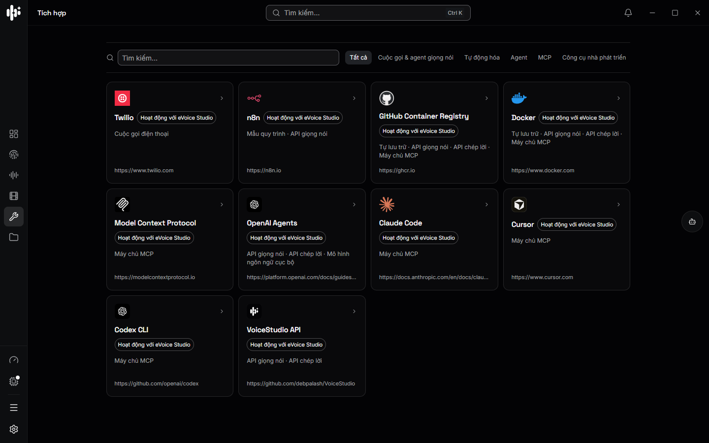

## Tính năng này làm gì

Trang **Tích hợp** tập hợp cấu hình dựng sẵn để kết nối các ứng dụng bên ngoài với giọng nói và công cụ chép lời cục bộ của eVoice Studio. Bạn có thể nối các trợ lý lập trình qua giao thức MCP, gọi endpoint tương thích chuẩn OpenAI qua REST API, nhập quy trình tự động hoặc thiết lập cuộc gọi điện thoại. Mọi tác vụ tạo giọng và nhận diện giọng nói vẫn chạy trực tiếp trên máy của bạn mà không cần cài thêm máy chủ phụ.

## Cần chuẩn bị

- Mở sẵn eVoice Studio và đợi thanh trạng thái báo **Thiết bị cục bộ: Engine sẵn sàng**.
- Tạo hoặc lưu ít nhất một giọng trong ứng dụng nếu muốn gắn giọng riêng cho từng công cụ kết nối.
- Chuẩn bị sẵn ứng dụng khách tương ứng trên máy (như **Claude Code**, **Cursor**, **Codex CLI**, **n8n**, **Docker**) hoặc tài khoản **Twilio** kèm kết nối mạng nếu bạn chủ động bật tính năng nghe gọi điện thoại.

## Các bước

### 1. Mở danh sách tích hợp và lọc công cụ

1. Bấm **Thêm** trên thanh điều hướng bên trái rồi chọn **Tích hợp** để mở danh mục các công cụ có nhãn **Hoạt động với eVoice Studio**.
2. Nhập tên công cụ hoặc tính năng vào ô **Tìm kiếm…** để thu hẹp danh sách hiển thị.
3. Bấm một trong các nút lọc **Tất cả**, **Cuộc gọi & agent giọng nói**, **Tự động hóa**, **Agent**, **MCP** hoặc **Công cụ nhà phát triển** trên thanh công cụ để xem theo nhóm nhu cầu.

### 2. Mở trang chi tiết tích hợp

1. Bấm vào thẻ của công cụ bạn muốn thiết lập như **Claude Code**, **Cursor**, **Codex CLI**, **Model Context Protocol**, **VoiceStudio API**, **OpenAI Agents**, **n8n**, **Docker**, **GitHub Container Registry** hoặc **Twilio**.
2. Xem khung **Trạng thái và chi tiết** cùng mục **Khả năng** để kiểm tra các tính năng được hỗ trợ như **Máy chủ MCP**, **API giọng nói**, **API chép lời**, **Mẫu quy trình**, **Tự lưu trữ**, **Mô hình ngôn ngữ cục bộ** hoặc **Cuộc gọi điện thoại**.
3. Bấm **Tìm hiểu thêm** nếu bạn muốn đọc hướng dẫn chi tiết cho tích hợp đó, hoặc bấm thẻ **Trang web** khi cần mở trang chủ của nhà cung cấp.

### 3. Bật MCP hoặc API cục bộ cho công cụ của bạn

1. Chọn thẻ **Claude Code**, **Cursor**, **Codex CLI** hoặc **Model Context Protocol**, sau đó sao chép đoạn mã trong mục **Cấu hình máy khách** (hoặc **Shim stdio** nếu công cụ chỉ hỗ trợ giao tiếp stdio) rồi dán vào tệp cấu hình của ứng dụng khách:
   - Với **Claude Code**, thêm cấu hình vào tệp `.mcp.json`.
   - Với **Cursor**, thêm cấu hình vào tệp `.cursor/mcp.json`.
   - Với **Codex CLI**, thêm bảng `[mcp_servers.voicestudio]` vào tệp `~/.codex/config.toml`.
   - Với các công cụ hỗ trợ Streamable HTTP khác, trỏ trực tiếp tới địa chỉ `http://127.0.0.1:3900/mcp/` (hoặc cổng thực tế mà ứng dụng đang hiển thị).
2. Chọn thẻ **VoiceStudio API** nếu bạn muốn gọi trực tiếp từ mã nguồn, sau đó lấy địa chỉ tại mục **URL cơ sở** và dùng mẫu lệnh trong **Chuyển văn bản thành giọng nói (curl)** hoặc **Chép lời (curl)** cho các endpoint `/v1/audio/speech` và `/v1/audio/transcriptions`.
3. Chọn các thẻ chuyên biệt khác nếu bạn tích hợp theo quy trình riêng:
   - Trên trang **n8n**, lấy mẫu trong mục **Quy trình n8n** để nhập quy trình gọi giọng nói thủ công vào n8n.
   - Trên trang **Docker** hoặc **GitHub Container Registry**, sao chép lệnh trong **Chạy container** hoặc **Chạy container (Windows PowerShell)** khi muốn triển khai máy chủ tự lưu trữ.
   - Trên trang **Twilio**, làm theo danh sách kiểm tra từng bước để kết nối đường hầm HTTPS của bạn khi cần trả lời cuộc gọi bằng giọng nói đã lưu.

## Mẹo

- Bấm **Gán cho mỗi client một giọng riêng trong Cài đặt** (hoặc vào **Cài đặt** để cấu hình) nhằm gắn từng mã định danh như `claude-code`, `cursor` hay `codex-cli` với một giọng đọc khác nhau.
- Giữ dấu gạch chéo cuối ở địa chỉ `/mcp/` khi điền vào ứng dụng khách để tương thích ổn định với mọi phiên bản.
- Đặt biến môi trường `OMNIVOICE_MCP_OUTPUT_MODE=files` kèm thư mục `OMNIVOICE_MCP_BASE_PATH` nếu bạn muốn máy chủ MCP trả về đường dẫn tệp âm thanh trên ổ đĩa thay vì chuỗi base64 dài trong cửa sổ hội thoại của agent.

## Lỗi thường gặp

- danh sách hiện thông báo **Không có kết quả** khi tìm kiếm: bấm nút **Tất cả** để bỏ bộ lọc danh mục đang chọn và xóa từ khóa trong ô **Tìm kiếm…**.
- công cụ MCP báo không kết nối được tới máy chủ cục bộ: giữ eVoice Studio luôn mở trong lúc gọi tool, kiểm tra trạng thái **Thiết bị cục bộ: Engine sẵn sàng** ở góc dưới bên trái và đối chiếu đúng số cổng trong mục **Cấu hình máy khách**.
- lần đầu gọi tạo giọng nói qua MCP hoặc API bị quá thời gian chờ: nếu máy chưa tải model âm thanh, hãy tải sẵn model trong ứng dụng trước khi gọi tự động hoặc tăng thời gian chờ qua biến môi trường `OMNIVOICE_MCP_TIMEOUT_S`.
- công cụ báo từ chối đọc hoặc ghi đường dẫn tệp âm thanh qua MCP: khai báo thư mục được phép truy cập vào biến môi trường `OMNIVOICE_MCP_BASE_PATH` và chỉ truyền đường dẫn nằm bên trong thư mục đó.
- kết nối từ máy khác trong mạng nội bộ bị từ chối: bật chia sẻ mạng nội bộ trong **Cài đặt**, dùng đúng địa chỉ LAN cùng cổng chia sẻ và gửi kèm mã PIN trong header `X-OmniVoice-Pin`.

## Bài liên quan

- [Bắt đầu với eVoice Studio](../bat-dau/)
- [Quản lý giọng đã lưu](../giong-da-luu/)
- [Phiên âm và đọc chính tả](../phien-am/)
- [Quy trình tự động](../quy-trinh/)
- [Cài đặt](../cai-dat/)
- [Khắc phục sự cố](../khac-phuc-su-co/)
