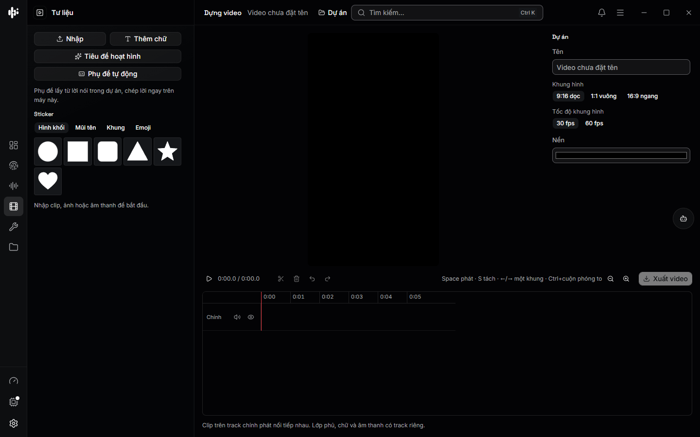

## Tính năng này làm gì

**Dựng video** giúp bạn cắt ghép clip, ảnh và âm thanh trên timeline nhiều track ngay trên máy tính. Bạn có thể thêm chữ, **Sticker**, **Tiêu đề hoạt hình**, tạo **Phụ đề tự động** từ lời nói trong dự án và xuất thành tệp MP4 mà không cần tải dữ liệu lên mạng.

## Cần chuẩn bị

- Đảm bảo trạng thái ở thanh bên trái báo **Thiết bị cục bộ: Engine sẵn sàng**.
- Chuẩn bị sẵn các tệp video, hình ảnh hoặc âm thanh trên máy tính.
- Nếu muốn dùng **Phụ đề tự động**, bạn cần cài sẵn model nhận dạng giọng nói trong ứng dụng.
- Nếu muốn dùng **Tiêu đề hoạt hình**, bạn cần dùng bản ứng dụng desktop và bật tính năng này trước ở trang **Mở Video quảng cáo**.

## Các bước

### 1. Mở trang Dựng video và thiết lập dự án

1. Bấm vào mục **Lồng tiếng** ở thanh điều hướng bên trái rồi mở **Dựng video**.
2. Nhập tên mới vào ô **Tên** ở cột **Dự án** bên phải nếu muốn đổi tên mặc định **Video chưa đặt tên**.
3. Chọn tỉ lệ trong mục **Khung hình** gồm **9:16 dọc**, **1:1 vuông** hoặc **16:9 ngang**.
4. Chọn **30 fps** hoặc **60 fps** ở mục **Tốc độ khung hình**, và chọn màu tại ô **Nền**.
5. Bấm nút **Dự án** trên thanh tiêu đề nếu bạn muốn mở dự án cũ, tạo **Dự án mới**, nhân bản hoặc **Xoá** dự án.

### 2. Thêm clip, ảnh và âm thanh vào timeline

1. Bấm nút **Nhập** trong cột **Tư liệu** bên trái để chọn video, ảnh hoặc tệp âm thanh từ máy tính.
2. Bấm nút cộng trên tệp vừa nhập để đưa vào timeline: video và ảnh sẽ nối tiếp nhau trên track **Chính**, còn âm thanh sẽ nằm ở track **Âm thanh**.
3. Chọn thêm vào **Lớp phủ** nếu bạn muốn đặt clip hoặc ảnh nằm đè lên trên track **Chính**.

### 3. Cắt ghép, thêm chữ, sticker và chỉnh âm thanh

1. Kéo clip trên timeline để đổi vị trí, hoặc kéo hai đầu clip để cắt ngắn thời lượng.
2. Đặt đầu phát tại vị trí cần cắt rồi bấm **Tách tại đầu phát (S)** để chia đôi clip, hoặc bấm **Xoá (Del)** để bỏ clip đang chọn.
3. Bấm **Thêm chữ** ở cột **Tư liệu** để chèn văn bản, sau đó chỉnh **Nội dung**, **Phông chữ**, **Cỡ chữ**, **Màu**, **In đậm** hoặc **Hộp nền** ở cột **Thuộc tính** bên phải.
4. Chọn **Tiêu đề hoạt hình**, chọn **Mẫu**, chỉnh nội dung rồi bấm **Dựng và thêm** để chèn tiêu đề chuyển động vào track **Lớp phủ**.
5. Chọn thẻ **Hình khối**, **Mũi tên**, **Khung** hoặc **Emoji** trong mục **Sticker** rồi bấm vào mẫu bạn muốn để chèn vào vị trí đầu phát.
6. Bấm **Phụ đề tự động** để engine trên máy tự chép lời từ âm thanh trong dự án và tạo track phụ đề.
7. Chọn một clip trên timeline để chỉnh **Vị trí và kích thước**, **Màu**, **Tách phông (chroma key)**, **Chuyển cảnh sang clip sau** hoặc chỉnh **Âm lượng**, **Tăng dần**, **Tắt dần**, **Tốc độ**, **Giữ cao độ** và **Giảm khi có giọng** ở cột bên phải.

### 4. Xem trước và xuất video

1. Bấm **Phát** (hoặc phím Space) để xem trước toàn bộ video trên khung **Xem trước**.
2. Dùng nút **Hoàn tác (Ctrl+Z)** hoặc **Làm lại (Ctrl+Shift+Z)** nếu cần quay lại thao tác trước đó.
3. Bấm **Xuất video** ở góc phải phía trên timeline và chọn nơi lưu tệp MP4 trên máy khi quá trình kết thúc.

## Mẹo

- Dùng dãy phím tắt hiển thị ngay trên thanh công cụ (**Space phát · S tách · ←/→ một khung · Ctrl+cuộn phóng to**) hoặc hai nút **Thu nhỏ**, **Phóng to** để căn chỉnh điểm cắt chính xác.
- Kéo trực tiếp hình ảnh hoặc chữ ngay trên khung **Xem trước** để đổi nhanh vị trí hiển thị.
- Bật **Giữ cao độ** khi thay đổi **Tốc độ** phát để giọng nói không bị méo tiếng, và bật **Giảm khi có giọng** cho nhạc nền để tiếng nhạc tự nhỏ xuống khi có lời thoại.
- Bấm biểu tượng **Tắt tiếng track** hoặc **Ẩn track** ở đầu mỗi track khi bạn muốn kiểm tra riêng từng lớp hình và tiếng.

## Lỗi thường gặp

- Không bấm được nút **Xuất video**: Kiểm tra xem bạn đã thêm clip vào timeline chưa (**Thêm nội dung vào dòng thời gian trước.**), tổng thời lượng có vượt mức tối đa không (**Video dài tối đa 5 phút.**), hoặc có tệp nguồn nào bị xoá khỏi máy và báo **Mất tệp** trong cột **Tư liệu** hay không.
- Bấm **Phụ đề tự động** nhưng báo **Dự án không có âm thanh để tạo phụ đề.** hoặc **Không tìm thấy lời nói.**: Kiểm tra xem các clip trên timeline có tiếng và chưa bị tắt tiếng, hoặc cài model nhận dạng giọng nói nếu máy chưa có.
- Không tạo được **Tiêu đề hoạt hình**: Nếu ứng dụng báo **Hãy bật tiêu đề hoạt hình ở trang Video quảng cáo trước.** hoặc **Tiêu đề hoạt hình cần ứng dụng desktop.**, hãy mở ứng dụng trên máy tính, bấm **Mở Video quảng cáo** để bật tính năng này rồi quay lại. Nếu báo **ffmpeg chưa sẵn sàng. Hãy hoàn tất cài công cụ media rồi thử lại.**, hãy hoàn tất cài đặt công cụ trong ứng dụng.

## Bài liên quan

- [Lồng tiếng video](../long-tieng-video/)
- [Video quảng cáo (Promo)](../video-quang-cao/)
- [Phiên âm và đọc chính tả](../phien-am/)
- [Dự án](../du-an/)
