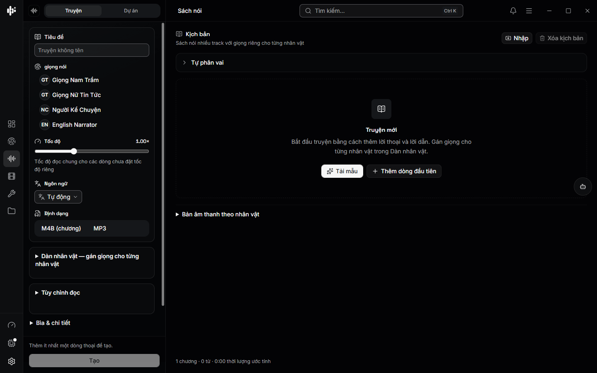

## Tính năng này làm gì

Trang **Truyện** giúp bạn biên tập kịch bản hoặc truyện dài thành sách nói nhiều track với giọng đọc riêng cho từng nhân vật. Bạn có thể dán văn bản hoặc nhập tệp có sẵn, tự động nhận diện lời thoại để phân vai, nghe thử từng dòng và xuất thành file âm thanh hoàn chỉnh ngay trên máy.

## Cần chuẩn bị

- Chuẩn bị ít nhất một hồ sơ giọng đã lưu trong ứng dụng (tạo từ tính năng **Nhân bản giọng** hoặc **Thiết kế giọng**).
- Chuẩn bị nội dung truyện hoặc kịch bản dưới dạng văn bản thuần hoặc tệp `.txt`, `.md`, `.srt`, `.vtt`, `.epub`, `.pdf`.
- Kiểm tra biểu tượng trạng thái ở góc dưới thanh bên trái hiện **✅ Mọi thứ đều ổn — không phát hiện vấn đề** và **Thiết bị cục bộ: Engine sẵn sàng**.

## Các bước

### 1. Mở trang Truyện và nhập kịch bản

- Bấm biểu tượng **Truyện** trên thanh điều hướng bên trái để mở trang biên tập.
- Nhập tên tác phẩm vào ô **Tiêu đề** ở cột thiết lập bên trái (mặc định là **Truyện không tên**).
- Chọn một giọng đọc mặc định trong danh sách **giọng nói** cho người dẫn chuyện hoặc các dòng chưa gán nhân vật riêng.
- Bấm nút **Nhập** ở góc trên bên phải khung **Kịch bản** để tải tệp truyện (`.txt`, `.md`, `.srt`, `.vtt`, `.epub`, `.pdf`) từ máy tính.
- Bấm **Tải mẫu** nếu bạn muốn nạp nhanh một kịch bản mẫu để làm quen, hoặc bấm **Thêm dòng đầu tiên** để tự gõ từng dòng thoại từ đầu.

### 2. Tự phân vai hoặc tách văn bản thành dòng

- Bấm mở mục **Tự phân vai** phía trên khung **Kịch bản**.
- Nhập hoặc dán đoạn văn bản dài vào ô văn bản (nếu bạn chưa dùng nút **Nhập** ở bước trước).
- Chọn cách chia đoạn tại mục **Tách theo** gồm **Câu**, **Đoạn văn** hoặc **Chương**, rồi bấm **Tách thành dòng** để đưa từng đoạn vào danh sách dòng.
- Bấm **Tự phân vai** nếu văn bản có lời thoại hoặc tên người nói để bộ phân tích cục bộ tự động tách dòng, nhận diện nhân vật và gán các hồ sơ giọng sẵn có.

### 3. Gán giọng cho từng nhân vật

- Bấm mở thẻ **Dàn nhân vật — gán giọng cho từng nhân vật** ở cột bên trái.
- Bấm **Thêm nhân vật** và điền **Tên nhân vật** nếu bạn muốn tạo thêm vai mới ngoài danh sách đã tự phân vai.
- Chọn giọng đọc tương ứng cho mỗi nhân vật trong **Dàn nhân vật** từ các hồ sơ giọng đã lưu trên máy.
- Bấm **Xóa nhân vật** bên cạnh tên nhân vật nếu không còn dùng vai đó trong kịch bản.

### 4. Nghe thử và chỉnh sửa từng đoạn

- Nhập hoặc sửa nội dung trực tiếp trên từng dòng trong khung **Kịch bản**.
- Bấm **Chèn khoảng ngắt [pause 0.5s]** khi cần thêm khoảng nghỉ ngắn giữa câu, hoặc bấm **Đặt giọng giữa câu** để đổi giọng cho phần văn bản đang bôi đen.
- Kéo thanh trượt **Tốc độ** ở cột bên trái để chỉnh tốc độ đọc chung cho toàn bộ truyện, hoặc bấm **Dùng cho mọi dòng** để áp dụng tốc độ chung cho cả các dòng đã chỉnh riêng.
- Bấm **Chuyển lên** hoặc **Chuyển xuống** để sắp xếp lại thứ tự dòng, bấm **Thêm dòng** hoặc **Thêm chương** để chèn nội dung mới, hoặc bấm **Xóa dòng** để bỏ dòng không cần thiết.
- Bấm **Xem trước dòng này** trên dòng bất kỳ để nghe thử giọng đọc và nhịp ngắt trước khi tổng hợp toàn bộ truyện.

### 5. Tạo truyện âm thanh

- Chọn ngôn ngữ đầu ra tại mục **Ngôn ngữ** ở cột bên trái.
- Chọn định dạng đầu ra tại mục **Định dạng** là **M4B (chương)** hoặc **MP3**.
- Bấm mở **Tùy chỉnh đọc** nếu cần điều chỉnh các thông số tổng hợp như **Số bước**, **CFG** hoặc **Nhiệt độ vị trí**.
- Bấm nút **Tạo** ở cuối cột bên trái để bắt đầu tổng hợp âm thanh cho toàn bộ kịch bản.
- Bấm **Dừng** nếu bạn muốn ngắt quá trình tạo giữa chừng; tiến độ các chương đã xong được lưu lại để bạn bấm **Tiếp tục** sau đó mà không phải tạo lại từ đầu.

### 6. Xuất file âm thanh

- Bấm **Phát** trên trình phát hiện ra ở cuối trang sau khi quá trình tạo hoàn tất để kiểm tra lại toàn bộ bản thu.
- Bấm nút tải xuống ở khung kết quả để lưu file **M4B (chương)** hoặc **MP3** (kèm tệp mốc thời gian chương `.txt` nếu kịch bản có chia chương) về máy tính.
- Bấm mở mục **Bản âm thanh theo nhân vật** ở cuối khung **Kịch bản** nếu bạn muốn kết xuất và tải riêng từng file WAV cho mỗi nhân vật.

<!-- TODO: kiểm tra tên nút tải xuống trên giao diện tiếng Việt sau khi tạo xong -->

## Mẹo

- Chuyển sang tab **Dự án** ở đầu cột bên trái và bấm **Lưu** để cất bản thảo cùng cấu hình nhân vật thành dự án riêng, tiện mở lại khi làm truyện dài nhiều kỳ.
- Giữ định dạng tiêu đề chương bắt đầu bằng dấu `# ` trên một dòng riêng khi nhập văn bản để ứng dụng tự nhận diện mốc chương khi xuất **M4B (chương)**.
- Dùng nút **Xóa kịch bản** ở góc trên bên phải khi muốn xóa nhanh toàn bộ các dòng và chương trong bản thảo mà vẫn giữ nguyên **Dàn nhân vật** đã thiết lập.

## Lỗi thường gặp

- hiển thị thông báo **Chưa có hồ sơ giọng nào — nhân bản giọng hoặc thiết kế giọng trước.** ở mục **giọng nói**: máy chưa có giọng đọc nào được lưu. Bạn hãy mở trang **Nhân bản giọng** hoặc **Thiết kế giọng** để tạo ít nhất một hồ sơ giọng rồi quay lại trang **Truyện**.
- bấm **Tự phân vai** nhưng hiện thông báo **Chưa có gì để tự phân vai — dán hoặc nhập truyện trước.**: vùng văn bản chờ xử lý đang trống. Bạn hãy dán nội dung truyện vào khung hoặc bấm **Nhập** để chọn tệp văn bản trước.
- nút **Tạo** bị mờ và không bấm được: kiểm tra dòng thông báo ngay phía trên nút **Tạo** (ví dụ chưa có dòng thoại nào, có dòng chưa gán giọng khi chưa chọn giọng mặc định, hoặc hồ sơ giọng đã gán cho nhân vật bị xóa). Bạn hãy bổ sung dòng thoại hoặc chọn lại giọng hợp lệ trong **Dàn nhân vật**.
- hiện thông báo **Không đọc được tệp này. Thử chọn tệp khác.** khi bấm **Nhập**: tệp tải lên bị hỏng hoặc sai cấu trúc. Bạn hãy kiểm tra lại tệp nguồn và thử nhập lại bằng định dạng `.txt` hoặc `.md`.
- hiện thông báo **Không mã hóa được MP3 — đã tải về WAV thay thế.** hoặc **Xuất thất bại — kiểm tra xem máy chủ nền có đang chạy không.**: kiểm tra lại trạng thái engine ở góc dưới bên trái cửa sổ và bấm **Thử lại** khi engine đã sẵn sàng.

## Bài liên quan

- [Sách nói](../sach-noi/)
- [Nhân bản giọng](../nhan-ban-giong/)
- [Thiết kế giọng bằng mô tả](../thiet-ke-giong/)
- [Quản lý giọng đã lưu](../giong-da-luu/)
- [Dự án](../du-an/)
