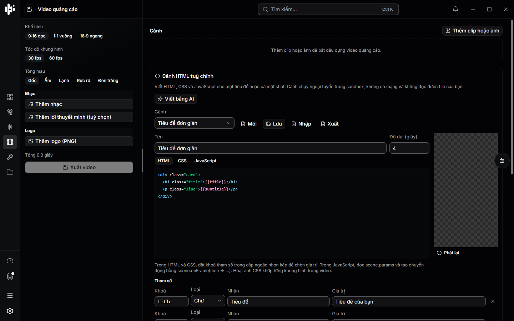

## Tính năng này làm gì

Trang **Video quảng cáo** ghép các đoạn video ngắn, ảnh tĩnh, nhạc nền, lời thuyết minh và logo thành một tệp MP4 hoàn chỉnh kèm hiệu ứng chuyển cảnh. Bạn có thể chèn thêm **Cảnh HTML tuỳ chỉnh** hoặc **Tiêu đề động** để tạo phần mở đầu, bảng giá, chữ chạy hay thẻ liên hệ. Toàn bộ quá trình dựng và xuất video chạy trực tiếp trên CPU của máy bằng công cụ media đi kèm, không gửi tệp ra ngoài.

## Cần chuẩn bị

- Các tệp video hoặc ảnh tĩnh (`.png`, `.jpg`, `.webp`, `.bmp`), tối đa 40 cảnh và dung lượng mỗi tệp không quá 4 GB.
- Tệp nhạc nền, tệp âm thanh lời thuyết minh và ảnh logo định dạng PNG nền trong suốt (không bắt buộc, logo tối đa 20 MB).
- Nếu muốn kết xuất **Tiêu đề động** hoặc **Cảnh HTML tuỳ chỉnh** thành video trên ứng dụng máy tính, bạn cần bật **Tiêu đề động** lần đầu để ứng dụng tải Chrome Headless Shell (khoảng 271 MB) sau khi bạn xác nhận.
- Nếu muốn dùng **Viết bằng AI**, bạn cần cấu hình sẵn nhà cung cấp trong **Cài đặt** → **Nhà cung cấp LLM** (có thể dùng model nội bộ như Ollama, LM Studio hoặc dịch vụ trực tuyến do bạn tự bật).

## Các bước

### 1. Mở trang Video quảng cáo và chọn định dạng

Bấm vào **Lồng tiếng** trên thanh điều hướng bên trái để mở nhóm công cụ video và chuyển sang trang **Video quảng cáo**.

Chọn tỉ lệ khung hình ở mục **Khổ hình**: **9:16 dọc** (1080×1920), **1:1 vuông** (1080×1080) hoặc **16:9 ngang** (1920×1080). Chọn **Tốc độ khung hình** là **30 fps** hoặc **60 fps**, sau đó chọn **Tông màu** (**Gốc**, **Ấm**, **Lạnh**, **Rực rỡ** hoặc **Đen trắng**) để đồng bộ màu sắc giữa tất cả các cảnh.

### 2. Thêm clip, ảnh, nhạc và logo

Bấm **Thêm clip hoặc ảnh** ở khung **Cảnh** bên phải để chọn các tệp video hoặc hình ảnh từ máy tính. Với mỗi cảnh trong danh sách, bạn điều chỉnh:

- Nhập **Độ dài (s)** (từ 0,5 đến 60 giây, tổng thời lượng toàn video tối đa 5 phút).
- Nhập thời điểm **Bắt đầu (s)** nếu cảnh là video, hoặc chọn hiệu ứng **Chuyển động** (**Đứng yên**, **Phóng to dần**, **Thu nhỏ dần**) nếu cảnh là ảnh tĩnh.
- Chọn kiểu **Chuyển cảnh vào** cho các cảnh từ vị trí thứ hai trở đi (**Cắt thẳng**, **Mờ dần**, **Loé sáng**, **Tối dần**, **Trượt**, **Đẩy**, **Quét**, **Phóng**, **Vòng tròn**, **Nhoè**) và kéo thanh trượt **Độ dài chuyển cảnh (giây)**.
- Chọn cách căn **Khung hình** là **Lấp đầy khung** hoặc **Giữ nguyên ảnh**.
- Bấm nút **Lên trên**, **Xuống dưới** để đổi thứ tự cảnh, **Xoá** để bỏ một cảnh hoặc **Xoá hết** để làm trống danh sách.

Chọn thêm âm thanh và nhận diện thương hiệu ở cột bên trái:

- Bấm **Thêm nhạc** tại mục **Nhạc**, kéo thanh **Âm lượng nhạc** và bật **Cắt theo nhịp nhạc** nếu muốn điểm chuyển cảnh tự khớp vào nhịp bài nhạc.
- Bấm **Thêm lời thuyết minh (tuỳ chọn)** để lồng giọng đọc lên trên nhạc nền (nhạc nền sẽ tự giảm âm lượng dưới lời thuyết minh).
- Bấm **Thêm logo (PNG)** tại mục **Logo**, chọn góc đóng dấu (**Tắt**, **Trên trái**, **Trên phải**, **Dưới trái**, **Dưới phải**) hoặc cấu hình **Logo kết thúc (giây)** (tối đa 10 giây) cùng màu **Nền đoạn kết**.

### 3. Chọn mẫu cảnh và tiêu đề động

Chọn một mẫu có sẵn trong mục **Cảnh HTML tuỳ chỉnh** tại trình đơn thả xuống **Cảnh** (như **Tiêu đề đơn giản**, **Tên và chức danh**, **Đếm ngược**, **Giá và khuyến mãi**, **Chữ chạy**, **Kêu gọi hành động**, **Mở đầu**, **Kết thúc**, **Slide chữ**):

- Nhập **Tên** và **Độ dài (giây)** cho cảnh, sau đó sửa nội dung trong danh sách **Tham số** (gồm **Khoá**, **Loại**, **Nhãn**, **Giá trị**) hoặc sửa trực tiếp mã trong các thẻ **HTML**, **CSS**, **JavaScript**.
- Bấm **Viết bằng AI** nếu muốn tạo cảnh mới từ mô tả ngắn, chọn kiểu **Lớp phủ** hoặc **Shot toàn khung**, nhập **Mô tả cảnh** rồi bấm **Viết cảnh**.
- Bấm **Lưu** để cất cảnh vào máy, hoặc dùng **Nhập** và **Xuất** để chia sẻ cảnh dưới dạng tệp `.html` hoặc `.zip`.
- Bấm **Thêm làm lớp phủ** để đè cảnh lên video hoặc **Thêm làm shot** để chèn cảnh thành một đoạn độc lập ở cuối danh sách **Cảnh**.

Chọn thêm mẫu trong mục **Tiêu đề động** bên dưới nếu bạn cần các hiệu ứng chữ dựng sẵn (**Từ khoá**, **Tiêu đề phát sáng**, **Chữ viết tay**, **Thanh tìm kiếm**, **Thẻ liên hệ**, **Logo xuất hiện**). Điền nội dung, chọn **Màu chữ**, **Màu nhấn**, **Vị trí**, chọn **Hiện cùng** một cảnh cụ thể hoặc **Tính từ đầu video**, rồi bấm **Tạo lớp phủ** (tối đa 12 lớp phủ trong một video).

### 4. Xem trước và chỉnh trên timeline

Bấm **Phát lại** dưới khung xem trước của **Cảnh HTML tuỳ chỉnh** hoặc **Xem trước mẫu** để kiểm tra chuyển động của từng cảnh.

Khi danh sách **Cảnh** đã có ít nhất một mục, khung **Xem trước** và thanh timeline sẽ hiện ra phía trên danh sách:

- Bấm **Phát** hoặc **Tạm dừng** (hoặc phím Space khi đang chọn timeline) để xem thử toàn bộ video cùng nhạc, lời thuyết minh, lớp phủ và logo.
- Kéo mép phải của cảnh trên timeline để chỉnh độ dài, kéo mép trái của clip để cắt điểm bắt đầu, kéo thân cảnh để đổi thứ tự hoặc kéo lớp phủ để dời thời điểm xuất hiện.
- Bấm **Cắt tại đầu phát (S)** để tách đôi cảnh tại vị trí con trỏ, bấm **Bám theo nhịp và điểm cắt** để bật/tắt chế độ tự hít vào phách nhạc, hoặc dùng **Hoàn tác (Ctrl+Z)** và **Làm lại (Ctrl+Shift+Z)** khi cần quay lại thao tác trước.

### 5. Xuất video

Kiểm tra tổng thời lượng hiển thị ở cuối cột bên trái rồi bấm **Xuất video**. Khi trạng thái **Đang xuất video…** hoàn tất, khung **Kết quả** sẽ xuất hiện ở đầu trang kèm trình phát để bạn kiểm tra lại thành phẩm; bấm **Lưu video** để chọn nơi lưu tệp MP4 về máy.

## Mẹo

- Bật **Cắt theo nhịp nhạc** sau khi thêm nhạc nền để ứng dụng tự dò nhịp và dời các điểm cắt cảnh vào đúng phách; thời lượng từng cảnh trong danh sách cũng sẽ tự cập nhật theo nhịp đã khớp.
- Khi chèn lớp phủ ở mục **Tiêu đề động**, hãy chọn một cảnh cụ thể trong ô **Hiện cùng** thay vì **Tính từ đầu video** để lớp phủ luôn đi theo cảnh đó khi bạn đổi thứ tự hoặc cắt theo nhịp nhạc.
- Trong **Cảnh HTML tuỳ chỉnh**, hãy viết hiệu ứng bằng CSS animation hoặc `scene.onFrame(time => ...)` trong thẻ **JavaScript** để chuyển động khớp chính xác từng khung hình khi xuất video.
- Nếu vừa đổi **Khổ hình** (ví dụ từ **9:16 dọc** sang **16:9 ngang**), bạn hãy kết xuất lại các shot tạo từ **Cảnh HTML tuỳ chỉnh** để bố cục khớp với tỉ lệ khung hình mới.

## Lỗi thường gặp

- nút **Xuất video** bị mờ và hiện thông báo **Mất tệp** cạnh cảnh, nhạc hoặc logo: tệp gốc trong thư mục dữ liệu đã bị xoá hoặc di chuyển. Bạn hãy bấm **Xoá tệp bị mất** ở cột bên trái hoặc chọn lại tệp mới cho mục bị thiếu.
- không bấm được **Thêm làm lớp phủ**, **Thêm làm shot** hoặc **Tạo lớp phủ** và hiện thông báo **Để dựng cảnh thành video, hãy bật tiêu đề hoạt hình ở phần bên dưới trước.** hoặc **Bật tiêu đề động trước.**: bạn hãy cuộn xuống mục **Tiêu đề động**, bật tính năng này và bấm **Tải về** khi được hỏi để cài đặt công cụ kết xuất một lần.
- hiện thông báo **ffmpeg chưa sẵn sàng. Hoàn tất cài công cụ media rồi thử lại.**: công cụ xử lý media cục bộ chưa cài xong. Bạn hãy chờ quá trình thiết lập hoàn tất hoặc kiểm tra lại trong trang **Cài đặt**.
- cửa sổ **Viết bằng AI** báo **Tính năng AI đang tắt (LLM đặt là Tắt). Bật lại trong Cài đặt → Nhà cung cấp LLM.**: bạn hãy mở **Cài đặt**, thiết lập một nhà cung cấp LLM rồi quay lại bấm **Kiểm tra lại**.
- xuất cảnh tuỳ chỉnh bị dừng kèm thông báo **Dựng quá lâu nên đã dừng. Có thể một script trong cảnh bị treo.**: kiểm tra lại mã trong thẻ **JavaScript** của cảnh để tránh vòng lặp vô tận, sau đó bấm **Phát lại** để thử trước khi thêm vào video.
- cảnh báo **Cảnh này được dựng cho khổ khác; hãy dựng lại cho khổ hiện tại.** xuất hiện trên dòng cảnh: xoá cảnh đó khỏi danh sách **Cảnh**, mở lại cảnh trong **Cảnh HTML tuỳ chỉnh** và bấm **Thêm làm shot** để dựng lại theo khổ hình mới.

## Bài liên quan

- [Trình dựng video](../trinh-dung-video/)
- [Lồng tiếng video](../long-tieng-video/)
- [Studio âm nhạc](../studio-am-nhac/)
- [Nhân bản giọng](../nhan-ban-giong/)
- [Cài đặt](../cai-dat/)
- [Khắc phục sự cố](../khac-phuc-su-co/)
